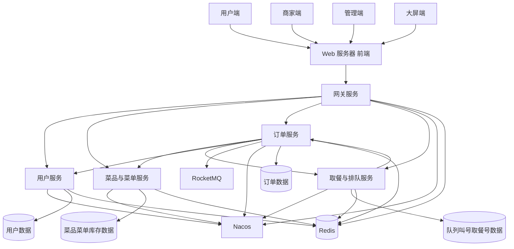
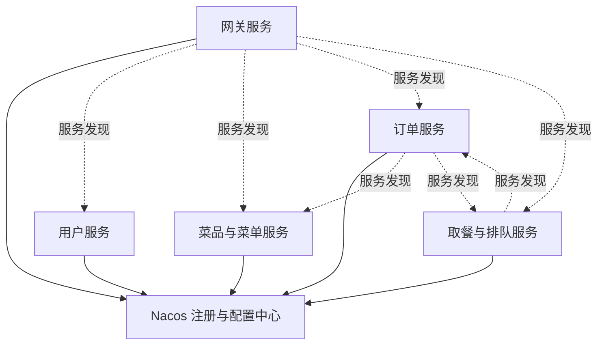
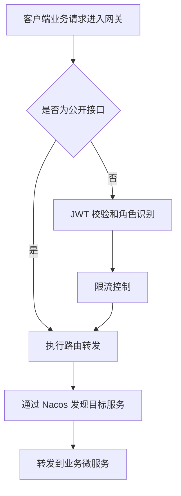
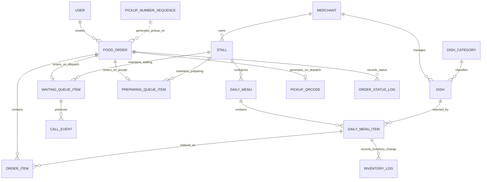
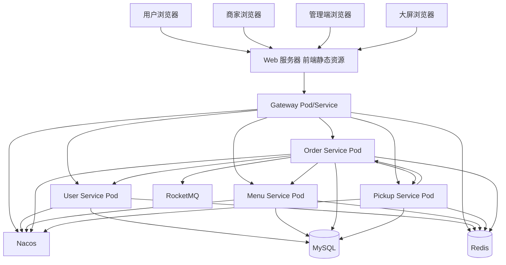

# A智能食堂系统概要设计说明书

## 1 引言

### 1.1 编写目的

本文档用于说明面向校园/园区的智能食堂系统的概要设计方案，主要从系统目标、总体业务、微服务模块划分、子系统关系、数据库总体结构、主要接口、非功能设计和部署拓扑等方面描述系统整体设计。

本文档面向课程设计开发人员、测试人员、部署人员和后续维护人员，为后续详细设计、编码实现、接口联调、测试验收和 K3S 部署提供总体依据。本文档仅描述系统的总体结构、模块职责、服务协作关系和数据总体规划，不展开具体类设计、字段级表结构、接口参数、异常分支处理和代码实现细节。

### 1.2 项目背景

本项目拟开发一套面向校园或园区的智能食堂系统，解决传统食堂点餐、排队和取餐过程中存在的信息不透明、人工叫号效率低、库存统计不及时、窗口处理压力集中等问题。系统支持用户在线浏览菜单、在线下单，凭取餐二维码或取餐码取餐，取餐号用于现场叫号和用户识别；支持商家接单、备餐、出餐和叫号；支持食堂大屏实时显示制作中队列和待取餐队列。

系统采用 Spring Cloud 微服务架构进行实现，按照用户认证、菜品菜单、订单、取餐排队和网关接入等领域划分服务。各微服务通过 Nacos 完成服务注册、发现和配置管理，通过 API 网关提供统一访问入口，并使用 JWT 完成统一鉴权。系统通过 WebSocket 实现叫号和队列信息的实时推送，并计划部署在 K3S 集群中，以满足课程项目对微服务独立运行、服务治理、容器化部署和实时交互能力的要求。

### 1.3 术语与缩略语

| 术语 | 含义 |
| ---- | ---- |
| 用户 | 在系统中浏览菜单、下单、查看订单并取餐的学生、教职工或园区员工 |
| 商家 | 入驻食堂窗口或档口的经营方，负责菜品维护、菜单发布、接单、备餐、出餐和核销 |
| 管理员 | 负责用户、商家、窗口、基础配置和系统运行信息维护的管理角色 |
| 大屏终端 | 食堂现场用于展示制作中队列、叫号弹窗和待取餐队列的浏览器终端 |
| 游客 | 未登录用户，可正常浏览菜单，但不能加入购物车和下单 |
| 取餐号 | 商家接单时系统为订单生成的展示编号，不作为订单唯一标识。规则：A001→A002→...→A999→B001→...→Z999，管理员可配置重置规则，同一配置周期内不重复。取餐号在用户端、商家端、大屏端均显示 |
| 取餐二维码 | 商家出餐时系统生成的核销凭证二维码，每个订单唯一，核销后立即失效。用户端可展开查看对应的字符串取餐码（次要入口） |
| 取餐码 | 取餐二维码对应的字符串编码，用于商家手动输入核销（次要功能入口） |
| 制作中队列 | 商家接单后订单自动进入的队列，按窗口独立维护，大屏实时展示 |
| 待取餐队列 | 商家出餐后订单进入的队列，按窗口独立维护，FIFO 仅用于展示排序 |
| FIFO | First In First Out，先进先出。仅用于待取餐队列的展示排序和用户排队位置计算，不强制要求出餐、叫号或核销按队首进行 |
| JWT | JSON Web Token，用于登录后身份认证和受保护接口鉴权 |
| Nacos | 服务注册、服务发现和配置管理组件 |
| API 网关 | 系统统一入口，负责请求路由、JWT 校验、限流、跨域和 WebSocket 代理 |
| WebSocket | 用于向电视大屏端实时推送叫号、队列变更等消息的通信协议（用户手机端采用 HTTP 轮询） |
| K3S | 轻量级 Kubernetes 发行版，用于系统后端微服务容器化部署和服务编排 |
| RocketMQ | 消息队列中间件，用于订单超时延迟消息 |
| Seata | 分布式事务解决方案（AT 模式），用于创建订单与库存预占的强一致性保障 |
| Redis | 缓存组件，用于验证码、Token 黑名单、限流计数、库存缓存、队列缓存和实时状态缓存 |
| Material 3 | 前端 UI 风格规范（大屏端除外） |

## 2 系统概述

### 2.1 建设目标

本系统的建设目标如下：

1. 建设统一的智能食堂在线点餐平台，使校园或园区用户能够在线查看当前可售菜品、提交订单并查看取餐信息。
2. 建设商家端接单备餐能力，使商家能够维护菜品和菜单、管理库存、处理订单、出餐叫号和核销取餐。
3. 建设食堂大屏实时展示能力，使大屏能够展示各窗口当前叫号、叫号序列和等待队列，提高取餐秩序和现场信息透明度。
4. 通过菜品库存预占、订单取消恢复和库存预警能力，降低高峰期超卖和人工统计错误的风险。
5. 通过微服务拆分实现系统领域边界清晰、服务独立运行、独立扩展和故障隔离。
6. 通过 Nacos、API 网关、JWT 和 WebSocket 等组件实现服务治理、统一接入、安全鉴权和实时通信。
7. 通过 K3S 集群部署实现系统容器化运行，为后续扩容、滚动更新和统一运维提供基础。

### 2.2 总体业务说明

系统面向游客、普通用户、商家、管理员、大屏终端和系统定时任务等角色。游客可以注册、登录并正常浏览菜单，但不能加入购物车和下单；普通用户登录后可以浏览当前可售菜单、加入购物车、提交订单并完成模拟支付、取消订单、查看取餐号和取餐二维码；商家可以维护菜品和菜单、接单（自动进入制作中）、不接单（拒绝接单）、出餐、手动叫号和核销取餐；管理员负责基础数据和系统配置维护（超时时间、取餐号重置规则等）；大屏终端负责接收实时消息并展示制作中队列、叫号弹窗和待取餐队列；系统定时任务负责订单超时处理、库存预警、取餐号重置等自动化业务。

系统总体业务链路概括如下：用户（或游客）通过前端页面浏览可售菜单，菜单查询请求经网关转发至菜品与菜单服务；登录用户提交订单后，订单进入待支付状态，系统通过订单服务与菜品菜单服务协作完成库存预占；用户完成模拟支付后，订单进入待接单状态；商家接单后订单自动进入制作中状态并生成取餐号，大屏展示制作中队列；商家出餐后订单进入待取餐状态、生成取餐二维码并自动叫号一次，大屏展示待取餐队列；商家核销取餐二维码后订单完成。订单超时取消由延迟任务驱动，超时时间等业务配置由管理员维护。课程项目中的短信验证码和支付均采用模拟实现，具体模拟规则见详细设计文档。

### 2.3 运行环境

| 类别 | 设计要求 |
| ---- | -------- |
| 前端环境 | Vue 3 Web 前端工程（四个独立工程：用户手机端、商家平板端、管理员 Web 端、电视大屏端），UI 风格统一采用 Material 3（大屏端除外）。开发阶段通过代理访问网关 API；部署阶段构建产物部署在 Web 服务器中 |
| 后端环境 | Java 17 ,Spring Boot，Spring Cloud，Spring Cloud Gateway |
| 注册配置 | Nacos，用于服务注册、服务发现和配置管理 |
| 数据库 | MySQL 8.x |
| 缓存 | Redis，用于验证码、Token 黑名单、限流计数、库存缓存、队列缓存和实时状态 |
| 消息队列 | RocketMQ，用于订单超时延迟消息（待支付超时 10 分钟、商家接单超时 10 分钟） |
| 分布式事务 | Seata（AT 模式），用于创建订单与库存预占分布式事务的强一致性保障 |
| 实时通信 | WebSocket 仅用于电视大屏端队列和叫号实时刷新；用户手机端不建立 WebSocket 连接，通过订单详情接口进行 HTTP 轮询（每 5 秒），轮询到 READY 状态后展示取餐提醒 |
| 部署环境 | 后端微服务部署在 K3S 集群中，前端部署在 Web 服务器中 |
| 操作系统 | 服务器环境 Linux |

### 2.4 总体设计原则

1. **领域拆分原则**：按照用户认证、菜品菜单、订单、取餐排队和网关接入等业务领域划分微服务，使服务职责清晰、边界稳定。
2. **高内聚低耦合原则**：每个微服务只负责本领域核心能力，跨服务交互通过明确接口完成，避免服务之间直接访问彼此数据库。
3. **统一入口原则**：后端 API 请求和 WebSocket 连接统一经过网关，由网关完成路由、鉴权、限流和代理；前端静态资源由 Web 服务器提供访问。
4. **服务自治原则**：各业务服务能够独立启动、独立注册、独立运行和独立扩展，服务内部维护自身业务数据和领域逻辑。
5. **数据一致性原则**：订单、库存和队列等关键业务数据以数据库持久化为准，Redis 用于缓存和实时状态加速，必要时可从数据库恢复。
6. **安全优先原则**：系统通过 JWT、角色权限、网关鉴权、限流、密码加密和操作日志等方式保障接口和数据安全。
7. **可扩展原则**：系统在微服务划分、接口设计、角色模型、菜单配置和部署拓扑上预留扩展空间，便于后续增加支付、评价、通知、统计等服务。
8. **概要层次原则**：本文档只描述总体设计、服务关系和核心协作，不展开接口参数、字段定义、类图、状态机细节和具体补偿实现。

## 3 功能模块划分

### 3.1 模块划分原则

系统按业务领域拆分微服务，遵循以下原则：
- 以用户认证、菜品菜单、订单、取餐排队四大业务领域为核心，每个领域对应一个独立微服务。
- 网关独立为一个服务，负责统一接入和安全控制，不承载业务逻辑。
- 跨领域通用能力提取到公共模块，避免跨服务代码冗余。

### 3.2 核心业务服务划分

| 序号 | 服务名称 | 服务标识建议 | 主要职责 | 主要数据归属 | 主要交互对象 |
| ---- | -------- | ------------ | -------- | ------------ | ------------ |
| 1 | 网关服务 | gateway-service | 提供统一入口、请求路由、JWT 校验、IP 级和用户级限流、跨域处理、WebSocket 代理 | 网关路由配置、限流配置、鉴权配置 | 所有客户端、Nacos、各业务服务 |
| 2 | 用户服务 | user-service | 用户注册、登录、验证码登录、JWT 令牌颁发、Token 刷新、用户信息查询与修改、支付密码验证（Feign，供订单服务调用）、账号状态管理 | 用户、角色、Token 相关数据 | 网关、订单服务、管理端 |
| 3 | 菜品与菜单服务 | menu-service | 菜品增删改查、每日菜单发布、售卖时段管理、库存预占、库存恢复、低库存预警、上下架控制 | 商家窗口、菜品、菜单、库存 | 网关、订单服务、商家端、用户端 |
| 4 | 订单服务 | order-service | 创建订单（待支付）、模拟支付验证（Feign 调用户服务）、订单状态流转（待支付→待接单→制作中→待取餐→已取餐→已取消）、商家接单/不接单/出餐、限时取消、超时自动取消（RocketMQ 延迟消息）、订单明细维护、RocketMQ 消息生产与消费 | 订单、订单明细、订单状态 | 网关、菜品与菜单服务、取餐与排队服务、RocketMQ |
| 5 | 取餐与排队服务 | pickup-service | 取餐号序列生成与管理（A001→Z999 递增，管理员可配置重置规则）、窗口制作中队列维护、窗口待取餐队列维护、接单入制作中队列、出餐移至待取餐队列（含生成取餐二维码）、出餐自动叫号、手动叫号、队列查询、取餐核销（扫码/手动输入）、出队、WebSocket 消息生产 | 取餐号序列、制作中队列、待取餐队列、叫号事件、核销记录 | 网关、订单服务、大屏端、商家端、用户端 |

### 3.3 基础支撑组件划分

| 序号 | 服务名称       | 服务标识建议 | 主要职责                                                     | 主要数据归属             | 主要交互对象                           |
| ---- | -------------- | ------------ | ------------------------------------------------------------ | ------------------------ | -------------------------------------- |
| 1    | 配置与注册中心 | nacos        | 提供服务注册、服务发现和配置管理能力                         | 服务实例信息、公共配置项 | 网关服务、各业务服务                   |
| 2    | 缓存组件       | redis        | 支撑验证码、Token 黑名单、限流计数、库存缓存、队列缓存和实时状态缓存 | 缓存数据、临时状态数据   | 网关服务、用户服务、菜单服务、取餐服务 |
| 3    | 消息队列       | rocketmq     | 支撑订单超时延迟消息（待支付 10 分钟超时、商家接单 10 分钟超时） | 延迟消息、消费进度       | 订单服务                               |
| 4    | 分布式事务     | seata        | 支撑创建订单与库存预占场景的分布式事务（AT 模式），保证创建订单与库存预占的强一致性 | 事务日志、分支事务记录   | 订单服务、菜品与菜单服务               |
| 5    | 数据库组件     | mysql        | 持久化核心业务数据                                           | 各服务业务库或业务表     | 各业务服务                             |

## 4 子系统关系设计

### 4.1 子系统划分

1. **客户端子系统**：包括用户端、商家端、管理端和大屏端页面。客户端通过浏览器访问 Web 服务器加载前端页面。各端 API 请求通过网关访问后端业务服务；电视大屏端的 WebSocket 连接也通过网关代理到取餐与排队服务，用户手机端不建立 WebSocket 连接。
2. **接入与安全子系统**：由网关服务承担，负责后端 API 请求路由、JWT 鉴权、限流、跨域处理和 WebSocket 连接代理。
3. **用户认证子系统**：由用户服务承担，负责注册、登录、验证码、Token 刷新、用户资料和账号状态管理。
4. **菜品菜单子系统**：由菜品与菜单服务承担，负责菜品、菜单、售卖时段、库存、上下架和库存预警等能力。
5. **订单交易子系统**：由订单服务承担，负责订单创建、订单明细、订单状态流转、取消和超时处理等能力。
6. **取餐排队子系统**：由取餐与排队服务承担，负责取餐号序列管理、制作中队列、待取餐队列、出餐自动叫号、手动叫号、取餐核销、出队和 WebSocket 实时消息生产。
7. **服务治理与基础设施子系统**：由 Nacos、MySQL、Redis、K3S 等组件组成，提供注册发现、配置管理、持久化、缓存和部署运行能力。

### 4.2 需求功能与设计模块对应关系

为保证概要设计与需求规格说明书保持一致，系统将主要需求功能归并到用户认证、菜品菜单、订单交易、取餐排队、大屏展示、管理后台、统一接入和基础设施等设计模块中。本文档只说明需求功能与设计模块之间的总体对应关系，不展开每个功能点的接口参数、异常流程和字段设计。

| 需求类别   | 主要需求功能                                         | 主要使用角色                 | 对应设计模块                                 | 说明                                                         |
| ---------- | ---------------------------------------------------- | ---------------------------- | -------------------------------------------- | ------------------------------------------------------------ |
| 用户认证类 | 用户注册、登录、验证码登录、Token 刷新、用户信息维护 | 游客、普通用户、商家、管理员 | 用户服务、网关服务、Redis                    | 用户服务负责账号、密码、验证码和 Token 相关逻辑；网关负责受保护接口鉴权。 |
| 菜品菜单类 | 菜品管理、每日菜单发布、售卖时段、上下架管理         | 商家、管理员                 | 菜品与菜单服务                               | 菜品与菜单服务负责菜品基础信息、菜单发布和当前可售菜品查询。 |
| 库存管理类 | 库存设置、库存预占、库存恢复、库存预警               | 商家、系统定时任务           | 菜品与菜单服务、订单服务、Redis              | 下单时进行库存预占，取消或超时时恢复库存，库存数据以数据库为准，Redis 用于缓存和加速。 |
| 订单交易类 | 在线下单、订单查询、订单状态流转、限时取消、自动取消 | 普通用户、商家、系统定时任务 | 订单服务、菜品与菜单服务                     | 订单服务负责订单主流程，菜品与菜单服务配合完成库存协作。     |
| 取餐排队类 | 接单入制作中队列、出餐移待取餐队列、出餐自动叫号、手动叫号、取餐核销 | 商家、普通用户、大屏终端     | 取餐与排队服务、订单服务                     | 取餐与排队服务负责队列、叫号事件、取餐号序列和核销，订单服务负责订单状态同步。 |
| 大屏展示类 | 制作中队列、叫号提示、待取餐队列实时展示                 | 大屏终端、商家、普通用户     | 取餐与排队服务、网关服务、WebSocket          | 取餐与排队服务产生实时消息，网关代理 WebSocket 推送；出餐叫号时大屏显示醒目提示。 |
| 管理维护类 | 用户管理、商家管理、窗口管理、系统配置（超时时间、取餐号重置规则等）、日志查看 | 管理员 | 用户服务、菜品与菜单服务、订单服务、网关服务 | 管理员通过管理后台维护基础数据和业务配置。 |
| 基础支撑类 | 服务注册发现、配置管理、缓存、数据库持久化、K3S 部署 | 系统服务、部署人员           | Nacos、Redis、MySQL、K3S                     | 基础组件为微服务运行、配置、缓存、持久化和容器化部署提供支撑。 |

### 4.3 静态结构关系

系统静态结构以网关为后端统一入口，前端部署在 Web 服务器中。业务服务通过 Nacos 实现服务注册与发现，各服务拥有自身核心数据域，订单服务通过 RocketMQ 处理超时延迟消息，通过 Seata 保证创建订单与库存预占的分布式事务一致性。

- 前端部署在 Web 服务器，通过网关访问后端 API；内部服务不直接暴露给浏览器。
- 网关通过 Nacos 发现用户服务、菜品与菜单服务、订单服务和取餐与排队服务。
- 订单服务在创建待支付订单时通过 Seata AT 全局事务与菜品与菜单服务协作完成库存预占，并在模拟支付时调用用户服务验证支付密码。
- 订单服务在接单、出餐和取消场景下与取餐与排队服务协作，传递队列变更和取餐凭证生成请求。
- 订单服务通过 RocketMQ 发送和消费超时延迟消息。
- 取餐与排队服务维护制作中队列、待取餐队列、取餐号序列和叫号事件，并通过网关代理的 WebSocket 通道向大屏端推送消息；用户手机端通过 HTTP 轮询获取状态。
- 各服务拥有自身业务数据，Redis 用于缓存、限流、队列快照和临时状态，不作为唯一持久化来源。

### 4.4 通信关系

| 通信双方 | 通信方式 | 主要协作场景 |
| -------- | -------- | -------- |
| 浏览器客户端 ↔ Web 服务器 | HTTP/HTTPS | 前端页面和静态资源访问 |
| 浏览器客户端 ↔ 网关服务 | HTTP/HTTPS、WebSocket | API 请求、WebSocket 连接、叫号与队列变更实时推送 |
| 网关服务 ↔ 业务微服务 | HTTP/REST | 路由转发，通过 Nacos 发现目标实例 |
| 订单服务 ↔ 菜品与菜单服务 | OpenFeign | 库存预占与恢复（预占纳入 Seata AT 全局事务） |
| 订单服务 ↔ 用户服务 | OpenFeign | 支付密码验证 |
| 订单服务 ↔ 取餐与排队服务 | OpenFeign | 接单入制作中队列、出餐移待取餐队列、取消出队、核销同步 |
| 订单服务 ↔ RocketMQ | RocketMQ 协议 | 待支付超时和接单超时的延迟消息 |
| 各微服务 ↔ Nacos | Nacos 客户端协议 | 服务注册、服务发现、配置加载 |
| 各业务服务 ↔ MySQL | 数据库连接 | 各自业务数据域的持久化读写 |
| 网关/用户/菜单/取餐/订单服务 ↔ Redis | Redis 协议 | 验证码、Token 黑名单、限流计数、库存与队列缓存 |

系统对外采用 JSON 作为主要数据交换格式，文件上传场景可使用 multipart/form-data。微服务间调用仅传递完成业务协作所需的概要信息，具体参数、错误码和字段定义在详细设计阶段确定。

### 4.5 服务注册与发现

系统使用 Nacos 作为注册中心和配置中心。网关服务、用户服务、菜品与菜单服务、订单服务、取餐与排队服务启动后均向 Nacos 注册服务实例信息，并从 Nacos 加载必要配置。网关服务通过 Nacos 获取业务服务实例列表，并根据路由规则将请求转发到目标服务；业务服务之间进行协作调用时，也通过服务名发现目标服务实例。

服务注册与发现的概要设计如下：

- 每个微服务以独立服务名注册到 Nacos，服务名与网关路由和服务间调用保持一致。
- Nacos 保存服务实例地址、端口和健康状态，网关和业务服务根据服务名进行发现。
- 公共配置、网关路由配置、限流配置、JWT 配置和业务超时配置可统一交由 Nacos 管理。
- 当某个服务实例不可用时，Nacos 能够反映实例健康状态，调用方可根据服务发现结果选择可用实例。
- Nacos 只负责注册、发现和配置管理，不承载订单、库存、队列等核心业务数据。

### 4.6 网关路由与统一鉴权

网关服务是系统后端统一入口，承担 API 请求路由转发和 WebSocket 连接代理职责。用户端、商家端、管理端和大屏端通过网关访问后端业务接口。前端静态资源部署在 Web 服务器中，页面中的业务请求通过网关转发至对应微服务。

网关路由与鉴权概要流程如下：

网关设计要点如下：

- 登录、注册、验证码等公开接口可配置为免登录访问，订单、用户资料、商家操作、管理操作等接口必须通过 JWT 校验。
- 网关从 JWT 中识别用户身份和角色信息，并将必要的身份上下文传递给后端服务。
- 网关提供 IP 级和用户级限流能力，降低恶意刷接口和高峰期突发流量对后端服务的影响。
- 网关负责 WebSocket 连接代理，使大屏端不直接连接内部取餐与排队服务；用户手机端通过网关 HTTP 接口获取状态。
- 网关不处理具体业务规则，业务规则由对应领域服务负责。

## 5 数据库总体结构设计

### 5.1 数据设计原则

1. **核心数据持久化原则**：用户、菜品、菜单、库存、订单、订单明细、取餐队列和叫号事件等核心数据应持久化到 MySQL。
2. **缓存辅助原则**：Redis 用于验证码、限流计数、Token 黑名单、库存缓存、队列缓存和实时状态缓存，但不能替代数据库中的核心业务记录。
3. **历史数据保留原则**：用户、商家、菜品等与历史订单相关的数据不采用物理删除方式破坏历史记录，应通过状态标记或逻辑删除方式维护。
4. **业务一致性原则**：订单、库存和队列之间应保持业务一致，订单取消时库存恢复，订单待取餐时进入队列，订单已取餐时从队列移除。

### 5.2 数据域划分

系统数据总体上划分为用户数据域、菜品菜单数据域、订单数据域、取餐排队数据域、日志配置数据域和缓存数据域。

| 数据域 | 归属服务 | 主要数据对象 | 说明 |
| ------ | -------- | ------------ | ---- |
| 用户数据域 | 用户服务 | 用户、角色、账号状态、支付密码、Token 相关记录 | 支撑注册、登录、鉴权、支付密码验证和用户资料维护 |
| 菜品菜单数据域 | 菜品与菜单服务 | 商家、窗口、菜品、每日菜单、售卖时段、库存、库存预警 | 支撑菜单展示、库存预占、库存恢复和上下架控制。每日菜单作为窗口和售卖时段维度的长期配置，菜单项中保存菜品关联和每日库存设定值，系统每日自动根据设定值重置库存。 |
| 订单数据域 | 订单服务 | 订单、订单明细、订单状态、取餐凭证快照、取消记录 | 支撑订单创建、支付验证、状态流转和取消 |
| 取餐排队数据域 | 取餐与排队服务 | 取餐号序列、取餐二维码、取餐码、窗口制作中队列、窗口待取餐队列、叫号事件、核销记录、队列快照 | 取餐号、取餐二维码和取餐码由本服务生成和主责维护；订单服务保存必要的关联快照用于订单详情展示 |
| 日志配置数据域 | 各服务或基础模块 | 操作日志、异常日志、系统配置 | 支撑审计、问题排查和业务规则配置 |
| 缓存数据域 | Redis | 验证码、Token 黑名单、限流计数、库存缓存、制作中队列缓存、待取餐队列缓存、WebSocket 状态 | 支撑高频访问和实时状态展示 |

### 5.3 总体ER图：

数据架构说明：

- 用户数据用于识别普通用户、商家和管理员身份，订单数据中只保存必要的用户关联信息。
- 菜品与菜单数据用于表示某窗口在某售卖时段内的每日固定售卖菜品、每日库存设定值、当天剩余库存和库存状态。
- 订单数据保存订单主信息、订单明细和取餐凭证，订单明细应保留下单时的菜品快照信息，避免菜品后续修改影响历史订单展示。
- **制作中队列（PREPARING_QUEUE_ITEM）**：商家接单后订单进入制作中队列，按窗口独立维护，大屏实时展示。
- **待取餐队列（WAITING_QUEUE_ITEM）**：商家出餐后订单从制作中队列移至待取餐队列，FIFO 仅作为展示排序和排队位置计算依据。
- **取餐号（PICKUP_NUMBER）**：按配置周期递增的展示编号（A001→Z999），管理员可配置重置规则。取餐号在接单时生成，不是订单主键或唯一业务凭证。取餐号序列用于生成订单展示编号，具体规则见详细设计文档。
- **叫号事件（CALL_EVENT）**：出餐自动叫号和手动叫号均生成叫号事件，记录叫号时间和叫号方式，大屏按事件时间依次展示。
- Redis 中的队列和实时状态用于提升大屏展示和用户查询速度，系统需要能够基于数据库中的队列数据和叫号事件恢复队列快照。

### 5.4 缓存数据设计

Redis 作为系统的缓存与临时状态存储组件，主要用于提升高频数据访问速度、降低数据库压力、支持接口限流和实时队列展示。Redis 中的数据不作为核心业务的唯一来源，订单、库存、队列和叫号事件等关键数据应在 MySQL 中保留可恢复记录。需求中也明确要求队列缓存异常时，应能根据数据库中的待取餐订单恢复队列。

| 缓存类型               | 主要内容                                       | 使用服务             | 设计说明                                                     |
| ---------------------- | ---------------------------------------------- | -------------------- | ------------------------------------------------------------ |
| 验证码缓存             | 手机号或账号对应的模拟验证码、验证码有效期     | 用户服务             | 当前版本不接入真实短信发送接口，验证码采用模拟实现，具体规则见详细设计文档。 |
| Refresh Token 状态缓存 | Refresh Token 有效状态、过期状态、用户登录态   | 用户服务             | 支持 Token 刷新、注销和登录状态管理。                        |
| 制作中队列缓存         | 窗口制作中订单列表、订单信息                   | 取餐与排队服务       | 支撑大屏实时展示制作中队列，缓存异常时根据数据库中制作中状态的订单恢复。 |
| 待取餐队列缓存         | 窗口待取餐队列、当前叫号、等待人数、队列位置   | 取餐与排队服务       | 支撑大屏和用户端高频查询；缓存异常时根据数据库中的待取餐订单和叫号事件恢复。 |
| 业务配置缓存           | 取消时间、接单超时时间、库存预警阈值、限流阈值、取餐号重置规则 | 各业务服务、网关服务 | 对配置中心或数据库配置进行本地或 Redis 缓存，提高读取效率。  |

### 5.5 数据一致性策略

系统采用”数据库为准、缓存辅助、接口协作、异常可追踪”的一致性设计思路。订单、库存、取餐队列和叫号事件等核心数据以 MySQL 持久化记录为准，Redis 用于缓存和实时状态加速。

- 下单与库存预占通过 Seata AT 全局事务保证强一致性，库存不足时事务回滚。
- 取消、超时、拒绝接单等场景触发库存恢复和队列移除，由订单服务协调各服务完成。
- 接单→入制作中队列+生成取餐号、出餐→移待取餐队列+生成取餐二维码+自动叫号，订单服务与取餐与排队服务通过接口协作保证状态同步。
- 缓存中的队列数据异常时，从数据库中的制作中/待取餐订单和叫号事件恢复。

订单状态以订单服务为准，库存状态以菜品与菜单服务为准，队列状态以取餐与排队服务为准。关键业务链路应记录操作日志。

## 6 接口概要设计

本章从总体层面说明系统接口类型和接口协作关系。具体接口路径、请求方法、请求参数、响应字段、错误码和异常分支不在概要设计中展开，后续在详细设计或接口文档中说明。

### 6.1 接口设计原则

1. 前端静态资源部署在 Web 服务器中，后端所有 API 请求统一经过网关服务，内部微服务不直接暴露给浏览器客户端。
2. 前端业务接口主要采用 HTTP/REST 风格，数据交换格式采用 JSON。
3. 登录、注册、验证码获取、菜单浏览等接口为公开接口；加入购物车、下单、支付、订单操作、用户资料、商家操作和管理操作等接口必须经过 JWT 鉴权。
4. 微服务之间通过 OpenFeign 或 REST 方式进行业务协作，不直接访问其他服务的数据表。
5. 订单服务通过 Seata AT 模式保证创建订单与库存预占的分布式事务一致性；通过 RocketMQ 延迟消息处理订单超时。
6. WebSocket 仅用于出餐自动叫号、手动叫号、队列变更和取餐提醒等实时消息推送，页面初始化和断线恢复仍通过 HTTP 接口查询最新状态。
7. 具体接口参数、错误码、返回字段和异常处理在详细设计阶段确定。

### 6.2 接口分类

| 接口类别       | 主要用途                                                     | 涉及模块                                                     |
| -------------- | ------------------------------------------------------------ | ------------------------------------------------------------ |
| 前端业务接口   | 支持注册登录、菜单查询、下单、订单处理、菜品管理、叫号核销等页面操作 | 网关服务、用户服务、菜品与菜单服务、订单服务、取餐与排队服务 |
| 服务间协作接口 | 支持库存预占、库存恢复、出餐入队、核销状态同步等跨服务业务   | 订单服务、菜品与菜单服务、取餐与排队服务                     |
| 实时通信接口   | 向大屏端推送叫号事件和队列变更（WebSocket）；用户端通过 HTTP 轮询获取取餐提醒     | 网关服务、取餐与排队服务、WebSocket                          |
| 服务治理接口   | 支持服务注册、服务发现和配置加载                             | Nacos、网关服务、各业务服务                                  |
| 基础设施接口   | 支持数据持久化、缓存、限流计数和临时状态存储                 | MySQL、Redis                                                 |

### 6.3 WebSocket 接口概要

WebSocket 仅用于电视大屏端叫号和队列变更的实时推送。大屏端通过网关建立 WebSocket 连接，业务消息由取餐与排队服务产生，网关负责连接代理。推送内容主要包括出餐自动叫号事件、手动叫号事件、制作中队列变更和待取餐队列变更。用户手机端不建立 WebSocket 连接，通过订单详情接口每 5 秒 HTTP 轮询获取订单状态、取餐二维码和叫号提醒。WebSocket 不作为最终数据来源，大屏首次进入或断线重连后通过 HTTP 接口拉取最新队列快照。

### 6.4 外部/模拟接口说明

| 外部/模拟接口  | 接入方式   | 概要说明                                                     |
| -------------- | ---------- | ------------------------------------------------------------ |
| 验证码接口     | 模拟实现   | 当前版本不接入真实短信验证码发送接口，验证码采用模拟实现，具体规则见详细设计文档。 |
| 支付接口       | 模拟实现   | 当前版本不接入真实支付接口，采用模拟支付流程推进订单状态。用户端提供模拟支付入口，待支付订单支持重新发起支付和取消订单，具体交互规则见详细设计文档。 |
| 文件上传接口   | 本地模拟   | 菜品图片以二进制形式直接存储到 MySQL（MEDIUMBLOB 字段，限制 ≤ 5MB）。上传接口鉴权后写库，获取图片时通过 GET 接口从数据库读取并返回二进制流。 |
| 扫码核销接口   | 浏览器 API | 商家平板通过浏览器摄像头 API 扫描用户取餐二维码完成核销（主要入口）；也可通过手动输入取餐码完成核销（次要入口）。 |
| 大屏显示接口   | 浏览器实现 | 大屏终端通过浏览器访问大屏页面并建立 WebSocket 连接。        |
| 校园一卡通接口 | 不接入     | 当前版本不与校园一卡通系统对接，后续可扩展。                 |

## 7 权限与安全设计

系统采用“网关统一鉴权 + JWT 身份认证 + 角色权限控制 + 业务归属校验”的安全设计方式。网关负责对受保护接口进行统一 Token 校验，业务服务根据用户角色和数据归属进行二次校验。

### 7.1 角色权限矩阵

| 功能模块       | 游客 | 普通用户 | 商家 | 管理员 | 大屏终端 | 说明                                                   |
| -------------- | ---- | -------- | ---- | ------ | -------- | ------------------------------------------------------ |
| 注册登录       | √    | √        | √    | √      | ×        | 游客可注册和登录，登录后获得 JWT。                     |
| 菜单浏览       | √    | √        | √    | √      | ×        | 游客可正常浏览菜单，但不能加入购物车和下单。           |
| 加入购物车     | ×    | √        | ×    | ×      | ×        | 仅登录用户可加入购物车。                               |
| 在线下单与支付 | ×    | √        | ×    | ×      | ×        | 普通用户可下单、完成模拟支付、取消符合规则的订单。     |
| 用户个人信息   | ×    | √        | √    | √      | ×        | 用户只能维护个人信息，管理员可维护账号状态。           |
| 菜品菜单管理   | ×    | ×        | √    | √      | ×        | 商家管理所属窗口菜品和菜单；管理员可查看和维护基础数据，不直接操作商家日常菜单。 |
| 商家订单处理   | ×    | ×        | √    | √      | ×        | 商家处理所属窗口订单（接单、不接单、出餐、核销）；管理员仅可查看和进行必要的异常处理。 |
| 取餐队列与叫号 | ×    | √        | √    | √      | √        | 用户查看本人排队信息；商家和大屏查看窗口队列；管理员仅可查看。 |
| 管理后台       | ×    | ×        | ×    | √      | ×        | 管理员维护用户、商家、窗口、业务配置和日志，不直接参与商家日常接单、出餐、叫号和核销流程。 |
| 大屏展示       | √    | √        | √    | √      | √        | 大屏展示制作中队列、叫号弹窗和待取餐队列。             |

说明：”√”表示允许，”×”表示不允许。商家权限必须受窗口或档口归属限制。

### 7.2 JWT 鉴权设计

用户登录成功后由用户服务签发 JWT，客户端后续请求携带 Token 访问受保护接口。网关负责校验 Token 的签名、有效期和黑名单状态，并将用户身份和角色信息传递给后端服务。业务服务根据角色和业务归属进行二次校验，例如普通用户只能访问自己的订单，商家只能处理所属窗口订单。

登录、注册、验证码获取和大屏公开展示类接口可配置为公开接口；订单、用户资料、商家操作和管理后台接口必须经过 JWT 鉴权。

### 7.3 网关限流设计

网关对登录、注册、验证码、菜单查询、下单、订单查询、核销和 WebSocket 连接等高频接口进行限流。限流维度包括 IP、用户 ID、接口路径和 WebSocket 连接数。限流计数可存储在 Redis 中，限流阈值通过配置中心或系统配置统一维护。

### 7.4 数据安全与操作日志

系统从密码安全、Token 安全、角色权限、数据归属和日志审计等方面保障安全。用户密码不得明文保存；Token 应设置有效期并支持失效处理；普通用户只能访问个人数据；商家只能访问所属窗口数据；管理员操作应进行权限校验。

系统应对登录、注册、菜品维护、菜单发布、库存修改、下单、取消、接单、出餐、叫号、核销、网关访问和异常情况记录操作日志。日志内容应至少包括操作者、操作对象、操作时间、操作类型和操作结果。日志中不得保存明文密码、完整 Token、完整取餐码等敏感信息。

## 8 非功能设计

### 8.1 性能设计

系统性能设计目标如下：

1. 普通业务接口在正常网络和资源条件下应保持较短响应时间，菜单列表、订单详情等高频查询接口应优先保证响应速度。
2. 大屏叫号和队列变更消息应具备实时性，正常网络条件下应尽量做到秒级内推送和展示。
3. 系统应支持高峰期多用户同时浏览菜单和查询订单，并支持一定规模的并发下单请求。
4. 库存预占、订单创建和队列入队等关键操作应避免重复提交和并发冲突导致的数据不一致。
5. 网关应提供 IP 级和用户级限流能力，防止高频请求影响后端服务稳定性。
6. 高频读场景可合理使用 Redis 缓存，例如验证码、限流计数、队列快照和实时状态，但缓存设计不得破坏业务数据一致性。

### 8.2 安全性设计

系统安全性设计包括以下方面：

1. 用户密码不得明文保存，应使用安全哈希方式存储密码摘要。
2. 登录成功后使用 JWT 表示用户身份，受保护接口必须经由网关统一鉴权。
3. Refresh Token 应支持过期、注销和黑名单机制，降低令牌泄露风险。
4. 系统按角色控制访问范围，普通用户只能访问个人订单和取餐信息，商家只能访问所属窗口或档口的数据，管理员访问管理功能。
5. 网关对请求进行统一限流，减少恶意刷接口和爆破登录风险。
6. 验证码应设置有效期和发送频率限制，课程项目中可采用模拟验证码逻辑。
7. 菜品修改、库存修改、接单、取消订单、叫号和核销等重要操作应记录操作日志。
8. 系统应在接口层防止越权访问、重复提交、SQL 注入、XSS 和接口重放等常见安全风险。

### 8.3 可靠性设计

系统可靠性设计包括以下方面：

1. 订单、库存和取餐队列等核心业务数据应持久化保存，系统异常时不得导致核心数据丢失。
2. Redis 中的队列缓存或实时状态异常时，应能够基于数据库中的待取餐订单和叫号事件恢复队列快照。
3. 订单创建、库存预占、库存恢复、出餐入队和取餐核销等关键链路应保证业务结果可追踪。
4. 微服务异常时应记录错误日志并向客户端返回友好提示，避免直接暴露内部异常信息。
5. 网关、业务服务、Nacos、MySQL 和 Redis 等关键组件应在部署时考虑基础可用性和健康检查。
6. WebSocket 连接断开后，客户端应支持重连；重连后可通过接口拉取最新队列快照，保证大屏展示能够恢复。
7. 系统定时任务应支持订单超时扫描、库存预警和临时数据清理等自动处理能力。

### 8.4 可维护性设计

系统可维护性设计包括以下方面：

1. 微服务按业务领域拆分，服务命名、接口命名、数据归属和职责边界保持清晰。
2. 各服务工程结构应保持统一，控制层、业务层、数据访问层和配置层职责明确。
3. 接口返回格式、错误提示、日志格式和鉴权上下文应保持一致，便于前后端联调和问题排查。
4. 网关路由、限流策略、JWT 参数、业务超时时间和库存预警阈值等可变配置应尽量通过配置管理统一维护。
5. 重要业务操作应记录操作日志，异常场景应记录必要上下文，便于定位订单、库存和队列问题。
6. 前端页面与后端接口保持逻辑分离，Vue 3 源码工程可独立维护，部署时构建产物由 Web 服务器提供访问。
7. 概要设计、需求文档、接口说明、数据库设计和部署说明应保持版本一致，减少开发和验收偏差。

### 8.5 可扩展性设计

系统可扩展性设计包括以下方面：

1. 微服务架构支持后续新增支付服务、评价服务、通知服务、统计服务、优惠券服务等扩展服务。
2. 网关路由基于服务名和路径规则进行扩展，新服务接入时可通过 Nacos 注册并增加路由配置。
3. 用户角色和权限模型预留扩展空间，后续可增加食堂运营人员、配送员、财务人员等角色。
4. 菜品分类、售卖时段、窗口类型、库存预警阈值和业务超时时间应支持配置化扩展。
5. 大屏展示可扩展为按食堂、楼层、窗口分组展示，也可扩展用户端消息通知能力。
6. K3S 部署形态支持服务副本扩容和滚动更新，便于在高峰期对网关、订单、菜单和取餐服务进行独立扩展。
7. 数据设计应保留历史订单和操作记录，为后续销量统计、窗口效率分析和用户行为分析提供基础。

## 9 部署设计

### 9.1 部署拓扑设计

系统部署采用前后端分离的部署拓扑：前端 Vue 3 构建产物部署在 Web 服务器中，后端微服务以容器化形式部署在 K3S 集群中。用户端、商家端、管理端和大屏端通过浏览器访问前端页面，页面中的 API 请求通过网关服务进入后端；网关服务作为后端统一入口，负责转发 API 和 WebSocket 请求；用户服务、菜品与菜单服务、订单服务、取餐与排队服务作为独立业务服务运行在 K3S 集群中；MySQL、Nacos、Redis、RocketMQ 和 Seata 作为容器化基础支撑组件为各服务提供持久化、注册发现、配置管理、缓存、消息和分布式事务能力，其中 MySQL 需要配置持久化存储。

部署拓扑概要说明如下：

1. **前端**：Vue 3 四个前端工程构建后部署在 Web 服务器中，通过网关访问后端 API。
2. **后端**：用户服务、菜品与菜单服务、订单服务、取餐与排队服务以独立容器运行在 K3S 集群中，可独立启动、注册和扩展。
3. **基础组件**：MySQL 负责核心业务数据持久化并挂载持久化存储；Nacos 提供服务注册、发现和配置管理；Redis 负责缓存和实时状态；RocketMQ 处理超时延迟消息；Seata Server 支撑创建订单与库存预占的 AT 模式分布式事务。
4. **实时通信**：大屏端通过网关建立 WebSocket 连接接收实时推送；用户手机端通过 HTTP 轮询获取订单状态。
5. **扩展能力**：K3S 集群支持对各服务独立增加副本，实现横向扩展。

本文档仅描述系统部署拓扑关系，不包含详细部署步骤、集群配置和运维脚本。
