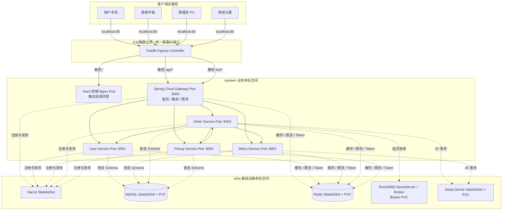
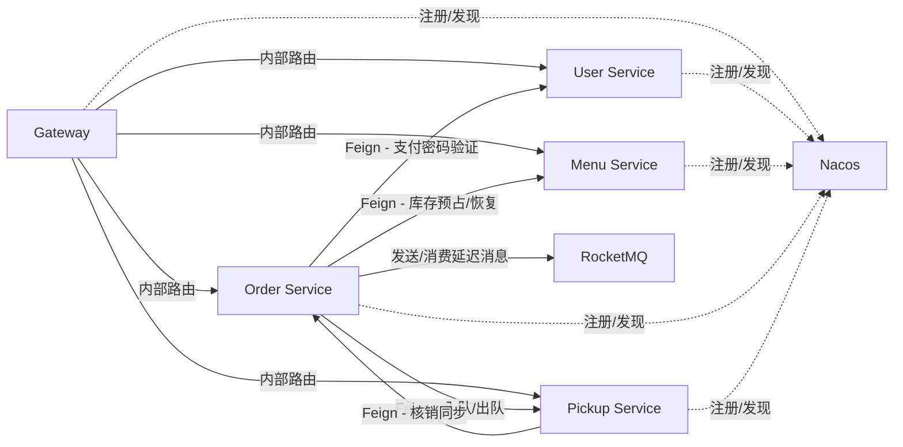

# A智能食堂系统架构设计文档

## 一、引言

### 1.1 项目背景

本系统面向校园/园区场景，为用户提供在线点餐、商家接单备餐、扫码取餐、食堂大屏实时展示的一站式餐饮服务。系统采用 Spring Cloud 微服务架构，全栈（包括前端 Vue3 应用、后端微服务及所有中间件）统一容器化部署在 K3s (K3d) 本地集群中，解决传统食堂点餐排队信息不透明、人工叫号效率低、库存管理粗放等问题。

### 1.2 项目概述

系统包含 4 个客户端入口（用户手机端、商家平板端、管理员 Web 端、电视大屏端）、4 个业务微服务（用户服务、菜品菜单服务、订单服务、取餐排队服务）和 1 个 API 网关服务。整体采用前后端分离架构：前端由一个 Vue3 + Vite 多入口应用构建后通过 Nginx 容器托管，Ingress 将静态资源、REST API 与 WebSocket 请求统一接入。核心业务通过 Seata AT 保证下单与库存的一致性，通过 RocketMQ 延迟消息驱动超时取消。

### 1.3 术语表

| 术语 | 含义 |
|------|------|
| 取餐号 | 接单时生成的全局排队展示编号（A001→Z999，可重置） |
| 取餐二维码 | 出餐时生成的核销凭证，核销后失效 |
| 制作中队列 | 窗口接单后订单所在队列，大屏展示 |
| 待取餐队列 | 窗口出餐后订单所在队列，FIFO 仅用于展示排序 |
| JWT | 双 Token 机制（access_token 2h + refresh_token 7d） |
| Seata AT | 下单扣库存分布式事务方案 |
| RocketMQ | 订单超时延迟消息中间件 |
| K3s / K3d | 轻量级 Kubernetes 发行版及容器化集群管理工具，全栈容器化部署平台 |
| Material 3 | 前端 UI 风格（大屏端除外） |

### 1.4 参考资料

- 《A智能食堂系统需求规格说明书》
- 《A智能食堂系统概要设计说明书》
- Spring Cloud、Nacos、Seata、RocketMQ 官方文档

---

## 二、总体设计

### 2.1 系统架构概述

系统采用 6 层架构：客户端层、接入层（Ingress）、网关层、服务层、基础能力层、外部系统层。客户端通过 K3d 的 Traefik Ingress 负载均衡器接入集群，Ingress 根据 URL 路径实现同源分流，减少浏览器跨域配置。网关作为后端统一入口进行鉴权和路由，4 个业务微服务构成服务层，各服务拥有独立的数据 Schema 与访问边界。

基础能力层提供注册发现、持久化、缓存、消息和分布式事务支撑。课程演示环境中的基础支撑组件以单副本 Kubernetes **StatefulSet（有状态副本集）** 部署；MySQL、Redis、Nacos、RocketMQ Broker 与 Seata Server 按部署清单绑定 **PVC（持久化卷声明）**，RocketMQ NameServer 保持单实例无状态运行。

### 2.2 总体架构图



### 2.3 架构分层说明

| **层级**     | **包含组件**                                   | **说明**                                                     |
| ------------ | ---------------------------------------------- | ------------------------------------------------------------ |
| 客户端设备层 | 用户手机、商家平板、管理员 PC、电视大屏        | 用户实际访问系统的终端设备                                   |
| 前端应用层   | 1 个 Vue3 + Vite 多入口应用（用户、商家、管理员、大屏入口） | 负责页面展示、用户交互、状态管理、接口调用和 WebSocket 连接，共用公共 Axios 封装与 Token 管理 |
| 接入层       | K3d Traefik Ingress                            | 集群流量总入口。托管静态资源的 Nginx Pod 和网关 Pod 统一挂载在其下方，靠路径转发，规避浏览器跨域限制 |
| 网关层       | Spring Cloud Gateway 服务                      | 后端统一路由、JWT 校验、IP/用户级限流、WebSocket 代理转发    |
| 服务层       | 4 个业务微服务                                 | 用户服务、菜品菜单服务、订单服务、取餐排队服务；每服务使用独立 Schema 与 API 边界 |
| 基础能力层   | Nacos / MySQL / Redis / RocketMQ / Seata       | 提供注册发现、持久化、缓存、消息队列、分布式事务能力的支撑组件 |
| 外部系统层   | 预留                                           | 当前版本不接入真实支付、短信等外部系统，均采用模拟实现       |

## 三、技术选型

### 3.1 后端技术选型

| **技术**                         | **用途**         | **选择原因**                                                 |
| -------------------------------- | ---------------- | ------------------------------------------------------------ |
| Spring Boot 3.x                  | 微服务基础框架   | 开发生态成熟，与 Spring Cloud 深度集成                       |
| Spring Cloud 2023.0.3 / SCA 2023.0.3.3 | 微服务治理 | 与项目依赖版本一致，集成 Nacos、Gateway 与 OpenFeign |
| Spring Cloud Gateway             | API 网关         | 响应式非阻塞，与 Nacos 服务发现无缝集成                      |
| OpenFeign                        | 服务间调用       | 声明式调用，简化跨服务通信，并在订单侧配置调用失败回退       |
| Seata（AT 模式）                 | 分布式事务       | 下单与库存预占需要强一致，AT 模式业务侵入小                  |
| RocketMQ 5.x                     | 消息队列         | 引入全新任意时间戳延迟消息，支撑订单超时取消，与云原生契合度高 |
| MyBatis-Plus                     | ORM              | 简化 CRUD基本操作，分页和条件查询便捷                        |
| MySQL 8.x                        | 关系型数据库     | 关系型存储，事务支持完善                                     |
| Redis 7.x                        | 缓存             | Token 黑名单、限流计数、队列实时快照高速缓存                 |
| jjwt 0.12.x                      | JWT 认证         | 轻量级 JWT 签发与校验                                        |
| Knife4j                          | API 文档         | 为业务服务生成接口文档                                       |

### 3.2 前端技术选型

| **技术**           | **用途**                     |
| ------------------ | ---------------------------- |
| Vue 3 + Vite       | 前端框架与轻量构建工具       |
| Vue Router         | 路由管理（用户端 History、商家/管理员端 Hash） |
| Axios              | HTTP 请求封装                |
| Material 3         | 用户、商家和管理员页面的 UI 风格 |
| 原生 WebSocket API | 大屏端高频实时通信           |
| Nginx (Alpine)     | 容器内前端静态资源高性能托管 |

### 3.3 基础组件选型及部署声明

| **组件** | **部署版本** | **用途**                                     | **部署方式（K3s/K3d）**         |
| -------- | ------------ | -------------------------------------------- | ------------------------------- |
| Nacos    | 2.3.2        | 服务注册与发现，保留配置中心扩展能力         | StatefulSet + PVC + Service     |
| Redis    | 7.2          | 验证码、Token 黑名单、限流计数、队列快照缓存 | StatefulSet + PVC + Service     |
| RocketMQ | 5.2.0        | 订单超时延迟消息                             | 单 NameServer + 单 Broker StatefulSet；Broker PVC |
| Seata Server | 1.7.1   | 分布式事务服务器（AT 模式）                  | StatefulSet + PVC + Service     |
| MySQL    | 8.0.44       | 业务数据持久化                               | StatefulSet + PVC + Service     |

## 四、微服务划分设计

### 4.1 服务划分原则

- 按业务领域拆分：用户认证、菜品菜单、订单、取餐排队，四大领域对应四个独立微服务。
- 每服务拥有独立 Schema 与数据访问边界，只能通过 API（OpenFeign）协作，禁止直接跨库访问或进行跨库 JOIN。
- 跨领域通用能力（DTO、异常、工具类）提取到 `smart-canteen-common` 模块。
- 网关独立为一个服务，通过 Nacos 服务发现路由下游，不承载任何业务逻辑。

### 4.2 微服务清单

| **服务名称** | **服务标识**    | **端口** | **独立 Schema** | **主要职责**                                                 |
| ------------ | --------------- | -------- | -------------- | ------------------------------------------------------------ |
| 网关服务     | gateway-service | 9000     | -              | 统一路由转发、JWT 校验、IP/用户级限流、WebSocket 代理        |
| 用户服务     | user-service    | 9001     | canteen_user   | 注册登录、JWT 签发/刷新、用户信息维护、支付密码验证          |
| 菜品菜单服务 | menu-service    | 9002     | canteen_menu   | 菜品 CRUD、每日菜单配置、每日库存自动重置、库存预占/恢复、上下架、库存预警 |
| 订单服务     | order-service   | 9003     | canteen_order  | 下单、支付验证、状态流转（6 状态）、超时取消（RocketMQ）     |
| 取餐排队服务 | pickup-service  | 9004     | canteen_pickup | 取餐号全局序列、制作中队列、待取餐队列、叫号（自动+手动）、核销、WebSocket 消息生产 |

### 4.3 服务依赖与调用关系



## 五、关键架构组件设计

### 5.1 API 网关与安全

**路由规则（Ingress + Gateway）：**

1. **K3d Ingress 层分流**：
   - 路径 `/api/` $\rightarrow$ 转发至 `gateway-service:9000`
   - 路径 `/ws/` $\rightarrow$ 转发至 `gateway-service:9000`（升级为 WebSocket 协议）
   - 路径 `/` $\rightarrow$ 默认转发至前端静态资源托管的 Nginx Pod
2. **Gateway 服务层转发**：

| **路由前缀**     | **目标服务**   | **说明**                         |
| ---------------- | -------------- | -------------------------------- |
| `/api/user/**`   | user-service   | 用户认证、信息维护               |
| `/api/menu/**`   | menu-service   | 菜品、菜单、库存                 |
| `/api/order/**`  | order-service  | 订单、支付                       |
| `/api/pickup/**` | pickup-service | 队列、叫号、核销                 |
| `/api/admin/**`  | 各对应服务     | 管理员后台运营与异常控制配置接口 |
| `/ws/**`         | pickup-service | 大屏 WebSocket 实时队列与叫号推送 |

上述路径由 Gateway 原样转发，各业务 Controller 已包含 `/api` 前缀，因此不配置 `StripPrefix`。

**JWT 认证与双 Token 机制：** - 签发 access_token（2h）+ refresh_token（7d）。

- 刷新时旧 access_token 写入 Redis 黑名单（key: `token:blacklist:{jti}`，TTL 对齐该 Token 剩余过期时间）。
- 白名单接口（注册、登录、刷新 Token）跳过校验，其余接口由 Gateway 拦截并校验。
- 校验通过后，网关在请求头中注入 `X-User-Id` 和 `X-User-Role` 传递给下游微服务，下游服务基于此做角色权限隔离。

**接口限流（基于 Redis + Lua 令牌桶）：**

- IP 级限流：100 req/s（通用防护）。
- 用户级限流：50 req/s（按网关解析的 `X-User-Id` 计数）。
- 敏感接口（登录/注册/验证码）：5 req/min per IP。

### 5.2 注册与配置中心设计

Nacos 以 standalone 方式部署于 `infra` 命名空间。当前版本主要使用 Nacos 进行服务注册与发现；后端模块已引入 Nacos Config 客户端，保留后续集中配置扩展能力，但网关路由和应用运行参数仍以仓库中的配置文件及 Kubernetes 环境变量为准。

- 微服务通过 `NACOS_SERVER_ADDR=nacos.infra.svc.cluster.local:8848` 接入注册中心，Gateway 使用 `lb://service-name` 路由到注册实例。
- 跨命名空间的 MySQL、Redis、RocketMQ、Seata 地址统一使用 Kubernetes Service DNS，例如 `mysql.infra.svc.cluster.local:3306`。
- 订单超时、取餐号重置等业务动态配置由各业务服务的 `config` 表维护，并通过 Redis 缓存加速，不依赖未部署的 Sentinel 规则中心。

### 5.3 分布式事务与消息队列

**Seata（AT 模式）：** 用于“创建订单 + 生成订单明细 + 预占库存”的跨服务一致性场景。

- **全局事务发起**：订单服务（`order-service`）作为 TM 开启全局事务，通过 Feign 跨服务调用菜品菜单服务（`menu-service`）。
- **数据回滚保障**：`menu-service` 收到请求后利用本地数据源代理，在业务表扣减库存的同时，自动记录 undo_log 进本地数据库。一旦订单生成失败，Seata 驱动各分支自动反向补偿，确保库存准确性。

**RocketMQ 5.x（延迟取消与幂等性设计）：**

| **场景**             | **延迟时间** | **延时方式**                           |
| -------------------- | ------------ | -------------------------------------- |
| 下单 10 分钟未支付   | 10min        | RocketMQ 5.x 任意延时 (指定投递时间戳) |
| 支付后 10 分钟未接单 | 10min        | RocketMQ 5.x 任意延时 (指定投递时间戳) |

- **消息幂等性设计**：消费端（`order-service`）接收到延迟消息后执行状态校验，仅当订单仍处于对应超时状态时才执行取消逻辑；已完成流转或已取消的订单不会重复处理。

### 5.4 缓存架构与容灾自愈

| **缓存类型** | **使用服务**   | **数据失效与自愈策略**                                       |
| ------------ | -------------- | ------------------------------------------------------------ |
| 验证码       | user-service   | 固定值 `123456`（模拟），Redis 设置 TTL 自动过期             |
| Token 黑名单 | user-service   | Key: `token:blacklist:{jti}`，TTL 自动对齐 Token 过期时间    |
| 队列快照     | pickup-service | **按需重建**：读取缓存缺失时从 MySQL 队列表重建；入队、出队、核销等状态变化后主动重建相关窗口缓存 |
| 限流计数     | gateway        | 令牌桶实时计数，无持久化，随用随增                           |

### 5.5 前端架构设计与同源接入

#### 5.5.1 前端应用划分与镜像化

系统前端采用一个 Vue 3 + Vite 多入口工程：`index.html` 为用户端，`merchant.html` 为商家端，`admin.html` 为管理员端，`screen.html` 为电视大屏端。打包时，通过 Multi-stage Dockerfile 将单次构建生成的 `dist/` 直接嵌入 Alpine Nginx 镜像，作为一个 `frontend-nginx` Deployment 交付给 K3d 集群。

#### 5.5.2 前后端通信与同源访问

- **API 访问**：前端 Axios 的 `baseURL` 统一写相对路径 `/api`（例如 `/api/order/create`）。
- **大屏实时通信**：大屏端利用原生 WebSocket 访问集群，路径为 `/ws/screen/{merchantId}`，例如 `/ws/screen/2000001`。
- **访问入口**：用户端通过 `/` 访问，商家端、管理员端和大屏端分别通过 `/merchant.html`、`/admin.html`、`/screen.html` 访问。
- **同源访问**：Ingress 将前端 Nginx 静态服务和后端 Gateway 服务统一映射到 `http://localhost:80`，浏览器以相同协议、主机和端口请求 API 与 WebSocket，从而避免常规部署中的跨域配置问题。

## 六、数据架构

### 6.1 数据域划分

| **数据域**     | **归属服务**   | **数据库名称** | **核心数据对象**                                        |
| -------------- | -------------- | -------------- | ------------------------------------------------------- |
| 用户数据域     | user-service   | canteen_user   | 用户基本信息、角色、支付密码                            |
| 菜品菜单数据域 | menu-service   | canteen_menu   | 窗口档口、菜品基本信息、每日菜单、每日库存变更、Seata `undo_log` 表 |
| 订单数据域     | order-service  | canteen_order  | 订单主表、订单明细表、状态流转时间线、Seata `undo_log` 表 |
| 取餐排队数据域 | pickup-service | canteen_pickup | 全局序列、制作中队列、待取餐队列、核销事件记录          |

### 6.2 数据库分布与删除策略

- **逻辑边界**：`user-service`、`menu-service`、`order-service`、`pickup-service` 分别访问 `canteen_user`、`canteen_menu`、`canteen_order`、`canteen_pickup` Schema，服务间通过 OpenFeign 交互，禁止跨库查询。
- **部署方式**：课程演示环境使用一个 MySQL StatefulSet 承载上述业务 Schema；该取舍降低本地资源占用，不改变服务的数据归属边界。
- **数据生命周期**：用户、商家、菜品等主体数据通过状态字段管理可用性，订单保留状态流转记录；取餐队列项和菜单明细等过程数据可随业务流转进行删除或重建。

## 七、部署架构

### 7.1 服务端口与 K3s 实例规划

| **组件名称**   | **K8s 控制控制器类型** | **服务暴露端口** | **默认副本数** | **挂载卷与持久化 (PVC)说明**         |
| -------------- | ---------------------- | ---------------- | -------------- | ------------------------------------ |
| Frontend-Nginx | Deployment             | 80 (ClusterIP)   | 1              | 无状态，不挂载                       |
| Gateway        | Deployment             | 9000 (ClusterIP) | 1              | 无状态，不挂载                       |
| User Service   | Deployment             | 9001 (ClusterIP) | 1              | 无状态，不挂载                       |
| Menu Service   | Deployment             | 9002 (ClusterIP) | 1              | 无状态，不挂载                       |
| Order Service  | Deployment             | 9003 (ClusterIP) | 1              | 无状态，不挂载                       |
| Pickup Service | Deployment             | 9004 (ClusterIP) | 1              | 无状态，不挂载                       |
| Nacos          | StatefulSet            | 8848 (ClusterIP) | 1              | 数据目录挂载 Local-Path PVC          |
| MySQL          | StatefulSet            | 3306 (ClusterIP) | 1              | `/var/lib/mysql` 绑定 Local-Path PVC |
| Redis          | StatefulSet            | 6379 (ClusterIP) | 1              | 数据持久化文件 AOF 绑定 PVC          |
| RocketMQ NameServer | StatefulSet        | 9876 (ClusterIP) | 1              | 单实例服务发现节点                   |
| RocketMQ Broker | StatefulSet            | 10911 (ClusterIP) | 1             | 消息存储目录绑定 PVC                 |
| Seata Server   | StatefulSet            | 8091 (ClusterIP) | 1              | 基础日志与状态挂载 PVC               |

### 7.2 集群启动顺序与健康检查强依赖

由于各基础组件间存在深度的启动依赖，在 K3s 部署编排时必须设置严格的启动等待链：

```
MySQL (业务表、演示数据及 undo_log 初始化完成)
  → Redis → Nacos (standalone 就绪)
    → RocketMQ → Seata Server
      → User Service → Menu Service → Pickup Service
        → Order Service
          → Gateway
            → 单个多入口 frontend-nginx 镜像 → Ingress 开启暴露
```

*注意：部署脚本在提交业务服务前等待 MySQL、Redis、Nacos、RocketMQ 和 Seata Pod 就绪；每个业务服务的 `ReadinessProbe` 访问自身 `/actuator/health`，用于确保该实例已完成依赖连接与启动后再接入流量。*

## 八、附录

### 8.1 接口规范概要

- **通信风格**：外部 API 采用 RESTful 风格，统一采用 JSON 数据格式；内部服务间使用 OpenFeign 进行强类型同步调用。
- **统一响应格式**：

JSON

```
{
  "code": 200,
  "message": "success",
  "data": {}
}
```

### 8.2 文档边界说明

本文档聚焦**架构设计决策**与 **K3d (K3s) 落地拓扑规范**，以下内容不在本文档范围内：

| **超出内容**                      | **应查阅**                         |
| --------------------------------- | ---------------------------------- |
| 详细业务流程、用例描述            | 《需求规格说明书》                 |
| 具体 API 参数、返回值、错误码     | Knife4j 在线文档或《详细设计文档》 |
| 数据库表 DDL 细节、索引设计       | 《详细设计文档》                   |
| K3d 集群搭建命令、Dockerfile 详情 | 《部署方案说明书》                 |
