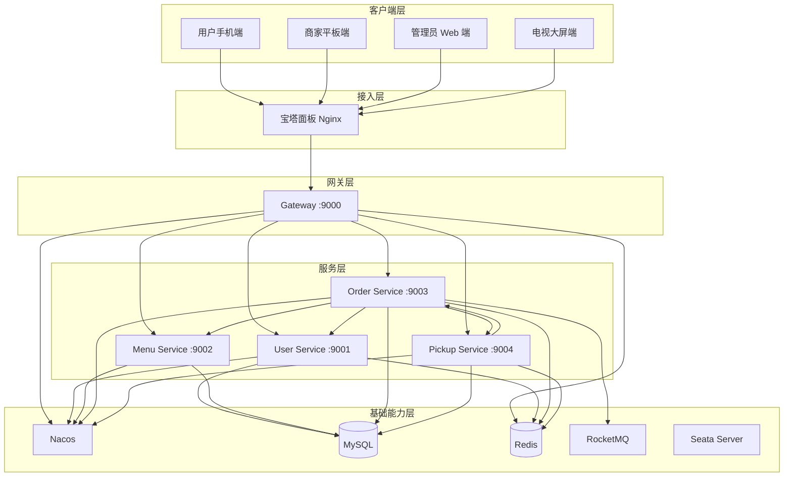
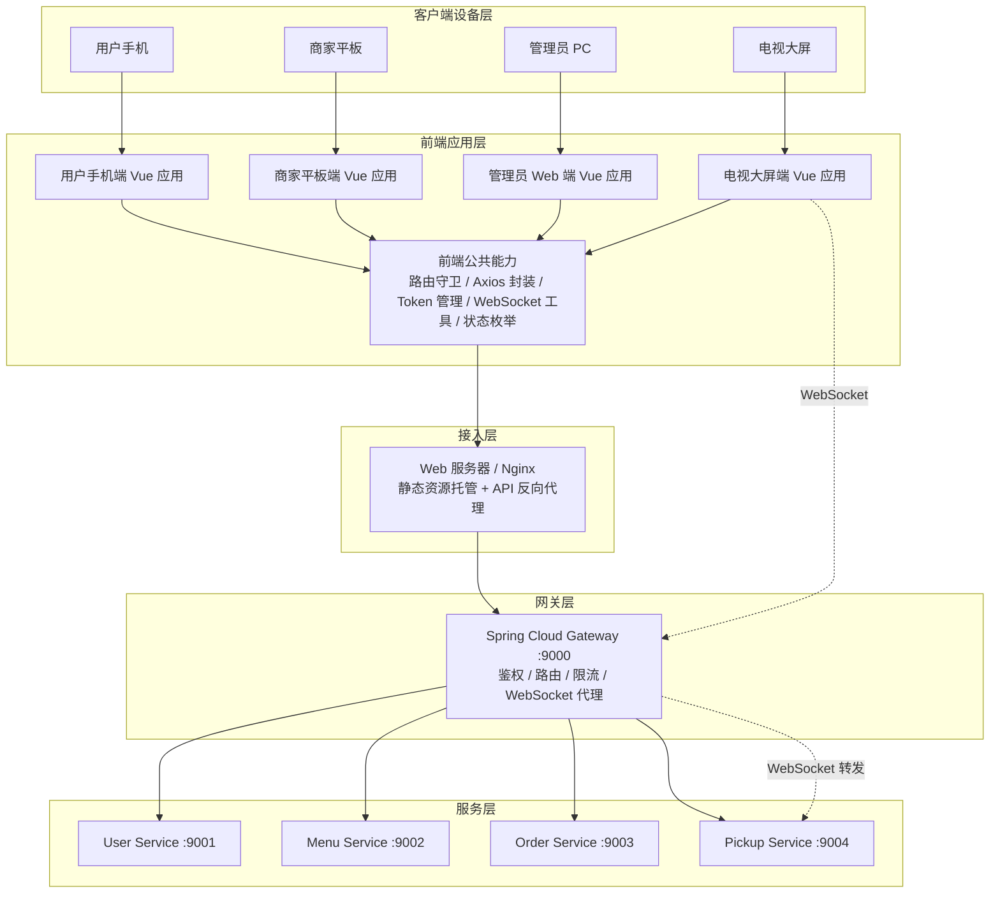
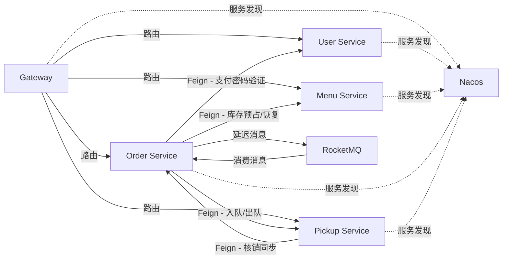
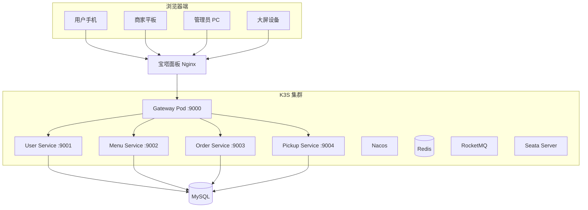

# A智能食堂系统架构设计文档

## 一、引言

### 1.1 项目背景

本系统面向校园/园区场景，为用户提供在线点餐、商家接单备餐、扫码取餐、食堂大屏实时展示的一站式餐饮服务。系统采用 Spring Cloud 微服务架构，后端部署在 K3S 集群，前端部署在云服务器宝塔面板，解决传统食堂点餐排队信息不透明、人工叫号效率低、库存管理粗放等问题。

### 1.2 项目概述

系统包含 4 个客户端（用户手机端、商家平板端、管理员 Web 端、电视大屏端）、4 个业务微服务（用户服务、菜品菜单服务、订单服务、取餐排队服务）和 1 个 API 网关服务。整体采用前后端分离架构，前端通过网关访问后端 RESTful API，大屏通过 WebSocket 接收实时推送。核心业务通过 Seata AT 保证下单与库存的一致性，通过 RocketMQ 延迟消息驱动超时取消。

### 1.3 术语表

| 术语 | 含义 |
|------|------|
| 取餐号 | 接单时生成的全局排队展示编号（A001→Z999，可重置） |
| 取餐二维码 | 出餐时生成的核销凭证，核销后失效 |
| 制作中队列 | 窗口接单后订单所在队列，大屏展示 |
| 待取餐队列 | 窗口出餐后订单所在队列，FIFO 仅用于展示排序 |
| JWT | 双 Token 机制（access_token 2h + refresh_token 7d） |
| Seata AT | 下单扣库存分布式事务方案 |
| RocketMQ | 订单超时延迟消息中间件 |
| K3S | 轻量级 Kubernetes，后端容器化部署平台 |
| Material 3 | 前端 UI 风格（大屏端除外） |

### 1.4 参考资料

- 《A智能食堂系统需求规格说明书》
- 《A智能食堂系统概要设计说明书》
- Spring Cloud、Nacos、Seata、RocketMQ 官方文档

---

## 二、总体设计

### 2.1 系统架构概述

系统采用 6 层架构：客户端层、接入层、网关层、服务层、基础能力层、外部系统层。客户端通过接入层到达网关，网关作为后端统一入口进行鉴权和路由，4 个业务微服务构成服务层，各服务拥有独立数据库。基础能力层提供注册配置、持久化、缓存、消息和分布式事务支撑。Nacos、Redis、RocketMQ、Seata Server 等基础支撑组件部署在 K3S 集群内，便于统一编排和服务治理；MySQL 作为核心业务数据持久化组件，部署在 K3S 集群外部。

### 2.2 总体架构图

> **架构图位置** — 待补充，建议使用 Mermaid 或 draw.io 绘制。






### 2.3 架构分层说明

| 层级 | 包含组件 | 说明 |
|------|---------|------|
| 客户端设备层 | 用户手机、商家平板、管理员 PC、电视大屏 | 用户实际访问系统的终端设备 |
| 前端应用层 | 用户手机端、商家平板端、管理员 Web 端、电视大屏端 Vue 应用 | 负责页面展示、用户交互、路由控制、状态管理、接口调用和 WebSocket 连接 |
| 接入层 | Web 服务器/Nginx | 托管前端静态资源，统一代理 API 和 WebSocket 请求到网关 |
| 网关层 | Spring Cloud Gateway服务 | 统一路由、JWT 校验、IP/用户级限流、WebSocket 代理 |
| 服务层 | 4 个业务微服务 | 用户服务、菜品菜单服务、订单服务、取餐排队服务；每服务独立数据库 |
| 基础能力层 | Nacos / MySQL / Redis / RocketMQ / Seata | 注册配置、持久化、缓存、消息队列、分布式事务 |
| 外部系统层 | 预留 | 当前版本不接入真实支付、短信等外部系统，均采用模拟实现 |

---

## 三、技术选型

### 3.1 后端技术选型

| 技术 | 用途 | 选择原因 |
|------|------|---------|
| Spring Boot 3.x | 微服务基础框架 | 开发生态成熟，与 Spring Cloud 深度集成 |
| Spring Cloud 2024.x / SCA 2023.x | 微服务治理 | 集成 Nacos、Gateway、OpenFeign、Sentinel |
| Spring Cloud Gateway | API 网关 | 响应式非阻塞，与 Nacos 服务发现无缝集成 |
| OpenFeign + Sentinel | 服务间调用与熔断 | 声明式调用，简化跨服务通信 |
| Seata（AT 模式） | 分布式事务 | 下单与库存预占需要强一致，AT 模式业务侵入小 |
| RocketMQ | 消息队列 | 延迟消息支撑订单超时取消，与 SCA 生态契合 |
| MyBatis-Plus | ORM | 简化 CRUD，分页和条件查询便捷 |
| MySQL 8.x | 关系型数据库 | 每服务独立数据库，事务支持完善 |
| Redis 7.x | 缓存 | Token 黑名单、限流计数、队列实时状态缓存 |
| jjwt 0.12.x | JWT 认证 | 轻量级 JWT 签发与校验 |
| Knife4j | API 文档 | 自动生成接口文档 |

### 3.2 前端技术选型

| 技术 | 用途 |
|------|------|
| Vue 3 + Vite | 前端框架与构建工具 |
| Vue Router | 路由管理（history 模式） |
| Axios | HTTP 请求 |
| Material 3 | UI 组件库（电视大屏端除外） |
| 原生 WebSocket API | 大屏端实时通信 |

### 3.3 基础组件选型

| 组件 | 版本要求 | 用途 | 部署 |
|------|---------|------|------|
| Nacos | 2.x | 服务注册、服务发现、配置管理 | K3S 集群内 |
| Redis | 7.x | 验证码、Token 黑名单、限流计数、队列缓存 | K3S 集群内 |
| RocketMQ | 5.x | 订单超时延迟消息 | K3S 集群内 |
| Seata | 1.x | 分布式事务（AT 模式） | K3S 集群内 |
| MySQL | 8.x | 业务数据持久化 | K3S 集群外 |

---

## 四、微服务划分设计

### 4.1 服务划分原则

- 按业务领域拆分：用户认证、菜品菜单、订单、取餐排队，四大领域对应四个独立微服务。
- 每服务独占数据库，只能通过 API（OpenFeign）协作，禁止直接访问其他服务数据库。
- 跨领域通用能力（DTO、异常、工具类）提取到 `smart-canteen-common` 模块。
- 网关独立为一个服务，不承载业务逻辑。

### 4.2 微服务清单

| 服务名称 | 服务标识 | 端口 | 独立数据库 | 主要职责 |
|---------|---------|------|-----------|---------|
| 网关服务 | gateway-service | 9000 | - | 路由转发、JWT 校验、IP/用户级限流、WebSocket 代理 |
| 用户服务 | user-service | 9001 | user_db | 注册登录、JWT 签发/刷新、用户信息维护、支付密码验证 |
| 菜品菜单服务 | menu-service | 9002 | menu_db | 菜品 CRUD、每日菜单发布、库存预占/恢复、上下架、库存预警 |
| 订单服务 | order-service | 9003 | order_db | 下单、支付验证、状态流转（6 状态）、超时取消（RocketMQ） |
| 取餐排队服务 | pickup-service | 9004 | pickup_db | 取餐号全局序列、制作中队列、待取餐队列、叫号（自动+手动）、核销、WebSocket 消息生产 |

### 4.3 服务依赖关系

| 调用方 | 被调用方 | 调用目的 |
|--------|---------|---------|
| 订单服务 | 菜品菜单服务 | 库存预占与恢复（Seata AT 全局事务） |
| 订单服务 | 用户服务 | 支付密码验证 |
| 订单服务 | 取餐排队服务 | 接单入制作中队列、出餐移待取餐队列、取消出队 |
| 取餐排队服务 | 订单服务 | 核销结果同步（更新订单为已取餐） |

> 订单服务通过 RocketMQ 发送和消费延迟消息处理超时取消，不涉及服务间同步调用。

### 4.4 服务调用关系图

> **图示位置** — 待补充。




## 五、关键架构组件设计

### 5.1 API 网关与安全

**路由规则：**

| 路由前缀 | 目标服务 | 说明 |
|---------|---------|------|
| `/api/user/**` | user-service | 用户认证、信息维护 |
| `/api/menu/**` | menu-service | 菜品、菜单、库存 |
| `/api/order/**` | order-service | 订单、支付 |
| `/api/pickup/**` | pickup-service | 队列、叫号、核销 |
| `/api/admin/users/**` | user-service | 管理员用户管理 |
| `/api/admin/merchants/**`、`/api/admin/stalls/**` | menu-service | 管理员商家和窗口管理 |
| `/api/admin/order/config/**` | order-service | 订单相关业务配置 |
| `/api/admin/menu/config/**` | menu-service | 菜单/库存相关业务配置 |
| `/api/admin/pickup/config/**` | pickup-service | 取餐相关业务配置 |
| `/api/admin/orders/**` | order-service | 异常订单处理、手动取消、库存补偿 |
| `/ws/**` | pickup-service | WebSocket 代理（大屏端） |

**JWT 认证：** 双 Token 机制 — access_token（2h）+ refresh_token（7d）。刷新时旧 access_token 写入 Redis 黑名单（key: `token:blacklist:{jti}`，TTL 对齐原过期时间）。白名单 `/api/user/register`、`/api/user/login/**`、`/api/user/refresh` 跳过校验，其余接口 Gateway 通过全局过滤器校验签名、有效期和黑名单状态，通过后注入 `X-User-Id` 和 `X-User-Role` Header 传递给下游。下游服务根据 `X-User-Role` 进行角色权限控制和数据归属校验。

**支付密码：** 登录密码 BCrypt 哈希存储；支付密码明文存储（模拟实现，默认 `123456`，用户可修改）。支付时直接字符串对比；连续错误 5 次锁定 30 分钟（Redis 计数器）。

**接口限流：** 基于 Redis + Lua 令牌桶：

| 级别 | 速率 | 说明 |
|------|------|------|
| IP 级 | 100 req/s | 所有接口 |
| 用户级 | 50 req/s | 按 `X-User-Id` 计数 |
| 敏感接口 | 5 req/min per IP | 登录、注册、验证码 |

### 5.2 注册与配置中心

Nacos 作为注册中心和配置中心合一部署。所有微服务启动后以独立服务名注册到 Nacos，网关通过服务发现完成路由转发，微服务间通过服务名进行 Feign 调用。Nacos 主要用于技术配置管理（服务端口、网关基础路由、数据源连接、Redis/RocketMQ 地址等）。业务运行配置（订单超时时间、接单超时时间、取餐号重置规则、库存预警扫描间隔）由各业务服务的 config 表维护，并通过 Redis 缓存提高读取效率。

### 5.3 分布式事务与消息队列

**Seata（AT 模式）：** 用于创建待支付订单时的“创建订单 + 生成订单明细 + 预占库存”场景。订单服务作为全局事务发起方，调用菜品菜单服务完成库存预占，保证订单数据与库存预占结果一致。用户支付时不再重复扣减库存，只调用用户服务验证支付密码，并将订单状态由“待支付”更新为“已下单（待接单）”。其他订单状态流转以本地事务为主。

**RocketMQ：** 仅用于订单超时延迟消息，不用于服务间数据同步。

| 场景 | 延迟时间 | RocketMQ 级别 |
|------|---------|-------------|
| 下单 10 分钟未支付 | 10min | level 14 |
| 支付后 10 分钟未接单 | 10min | level 14 |

Producer 在创建订单和支付成功时分别发送延迟消息；Consumer 在订单服务内部，收到消息后检查订单当前状态再决定是否执行取消，若订单已被处理则忽略。

### 5.4 缓存设计

| 缓存类型 | 使用服务 | 说明 |
|---------|---------|------|
| 验证码 | user-service | 固定值 `123456`，设置有效期 |
| Token 黑名单 | user-service | Key: `token:blacklist:{jti}`，TTL 对齐 token 过期时间 |
| 队列快照（制作中 + 待取餐） | pickup-service | 支撑大屏高频查询，异常时从 DB 恢复 |
| 限流计数 | gateway | 令牌桶计数器 |

> Redis 只做缓存加速，不作为唯一数据源。所有业务数据以 MySQL 为准。

---

### 5.5 前端架构设计

系统前端采用 Vue 3 + Vite 构建，面向用户手机端、商家平板端、管理员 Web 端和电视大屏端四类使用场景。前端采用前后端分离架构，通过 Web 服务器提供静态资源访问，通过 API 网关统一访问后端服务。

#### 5.5.1 前端应用划分

| 前端应用      | 使用对象      | 主要职责                                         |
| ------------- | ------------- | ------------------------------------------------ |
| 用户手机端    | 普通用户      | 浏览菜单、下单、支付、查看订单状态、扫码取餐     |
| 商家平板端    | 商家/窗口人员 | 接单、备餐、出餐、叫号、订单状态处理             |
| 管理员 Web 端 | 系统管理员    | 用户管理、商家管理、菜品管理、菜单管理、运营配置 |
| 电视大屏端    | 食堂现场用户  | 展示制作中队列、待取餐队列和叫号信息             |

#### 5.5.2 前端分层结构

前端内部采用分层组织方式，主要包括页面层、组件层、状态层、服务层、路由层和工具层。

| 层级   | 职责                                                       |
| ------ | ---------------------------------------------------------- |
| 页面层 | 按业务场景组织页面，如菜单页、订单页、接单页、队列展示页   |
| 组件层 | 封装订单卡片、菜品卡片、状态标签、队列列表等可复用组件     |
| 状态层 | 管理用户登录状态、角色信息、订单状态、队列状态等前端状态   |
| 服务层 | 封装 Axios 请求、Token 刷新、统一错误处理和 WebSocket 连接 |
| 路由层 | 根据用户角色控制页面访问权限                               |
| 工具层 | 封装时间格式化、金额处理、状态映射、二维码处理等通用逻辑   |

#### 5.5.3 前后端通信方式

前端通过 Axios 访问后端 REST API，所有业务请求统一发送至 API 网关，由网关完成认证、限流和服务路由。

大屏端通过原生 WebSocket 获取取餐队列实时推送，WebSocket 请求经过 API 网关转发至取餐排队服务，断线后自动重连并通过 HTTP 接口拉取快照恢复。用户手机端采用 HTTP 轮询（每 5 秒请求订单详情接口）获取订单状态和取餐信息。

#### 5.5.4 前端权限控制

前端通过路由守卫检查用户登录状态和角色信息。未登录用户跳转至登录页，角色不匹配时禁止访问对应页面。前端权限控制只作为页面访问控制和用户体验优化，最终权限仍以后端网关和业务服务校验结果为准。

#### 5.5.5 四端复用与差异化设计

四个前端应用共用接口请求封装、Token 管理、错误处理、状态枚举和部分基础组件（WebSocket 能力仅大屏端使用）。不同端根据使用场景进行差异化设计：

- 用户手机端强调移动端适配和下单流程简洁；
- 商家平板端强调接单、出餐、叫号等高频操作效率；
- 管理员 Web 端强调数据管理、表格查询和配置维护；
- 电视大屏端强调高可读性、实时刷新和远距离展示效果。

## 六、数据架构

### 6.1 数据域划分

| 数据域 | 归属服务 | 数据库 | 核心数据对象 |
|--------|---------|--------|-------------|
| 用户数据域 | user-service | user_db | 用户、角色、支付密码、登录日志 |
| 菜品菜单数据域 | menu-service | menu_db | 窗口/档口、菜品、分类、每日菜单、库存 |
| 订单数据域 | order-service | order_db | 订单主表、订单明细、状态变更时间线 |
| 取餐排队数据域 | pickup-service | pickup_db | 取餐号全局序列、制作中队列、待取餐队列、叫号事件、核销记录 |
| 日志配置数据域 | 各服务分散 | 各数据库 | 操作日志、异常日志、系统配置 |

### 6.2 数据库分布策略

- **物理隔离**：每服务独占数据库，服务间不共享数据库连接。
- **API 协作**：跨服务数据访问必须通过 OpenFeign 调用，禁止直连其他服务数据库或跨库 JOIN。
- **逻辑删除**：用户、商家、菜品与历史订单相关的数据不物理删除，通过状态标记（如 `status` 字段）维护。

### 6.3 缓存策略概览

| 缓存类型 | 使用服务 | 持久化兜底 |
|---------|---------|-----------|
| 验证码 | user-service | 无（过期自动失效） |
| Token 黑名单 | user-service | 无（过期自动失效） |
| 制作中队列快照 | pickup-service | MySQL pickup_db |
| 待取餐队列快照 | pickup-service | MySQL pickup_db |
| 业务配置 | 各服务 | Nacos / MySQL |
| 限流计数 | gateway | 无 |

> **原则：** Redis 只做缓存加速，不作为唯一数据源。所有业务数据以 MySQL 为准，队列异常时可从 DB 恢复。

---

## 七、部署架构（概要）

### 7.1 部署拓扑

> **图示位置** — 待补充。



### 7.2 服务端口与实例规划

| 组件 | 端口 | 部署方式 | 默认副本数 |
|------|------|---------|-----------|
| 前端（四端） | 宝塔 Nginx 端口 | 静态文件部署 | - |
| Gateway | 9000 | K3S Deployment + Service | 1 |
| User Service | 9001 | K3S Deployment + Service | 1 |
| Menu Service | 9002 | K3S Deployment + Service | 1 |
| Order Service | 9003 | K3S Deployment + Service | 1 |
| Pickup Service | 9004 | K3S Deployment + Service | 1 |
| Nacos | 8848 | K3S Deployment + Service | 1 |
| MySQL | 3306 | K3S 外部（或 StatefulSet） | 1 |
| Redis | 6379 | K3S Deployment + Service | 1 |
| RocketMQ | 9876 | K3S Deployment + Service | 1 |
| Seata Server | 8091 | K3S Deployment + Service | 1 |

### 7.3 启动顺序

```
Nacos → MySQL → Redis → RocketMQ → Seata Server
  → User Service → Menu Service → Pickup Service
  → Order Service → Gateway → 前端
```

> 详见《部署方案说明书》。

---

## 八、附录

### 8.1 接口规范概要

- **通信风格**：外部 API 采用 RESTful 风格，JSON 数据格式；内部服务间使用 OpenFeign（HTTP/JSON）。
- **统一响应格式**：

```json
{
  "code": 200,
  "message": "success",
  "data": {}
}
```

- **状态码约定**：200 成功 / 400 参数错误 / 401 未认证 / 403 无权限 / 404 未找到 / 500 服务异常。
- **文档生成**：各微服务集成 Knife4j，API 文档由注解自动生成，网关聚合后统一访问。

### 8.3 文档边界说明

本文档聚焦**架构设计决策**，以下内容不在本文档范围内：

| 超出内容 | 应查阅 |
|---------|-------|
| 详细业务流程、用例描述 | 《需求规格说明书》 |
| 具体 API 参数、返回值、错误码 | Knife4j 在线文档或《详细设计文档》 |
| 数据库表 DDL、字段定义、索引 | 《详细设计文档》 |
| 类图、时序图、活动图 | 《详细设计文档》 |
| K3S 集群搭建、Dockerfile、Helm Chart | 《部署方案说明书》 |
| 前端页面布局、组件结构 | 前端工程文档 |
