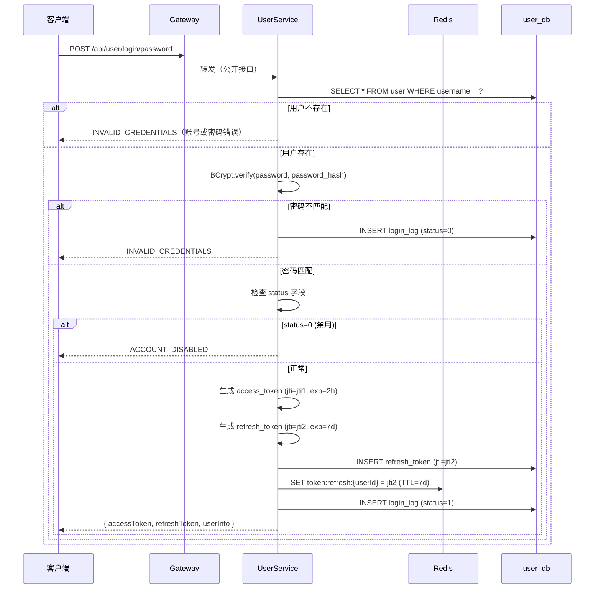
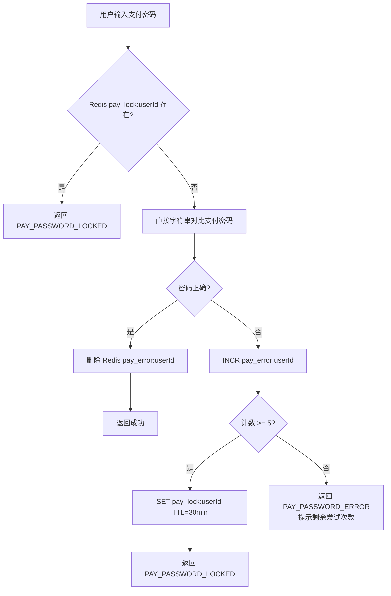
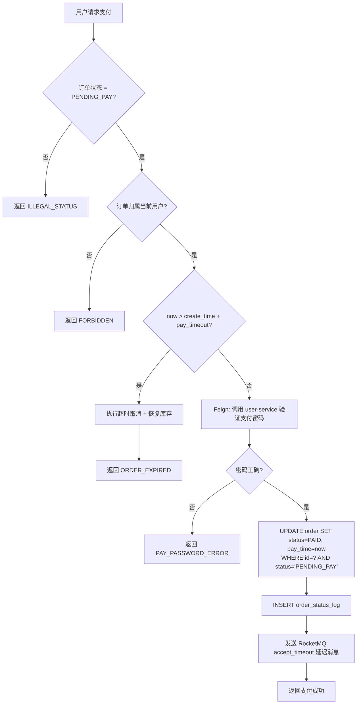
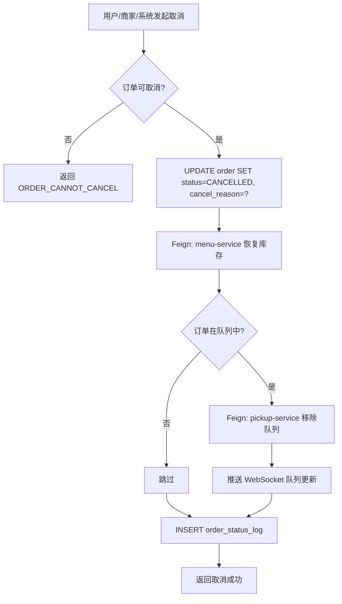
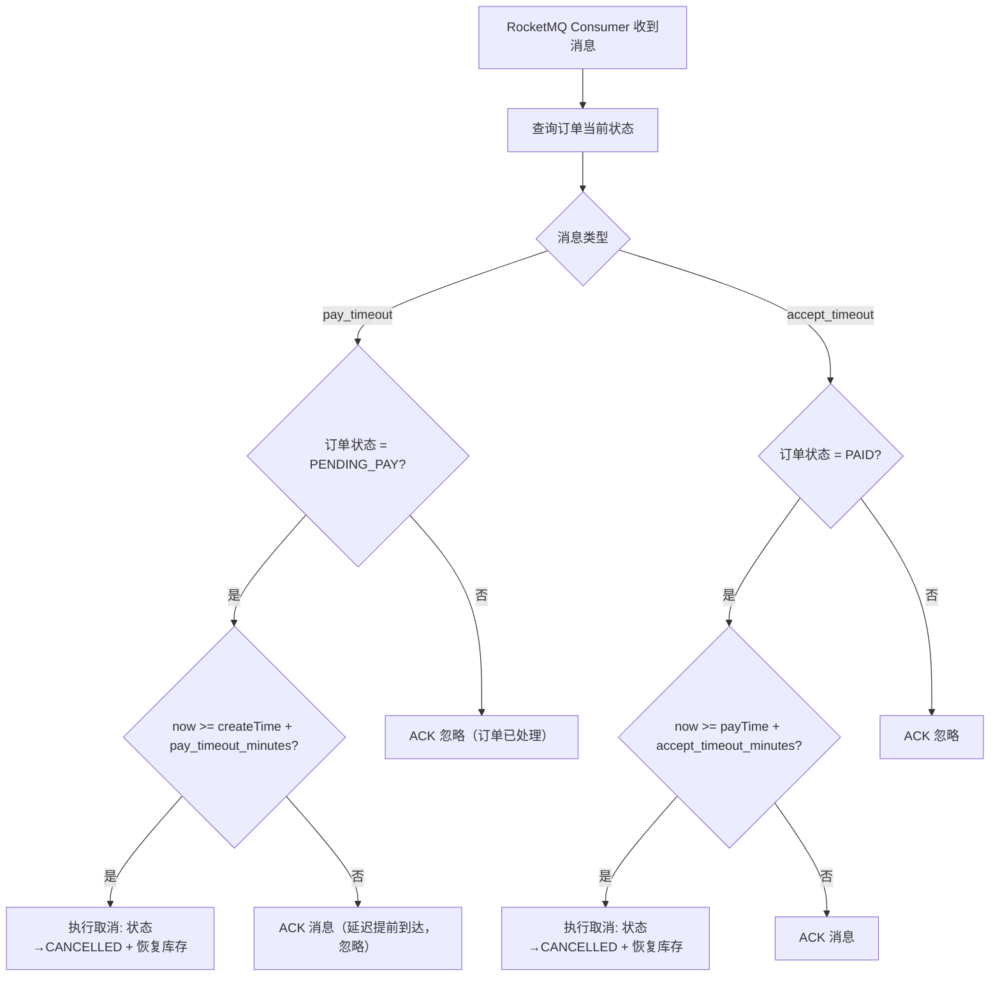
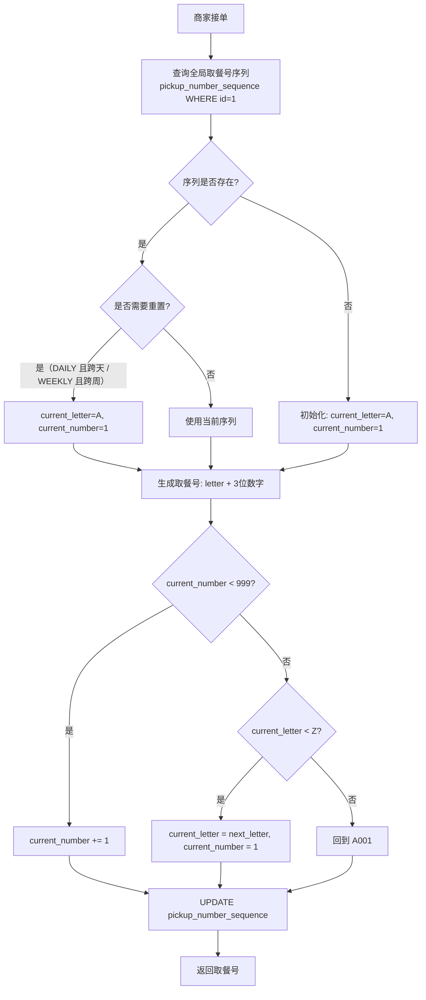
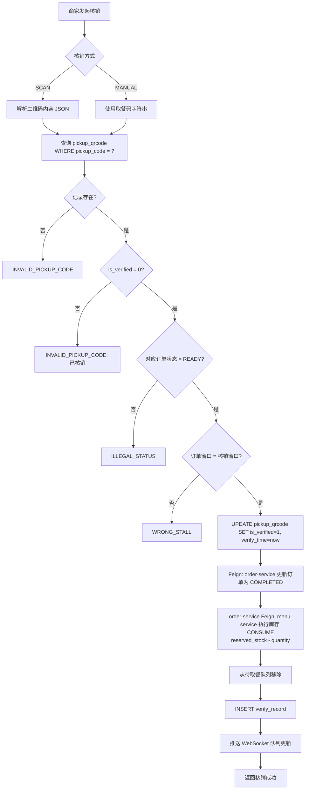
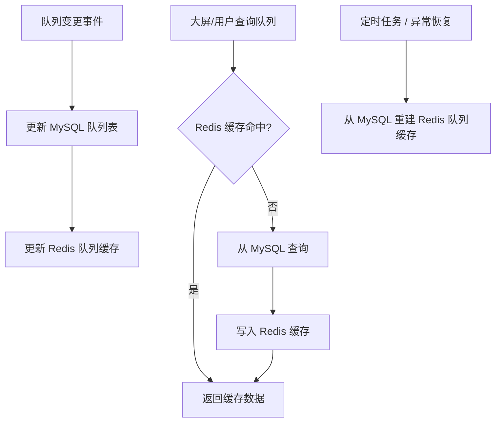
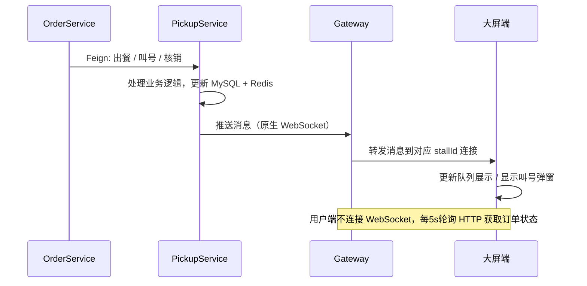

# A智能食堂系统详细设计说明书

## 一、引言

### 1.1 编写目的

本文档是智能食堂系统的详细设计说明书，在需求规格说明书、概要设计说明书和架构设计文档的基础上，对系统的数据结构、接口规范、核心算法和模块实现进行详细定义。本文档作为编码实现、单元测试和接口联调的直接依据。

### 1.2 设计依据

- 《A智能食堂系统需求规格说明书》
- 《A智能食堂系统概要设计说明书》
- 《A智能食堂系统架构设计文档》
- 课程设计任务书

### 1.3 适用范围

本文档适用于智能食堂系统的后端开发人员、前端开发人员、测试人员和 code reviewer。

### 1.4 术语说明

| 术语 | 说明 |
|------|------|
| access_token | 访问凭证，有效期 2h，用于接口鉴权 |
| refresh_token | 刷新凭证，有效期 7d，用于换取新 access_token |
| jti | JWT ID，Token 唯一标识，用于黑名单注销 |
| AT 模式 | Seata 分布式事务的自动事务模式，通过 DB 代理实现回滚补偿 |
| 令牌桶 | 基于 Redis + Lua 的限流算法，平滑限制请求速率 |

---

## 二、详细设计总体约定

### 2.1 工程结构约定

系统采用 Maven 多模块工程，父工程 `smart-canteen` 下包含 6 个子模块：

```
smart-canteen/
├── smart-canteen-common/          # 公共模块（DTO / 异常 / 工具 / 枚举 / 常量）
├── gateway-service/               # 网关服务 (:9000)
├── user-service/                  # 用户服务 (:9001)
├── menu-service/                  # 菜品菜单服务 (:9002)
├── order-service/                 # 订单服务 (:9003)
└── pickup-service/                # 取餐排队服务 (:9004)
```

每个业务服务子模块内部结构：

```
{service-name}/
├── pom.xml
└── src/main/
    ├── java/com/smartcanteen/{service}/
    │   ├── controller/            # 对外 REST 接口
    │   ├── service/               # 业务接口
    │   │   └── impl/              # 业务实现
    │   ├── mapper/                # MyBatis-Plus Mapper
    │   ├── entity/                # 数据库实体
    │   ├── dto/                   # 请求/响应 DTO
    │   ├── vo/                    # 视图对象
    │   ├── feign/                 # Feign 客户端
    │   │   └── fallback/          # Sentinel 降级实现
    │   ├── handler/               # 全局异常处理、WebSocket 处理器
    │   ├── config/                # 配置类
    │   └── util/                  # 服务内部工具
    └── src/main/resources/
        ├── application.yml        # 公共配置
        ├── bootstrap.yml          # 启动引导配置（Nacos 连接）
        └── db/migration/          # 数据库初始化 SQL
```

公共模块 `smart-canteen-common` 结构：

```
com.smartcanteen.common/
├── constant/                      # 常量（Redis Key、状态码等）
├── enums/                         # 枚举（订单状态、角色、错误码等）
├── dto/                           # 公共 DTO
├── exception/                     # 自定义异常
├── util/                          # 工具类（JWT 工具、雪花 ID 等）
├── config/                        # 公共配置（自动装配）
└── annotation/                    # 自定义注解
```

### 2.2 包结构约定

| 包路径模式 | 用途 |
|-----------|------|
| `com.smartcanteen.{service}.controller` | REST 控制器，只做参数校验和结果封装 |
| `com.smartcanteen.{service}.service` | 业务逻辑接口 |
| `com.smartcanteen.{service}.service.impl` | 业务逻辑实现，标注 `@Service` |
| `com.smartcanteen.{service}.mapper` | MyBatis-Plus BaseMapper 接口 |
| `com.smartcanteen.{service}.entity` | 数据库实体类，使用 `@TableName` 注解 |
| `com.smartcanteen.{service}.dto` | 请求 DTO（`*Req`）和响应 DTO（`*Resp`） |
| `com.smartcanteen.{service}.feign` | OpenFeign 接口 + Sentinel fallback |
| `com.smartcanteen.{service}.handler` | 全局异常处理器、WebSocket 处理器 |
| `com.smartcanteen.{service}.config` | Spring 配置类 |

### 2.3 命名规范

| 类别 | 规范 | 示例 |
|------|------|------|
| 实体类 | 表名对应驼峰 | `User` → `user` |
| DTO 请求类 | 功能 + `Req` | `LoginReq`, `CreateOrderReq` |
| DTO 响应类 | 功能 + `Resp` | `LoginResp`, `OrderDetailResp` |
| Controller | 资源名 + `Controller` | `UserController` |
| Service 接口 | 资源名 + `Service` | `UserService` |
| Service 实现 | 资源名 + `ServiceImpl` | `UserServiceImpl` |
| Mapper | 实体名 + `Mapper` | `UserMapper` |
| Feign 接口 | 被调用服务名 + `FeignClient` | `MenuFeignClient` |
| 方法名 | 动词开头，驼峰 | `createOrder`, `acceptOrder` |
| URL 路径 | `/api/{服务前缀}/{资源}` | `/api/user/login` |
| 数据库表名 | 小写 + 下划线分隔 | `order_item` |
| 数据库字段名 | 小写 + 下划线分隔 | `order_no`, `pay_password` |
| Redis Key | `领域:子域:标识` | `token:blacklist:{jti}` |

### 2.4 统一响应格式

所有接口统一返回以下 JSON 结构：

```json
{
  "code": 200,
  "message": "success",
  "data": {}
}
```

- `code`：HTTP 状态码（200/400/401/403/404/500）
- `message`：成功时为 `"success"`，失败时为业务错误提示文案（如 `"库存不足"`）
- `data`：成功时为业务数据，失败时为 `null`

| 状态码 | 含义 |
|--------|------|
| 200 | 成功 |
| 400 | 请求参数错误 / 业务校验失败 |
| 401 | 未认证（Token 缺失/无效/过期） |
| 403 | 无权限（角色或数据归属不符） |
| 404 | 资源不存在 |
| 500 | 服务内部异常 |

分页接口 `data` 字段统一为：

```json
{
  "code": 200,
  "message": "success",
  "data": {
    "records": [],
    "total": 100,
    "size": 20,
    "current": 1
  }
}
```

### 2.5 统一错误码

| 错误码 | HTTP 状态码 | message | 说明 |
|--------|------------|---------|------|
| `UNAUTHORIZED` | 401 | Token 无效或已过期 | Token 校验不通过 |
| `FORBIDDEN` | 403 | 无权限访问 | 角色或数据归属不符 |
| `USER_EXISTS` | 400 | 该账号已被注册 | 手机号或学工号已存在 |
| `INVALID_CREDENTIALS` | 401 | 账号或密码错误 | 登录失败，不区分原因 |
| `ACCOUNT_DISABLED` | 403 | 账号已被禁用 | 账号被管理员停用 |
| `INVALID_VERIFY_CODE` | 400 | 验证码无效 | 验证码错误或过期 |
| `INVALID_PASSWORD` | 400 | 密码不符合规则 | 密码强度不足 |
| `INVALID_PHONE_FORMAT` | 400 | 手机号格式不正确 | 格式校验失败 |
| `PHONE_BOUND` | 400 | 手机号已绑定其他账号 | 手机号唯一性冲突 |
| `INVALID_STOCK` | 400 | 库存不足 | 下单时库存不够 |
| `DISH_NOT_AVAILABLE` | 400 | 菜品当前不可购买 | 已下架/不在售卖时段 |
| `ORDER_NOT_EXISTS` | 404 | 订单不存在 | 订单 ID 无效 |
| `ILLEGAL_STATUS` | 400 | 当前状态不可执行此操作 | 状态流转非法 |
| `ORDER_CANNOT_CANCEL` | 400 | 当前订单不可取消 | 超过可取消时间窗口 |
| `PAY_PASSWORD_ERROR` | 400 | 支付密码错误 | 密码不匹配 |
| `PAY_PASSWORD_LOCKED` | 403 | 支付密码已锁定，请30分钟后重试 | 连续错误 5 次 |
| `INVALID_PICKUP_CODE` | 400 | 取餐码无效 | 取餐码不存在/已核销/已失效 |
| `ORDER_EXPIRED` | 400 | 该订单已取消 | 超时自动取消后操作 |
| `WRONG_STALL` | 400 | 请到对应窗口取餐 | 窗口归属不匹配 |
| `DUPLICATE_SUBMIT` | 400 | 请勿重复提交 | 幂等性校验失败 |

### 2.6 统一鉴权上下文

网关校验 JWT 后向业务服务转发时，注入以下 HTTP Header：

| Header | 说明 | 示例 |
|--------|------|------|
| `X-User-Id` | 当前用户 ID | `1234567890` |
| `X-User-Role` | 当前用户角色 | `USER` / `MERCHANT` / `ADMIN` |
| `X-Username` | 当前用户名（手机号或学工号） | `13800138000` |

角色枚举值：

| 角色 | 代码 | 说明 |
|------|------|------|
| 普通用户 | `USER` | 学生、教职工、园区员工 |
| 商家 | `MERCHANT` | 食堂窗口经营者 |
| 管理员 | `ADMIN` | 系统管理员 |

业务服务从 Header 中读取用户上下文，进行数据归属校验（如商家只能操作所属窗口订单）。

### 2.7 状态枚举约定

**订单状态（OrderStatus）：**

| 枚举值 | 状态名称 | 说明 |
|--------|---------|------|
| `PENDING_PAY` | 待支付 | 订单已创建，等待用户支付 |
| `PAID` | 已下单（待接单） | 用户已支付，等待商家接单 |
| `PREPARING` | 制作中 | 商家已接单，正在制作 |
| `READY` | 待取餐 | 商家已出餐，等待用户取餐 |
| `COMPLETED` | 已取餐 | 商家已核销，订单完结 |
| `CANCELLED` | 已取消 | 订单被取消 |

**菜品状态（DishStatus）：**

| 枚举值 | 说明 |
|--------|------|
| `ACTIVE` | 启用 |
| `DISABLED` | 停用/下架 |

**售卖时段（MealPeriod）：** `BREAKFAST` 早餐 / `LUNCH` 午餐 / `DINNER` 晚餐 / `SNACK` 夜宵

**叫号方式（CallType）：** `AUTO` 出餐自动叫号 / `MANUAL` 商家手动叫号

**核销方式（VerifyType）：** `SCAN` 扫码核销 / `MANUAL` 手动输入取餐码核销

**库存变更类型（InventoryChangeType）：** `RESERVE` 预占（创建待支付订单） / `RELEASE` 释放恢复（取消/拒绝/超时） / `CONSUME` 核销确认扣减（核销完成后减少 `reserved_stock`）

库存生命周期：创建待支付订单时 `remaining_stock - quantity, reserved_stock + quantity`（RESERVE）；取消/拒绝/超时时反向操作（RELEASE）；核销完成后 `reserved_stock - quantity`（CONSUME），已售量通过 `total_stock - remaining_stock - reserved_stock` 推导。

**取餐号重置规则（ResetRule）：** `NONE` 不重置（到达 Z999 后回到 A001） / `DAILY` 每天重置 / `WEEKLY` 每周重置

---

## 三、数据结构详细设计

### 3.1 用户服务数据结构

#### 3.1.1 user（用户表）

| 字段名 | 类型 | 长度 | 必填 | 默认值 | 说明 |
|--------|------|------|------|--------|------|
| `id` | BIGINT | - | 是 | 雪花算法 | 主键 |
| `username` | VARCHAR | 20 | 是 | - | 手机号或学工号，唯一索引 UNIQUE |
| `phone` | VARCHAR | 11 | 否 | NULL | 手机号（用于手机号注册） |
| `student_no` | VARCHAR | 20 | 否 | NULL | 学工号（用于学工号注册） |
| `password_hash` | VARCHAR | 128 | 是 | - | BCrypt 密码哈希 |
| `pay_password` | VARCHAR | 32 | 是 | `123456` | 支付密码（模拟实现，明文存储，注册时默认 `123456`，用户可修改） |
| `nickname` | VARCHAR | 50 | 否 | NULL | 昵称/姓名 |
| `avatar` | VARCHAR | 255 | 否 | NULL | 头像 URL |
| `role` | VARCHAR | 20 | 是 | `USER` | 角色：USER / MERCHANT / ADMIN |
| `status` | TINYINT | - | 是 | 1 | 1=正常, 0=禁用 |
| `create_time` | DATETIME | - | 是 | CURRENT_TIMESTAMP | 创建时间 |
| `update_time` | DATETIME | - | 是 | CURRENT_TIMESTAMP | 更新时间，ON UPDATE |

索引：`uk_username (username UNIQUE)`, `idx_phone (phone)`, `idx_student_no (student_no)`, `idx_role (role)`

#### 3.1.2 login_log（登录日志表）

| 字段名 | 类型 | 长度 | 必填 | 说明 |
|--------|------|------|------|------|
| `id` | BIGINT | - | 是 | 主键 |
| `user_id` | BIGINT | - | 是 | 用户 ID |
| `login_type` | VARCHAR | 20 | 是 | PASSWORD / VERIFY_CODE |
| `ip` | VARCHAR | 45 | 否 | 登录 IP |
| `user_agent` | VARCHAR | 255 | 否 | 客户端 UA |
| `status` | TINYINT | - | 是 | 1=成功, 0=失败 |
| `fail_reason` | VARCHAR | 100 | 否 | 失败原因 |
| `create_time` | DATETIME | - | 是 | 登录时间 |

#### 3.1.3 refresh_token（刷新令牌表）

| 字段名 | 类型 | 长度 | 必填 | 说明 |
|--------|------|------|------|------|
| `id` | BIGINT | - | 是 | 主键 |
| `user_id` | BIGINT | - | 是 | 用户 ID |
| `token_jti` | VARCHAR | 64 | 是 | JWT JTI，唯一索引 |
| `status` | TINYINT | - | 是 | 1=有效, 0=已注销 |
| `expire_time` | DATETIME | - | 是 | 过期时间 |
| `create_time` | DATETIME | - | 是 | 创建时间 |

索引：`uk_token_jti (token_jti UNIQUE)`, `idx_user_id (user_id)`

### 3.2 菜品菜单服务数据结构

#### 3.2.1 merchant（商家表）

| 字段名 | 类型 | 长度 | 必填 | 说明 |
|--------|------|------|------|------|
| `id` | BIGINT | - | 是 | 主键 |
| `user_id` | BIGINT | - | 是 | 关联用户表 ID |
| `name` | VARCHAR | 100 | 是 | 商家名称 |
| `contact_name` | VARCHAR | 50 | 否 | 负责人姓名 |
| `contact_phone` | VARCHAR | 11 | 否 | 联系电话 |
| `status` | TINYINT | - | 是 | 1=正常, 0=停用 |
| `create_time` | DATETIME | - | 是 | 创建时间 |
| `update_time` | DATETIME | - | 是 | 更新时间 |

#### 3.2.2 stall（窗口表）

| 字段名 | 类型 | 长度 | 必填 | 说明 |
|--------|------|------|------|------|
| `id` | BIGINT | - | 是 | 主键，即窗口编号 |
| `merchant_id` | BIGINT | - | 是 | 所属商家 ID |
| `name` | VARCHAR | 100 | 是 | 窗口名称 |
| `floor` | VARCHAR | 20 | 否 | 所在楼层 |
| `category` | VARCHAR | 50 | 否 | 窗口类型/分类 |
| `status` | TINYINT | - | 是 | 1=正常, 0=停用 |
| `create_time` | DATETIME | - | 是 | 创建时间 |

索引：`idx_merchant_id (merchant_id)`

#### 3.2.3 dish_category（菜品分类表）

| 字段名 | 类型 | 长度 | 必填 | 说明 |
|--------|------|------|------|------|
| `id` | BIGINT | - | 是 | 主键 |
| `merchant_id` | BIGINT | - | 是 | 所属商家 ID |
| `name` | VARCHAR | 50 | 是 | 分类名称（如"主食""小炒""饮品"） |
| `sort` | INT | - | 是 | 排序值，越小越前 |
| `create_time` | DATETIME | - | 是 | 创建时间 |

索引：`idx_merchant_id (merchant_id)`

#### 3.2.4 dish（菜品表）

| 字段名 | 类型 | 长度 | 必填 | 说明 |
|--------|------|------|------|------|
| `id` | BIGINT | - | 是 | 主键 |
| `merchant_id` | BIGINT | - | 是 | 所属商家 ID |
| `category_id` | BIGINT | - | 否 | 分类 ID |
| `name` | VARCHAR | 100 | 是 | 菜品名称 |
| `image` | MEDIUMBLOB | - | 否 | 菜品图片二进制数据，≤ 5MB |
| `price` | DECIMAL | 10,2 | 是 | 单价（元），≥ 0 |
| `description` | VARCHAR | 500 | 否 | 菜品描述 |
| `status` | TINYINT | - | 是 | 1=启用, 0=停用（逻辑删除） |
| `create_time` | DATETIME | - | 是 | 创建时间 |
| `update_time` | DATETIME | - | 是 | 更新时间 |

索引：`idx_merchant_id (merchant_id)`, `idx_category_id (category_id)`, `idx_status (status)`

#### 3.2.5 daily_menu（每日菜单表）

| 字段名 | 类型 | 长度 | 必填 | 说明 |
|--------|------|------|------|------|
| `id` | BIGINT | - | 是 | 主键 |
| `stall_id` | BIGINT | - | 是 | 所属窗口 ID |
| `menu_date` | DATE | - | 是 | 菜单日期 |
| `meal_period` | VARCHAR | 20 | 是 | 售卖时段：BREAKFAST/LUNCH/DINNER/SNACK |
| `status` | TINYINT | - | 是 | 1=已发布, 0=草稿 |
| `create_time` | DATETIME | - | 是 | 创建时间 |

索引：`uk_stall_date_period (stall_id, menu_date, meal_period UNIQUE)`

#### 3.2.6 daily_menu_item（每日菜单菜品项）

| 字段名 | 类型 | 长度 | 必填 | 说明 |
|--------|------|------|------|------|
| `id` | BIGINT | - | 是 | 主键 |
| `daily_menu_id` | BIGINT | - | 是 | 关联每日菜单 ID |
| `dish_id` | BIGINT | - | 是 | 关联菜品 ID |
| `total_stock` | INT | - | 是 | 总库存，≥ 0 |
| `remaining_stock` | INT | - | 是 | 剩余库存 = total - reserved |
| `reserved_stock` | INT | - | 是 | 预占库存（待支付订单已预占但未确认） |
| `alert_threshold` | INT | - | 是 | 库存预警阈值 |
| `is_listed` | TINYINT | - | 是 | 1=上架, 0=下架 |
| `price_override` | DECIMAL | 10,2 | 否 | 覆盖价格（NULL 则使用菜品原价） |
| `create_time` | DATETIME | - | 是 | 创建时间 |

索引：`idx_menu_id (daily_menu_id)`, `idx_dish_id (dish_id)`, `unique uk_menu_dish (daily_menu_id, dish_id UNIQUE)`

#### 3.2.7 inventory_log（库存变更日志表）

| 字段名 | 类型 | 长度 | 必填 | 说明 |
|--------|------|------|------|------|
| `id` | BIGINT | - | 是 | 主键 |
| `daily_menu_item_id` | BIGINT | - | 是 | 关联每日菜单菜品项 ID |
| `change_type` | VARCHAR | 20 | 是 | RESERVE/RELEASE/CONSUME |
| `change_amount` | INT | - | 是 | 变更数量（正=增加，负=减少） |
| `before_remaining` | INT | - | 是 | 变更前剩余库存 |
| `after_remaining` | INT | - | 是 | 变更后剩余库存 |
| `order_id` | BIGINT | - | 否 | 关联订单 ID |
| `create_time` | DATETIME | - | 是 | 变更时间 |

### 3.3 订单服务数据结构

#### 3.3.1 `order`（订单主表）

| 字段名 | 类型 | 长度 | 必填 | 默认值 | 说明 |
|--------|------|------|------|--------|------|
| `id` | BIGINT | - | 是 | 雪花算法 | 主键 |
| `order_no` | VARCHAR | 32 | 是 | - | 系统内部订单编号，全局唯一，永不重置 |
| `user_id` | BIGINT | - | 是 | - | 下单用户 ID |
| `merchant_id` | BIGINT | - | 是 | - | 商家 ID |
| `stall_id` | BIGINT | - | 是 | - | 窗口 ID |
| `total_amount` | DECIMAL | 10,2 | 是 | - | 订单总金额 |
| `status` | VARCHAR | 20 | 是 | `PENDING_PAY` | 订单状态枚举值 |
| `pickup_no` | VARCHAR | 10 | 否 | NULL | 取餐号（接单时生成），如 "A001" |
| `pickup_qrcode_id` | BIGINT | - | 否 | NULL | 取餐二维码关联 ID（出餐时填入） |
| `remark` | VARCHAR | 200 | 否 | NULL | 用户备注 |
| `cancel_reason` | VARCHAR | 200 | 否 | NULL | 取消原因 |
| `pay_time` | DATETIME | - | 否 | NULL | 支付时间 |
| `accept_time` | DATETIME | - | 否 | NULL | 商家接单时间 |
| `complete_time` | DATETIME | - | 否 | NULL | 核销完成时间 |
| `cancel_time` | DATETIME | - | 否 | NULL | 取消时间 |
| `create_time` | DATETIME | - | 是 | CURRENT_TIMESTAMP | 创建时间 |
| `update_time` | DATETIME | - | 是 | CURRENT_TIMESTAMP | 更新时间 |

索引：`uk_order_no (order_no UNIQUE)`, `idx_user_id_status (user_id, status)`, `idx_stall_id_status (stall_id, status)`, `idx_create_time (create_time)`

#### 3.3.2 order_item（订单明细表）

| 字段名 | 类型 | 长度 | 必填 | 说明 |
|--------|------|------|------|------|
| `id` | BIGINT | - | 是 | 主键 |
| `order_id` | BIGINT | - | 是 | 关联订单 ID |
| `dish_id` | BIGINT | - | 是 | 菜品 ID |
| `dish_name` | VARCHAR | 100 | 是 | 下单时菜品名称（快照） |
| `dish_image` | MEDIUMBLOB | - | 否 | 下单时菜品图片二进制快照 |
| `unit_price` | DECIMAL | 10,2 | 是 | 下单时单价（快照） |
| `quantity` | INT | - | 是 | 数量 |
| `subtotal` | DECIMAL | 10,2 | 是 | 小计 = unit_price × quantity |

索引：`idx_order_id (order_id)`

#### 3.3.3 order_status_log（订单状态变更日志表）

| 字段名 | 类型 | 长度 | 必填 | 说明 |
|--------|------|------|------|------|
| `id` | BIGINT | - | 是 | 主键 |
| `order_id` | BIGINT | - | 是 | 关联订单 ID |
| `from_status` | VARCHAR | 20 | 是 | 变更前状态 |
| `to_status` | VARCHAR | 20 | 是 | 变更后状态 |
| `operator_id` | BIGINT | - | 是 | 操作者 ID（系统操作则为 0） |
| `operator_role` | VARCHAR | 20 | 是 | 操作者角色：USER/MERCHANT/ADMIN/SYSTEM |
| `remark` | VARCHAR | 200 | 否 | 备注 |
| `create_time` | DATETIME | - | 是 | 变更时间 |

### 3.4 取餐排队服务数据结构

#### 3.4.1 pickup_number_sequence（取餐号全局序列表）

| 字段名 | 类型 | 长度 | 必填 | 说明 |
|--------|------|------|------|------|
| `id` | BIGINT | - | 是 | 主键，固定为 1（全局唯一一行） |
| `current_letter` | CHAR | 1 | 是 | 当前字母位 'A'-'Z' |
| `current_number` | INT | - | 是 | 当前数字位 1-999 |
| `reset_rule` | VARCHAR | 20 | 是 | NONE/DAILY/WEEKLY |
| `last_reset_time` | DATETIME | - | 否 | 上次重置时间 |

> 所有窗口共享同一套全局取餐号序列。A001→A002→...→A999→B001→...→Z999→A001。
> 取餐号在商家接单时生成，已取消订单的取餐号不回收。

#### 3.4.2 pickup_qrcode（取餐二维码表）

| 字段名 | 类型 | 长度 | 必填 | 说明 |
|--------|------|------|------|------|
| `id` | BIGINT | - | 是 | 主键 |
| `order_id` | BIGINT | - | 是 | 关联订单 ID，唯一索引 |
| `qrcode_content` | VARCHAR | 255 | 是 | 二维码编码内容（JSON 字符串） |
| `pickup_code` | VARCHAR | 32 | 是 | 取餐码字符串（手动输入核销用），唯一索引 |
| `is_verified` | TINYINT | - | 是 | 0=未核销, 1=已核销 |
| `verify_time` | DATETIME | - | 否 | 核销时间 |
| `create_time` | DATETIME | - | 是 | 生成时间 |

索引：`uk_order_id (order_id UNIQUE)`, `uk_pickup_code (pickup_code UNIQUE)`

#### 3.4.3 preparing_queue_item（制作中队列项）

| 字段名 | 类型 | 长度 | 必填 | 说明 |
|--------|------|------|------|------|
| `id` | BIGINT | - | 是 | 主键 |
| `stall_id` | BIGINT | - | 是 | 窗口 ID |
| `order_id` | BIGINT | - | 是 | 订单 ID，唯一索引 |
| `pickup_no` | VARCHAR | 10 | 是 | 取餐号 |
| `enter_time` | DATETIME | - | 是 | 进入队列时间（= 接单时间） |
| `position` | INT | - | 是 | 队列位置序号，从 1 开始 |

索引：`uk_order_id (order_id UNIQUE)`, `idx_stall_id_enter (stall_id, enter_time)`

#### 3.4.4 waiting_queue_item（待取餐队列项）

| 字段名 | 类型 | 长度 | 必填 | 说明 |
|--------|------|------|------|------|
| `id` | BIGINT | - | 是 | 主键 |
| `stall_id` | BIGINT | - | 是 | 窗口 ID |
| `order_id` | BIGINT | - | 是 | 订单 ID，唯一索引 |
| `pickup_no` | VARCHAR | 10 | 是 | 取餐号 |
| `enter_time` | DATETIME | - | 是 | 进入待取餐队列时间（= 出餐时间） |
| `position` | INT | - | 是 | 队列位置序号（FIFO 插入时自动计算） |

索引：`uk_order_id (order_id UNIQUE)`, `idx_stall_id_enter (stall_id, enter_time)`

#### 3.4.5 call_event（叫号事件表）

| 字段名 | 类型 | 长度 | 必填 | 说明 |
|--------|------|------|------|------|
| `id` | BIGINT | - | 是 | 主键 |
| `stall_id` | BIGINT | - | 是 | 窗口 ID |
| `order_id` | BIGINT | - | 是 | 订单 ID |
| `pickup_no` | VARCHAR | 10 | 是 | 取餐号 |
| `call_type` | VARCHAR | 10 | 是 | AUTO（出餐自动）/ MANUAL（商家手动） |
| `call_time` | DATETIME | - | 是 | 叫号时间 |

索引：`idx_stall_id_call_time (stall_id, call_time)`, `idx_order_id (order_id)`

#### 3.4.6 verify_record（核销记录表）

| 字段名 | 类型 | 长度 | 必填 | 说明 |
|--------|------|------|------|------|
| `id` | BIGINT | - | 是 | 主键 |
| `order_id` | BIGINT | - | 是 | 订单 ID |
| `qrcode_id` | BIGINT | - | 是 | 取餐二维码 ID |
| `stall_id` | BIGINT | - | 是 | 核销窗口 ID |
| `verify_type` | VARCHAR | 10 | 是 | SCAN（扫码）/ MANUAL（手动输入取餐码） |
| `operator_id` | BIGINT | - | 是 | 核销操作的商家用户 ID |
| `verify_time` | DATETIME | - | 是 | 核销时间 |

#### 3.4.7 各服务配置表

配置不集中在一个独立的 `system_config` 表，而是按业务归属拆分到各服务数据库：

| 配置项 | 归属服务 | 存储位置 | 默认值 | 说明 |
|--------|---------|---------|--------|------|
| `pay_timeout_minutes` | order-service | order_db.config | 10 | 待支付超时（分钟） |
| `accept_timeout_minutes` | order-service | order_db.config | 10 | 接单超时（分钟） |
| `cancel_window_minutes` | order-service | order_db.config | 1 | 接单后可取消窗口（分钟） |
| `pickup_number_reset_rule` | pickup-service | pickup_db.config | NONE | 取餐号重置规则 |
| `stock_alert_scan_interval` | menu-service | menu_db.config | 300 | 库存预警扫描间隔（秒） |

每个服务在自己的数据库中建 `config` 表：

| 字段名 | 类型 | 长度 | 必填 | 说明 |
|--------|------|------|------|------|
| `id` | BIGINT | - | 是 | 主键 |
| `config_key` | VARCHAR | 50 | 是 | 配置键，唯一索引 |
| `config_value` | VARCHAR | 255 | 是 | 配置值 |
| `config_type` | VARCHAR | 20 | 是 | INT / STRING / BOOL |
| `description` | VARCHAR | 200 | 否 | 配置说明 |
| `update_time` | DATETIME | - | 是 | 最近修改时间 |
| `updated_by` | BIGINT | - | 否 | 最近修改者（管理员 ID） |

索引：`uk_config_key (config_key UNIQUE)`

**配置加载与生效机制：**
1. 各服务启动时从本服务数据库 `config` 表加载配置到 Redis（key: `config:{service}:{config_key}`）。
2. 管理员通过各服务的 `/api/admin/config` 接口修改配置后，写本服务数据库 → 刷新本服务 Redis 缓存。
3. 运行时读取顺序：Redis `config:{service}:{key}` → 本服务数据库 → 代码默认值。
4. 修改后即时生效，不要求重启。各服务不跨库读取其他服务的配置表。

### 3.5 Redis Key 设计

| Key 格式 | 类型 | TTL | 用途 | 使用服务 |
|---------|------|-----|------|---------|
| `sms:{phone}` | String | 5 min | 验证码缓存，固定值 `123456` | user-service |
| `sms:limit:{phone}` | String | 1 min | 验证码发送频率限制，60s 内不可重复发送 | user-service |
| `token:blacklist:{jti}` | String | 对齐 token 过期 | Token 黑名单，刷新后旧 access_token 加入 | user-service (写), gateway (读) |
| `token:refresh:{userId}` | String | 7d | 记录用户当前有效 refresh_token jti，登录后覆盖 | user-service |
| `pay_lock:{userId}` | String | 30 min | 支付密码错误锁定标记，连续错误 5 次后设置 | user-service |
| `pay_error:{userId}` | String | 30 min | 支付密码错误次数计数器 | user-service |
| `queue:preparing:{stallId}` | List | 无 | 制作中队列快照（JSON 数组） | pickup-service |
| `queue:waiting:{stallId}` | List | 无 | 待取餐队列快照（JSON 数组） | pickup-service |
| `ratelimit:ip:{ip}` | String | 1s 滑动窗口 | IP 级限流桶 | gateway |
| `ratelimit:user:{userId}` | String | 1s 滑动窗口 | 用户级限流桶 | gateway |
| `ratelimit:sensitive:{ip}:{path}` | String | 1 min | 敏感接口限流（登录/注册/验证码） | gateway |
| `idempotent:order:create:{userId}:{key}` | String | 30 min | 订单创建幂等 Key，value 保存 orderId + requestHash | order-service |
| `config:{service}:{config_key}` | String | 无 | 各服务自管配置缓存 | 各服务 |

> Redis 中的数据不作为业务唯一来源。队列缓存异常时，从 MySQL 中的 `preparing_queue_item` 和 `waiting_queue_item` 表恢复。

### 3.6 RocketMQ Topic / Tag / 消息体设计

**Topic 定义：**

| Topic | 用途 | 生产者 | 消费者 |
|-------|------|--------|--------|
| `order-timeout` | 订单超时延迟消息 | order-service | order-service |

**Tag 定义：**

| Tag | 说明 | 延迟级别 | 延迟时间 |
|-----|------|---------|---------|
| `pay_timeout` | 待支付超时 | level 14 (≈10min) | 10min |
| `accept_timeout` | 商家接单超时 | level 14 (≈10min) | 10min |

**消息体（JSON）：**

```json
{
  "orderId": 1234567890,
  "orderNo": "20260514120000001",
  "type": "PAY_TIMEOUT",
  "createTime": "2026-05-14T12:00:00"
}
```

| 字段 | 类型 | 说明 |
|------|------|------|
| `orderId` | Long | 订单主键 ID |
| `orderNo` | String | 订单编号 |
| `type` | String | PAY_TIMEOUT / ACCEPT_TIMEOUT |
| `createTime` | String | 消息创建时间（ISO 8601） |

### 3.7 WebSocket 消息结构设计

仅大屏端使用原生 WebSocket 连接。用户端改用 HTTP 轮询（每 5 秒请求一次订单详情接口获取最新状态和队列信息）。

**消息载体统一结构（JSON 文本帧）：**

```json
{
  "type": "CALL_NOTIFY",
  "stallId": 1001,
  "stallName": "1号窗口",
  "data": {},
  "timestamp": "2026-05-14T12:05:30"
}
```

**消息类型定义：**

| type | 触发时机 | 推送对象 | data 内容 |
|------|---------|---------|----------|
| `PREPARING_UPDATE` | 订单进入/离开制作中队列 | 大屏端 | `{ "preparingList": [...] }` |
| `WAITING_UPDATE` | 订单进入/离开待取餐队列 | 大屏端 | `{ "waitingList": [...] }` |
| `CALL_NOTIFY` | 出餐自动叫号 / 商家手动叫号 | 大屏端 | `{ "orderId": ..., "pickupNo": "A005", "callType": "AUTO" }` |

**大屏端 WebSocket 连接：** `ws://{host}/ws/screen/{stallId}` — 每个大屏窗口建立独立连接，订阅指定窗口的队列信息。

**用户端轮询方案：** 订单详情页和我的订单页每隔 5 秒通过 `GET /api/order/{orderId}` 刷新订单状态和取餐号/取餐二维码。制作中和待取餐的订单前端自动触发轮询；已完成或已取消的订单停止轮询。出餐叫号后用户下次轮询即可获取到取餐二维码。

> WebSocket 不做数据持久化，断连后大屏客户端自动重连，重连成功后通过 HTTP REST 接口拉取最新队列快照。Gateway 白名单中 `/ws/**` 为公开路径，因为大屏终端没有登录机制。

---

## 四、接口详细设计

> 所有接口根路径：`/api`。网关根据路由前缀转发到对应服务。JWT Token 通过 `Authorization: Bearer <token>` Header 传递。

### 4.1 用户服务接口

#### 4.1.1 发送验证码

| 项目 | 内容 |
|------|------|
| **接口路径** | `POST /api/user/send-code` |
| **鉴权** | 公开接口 |
| **限流** | IP 级：5 req/min |
| **请求参数** | `phone` (String, 必填) — 手机号 |

**响应示例：**
```json
{ "code": 200, "message": "success", "data": null }
```

**说明：** 课程项目中验证码为模拟实现，不实际发送短信。固定验证码值 `123456`。同一手机号 60s 内不可重复发送。验证码有效期 5 分钟。

#### 4.1.2 用户注册

| 项目 | 内容 |
|------|------|
| **接口路径** | `POST /api/user/register` |
| **鉴权** | 公开接口 |
| **限流** | IP 级：5 req/min |
| **请求参数** | 见下方 |

**请求体：**
```json
{
  "username": "13800138000",
  "password": "Abc@1234",
  "payPassword": "123456",
  "verifyCode": "123456",
  "nickname": "张三"
}
```

| 字段 | 类型 | 必填 | 说明 |
|------|------|------|------|
| `username` | String | 是 | 手机号或学工号 |
| `password` | String | 是 | 登录密码，≥6 位 |
| `payPassword` | String | 是 | 支付密码，≥6 位，明文存储（模拟实现，默认 `123456`） |
| `verifyCode` | String | 是 | 验证码 |
| `nickname` | String | 否 | 姓名/昵称 |

**响应示例（成功）：**
```json
{ "code": 200, "message": "注册成功", "data": null }
```

**异常：**
- `USER_EXISTS`：该账号已被注册
- `INVALID_VERIFY_CODE`：验证码无效
- `INVALID_PASSWORD`：密码不符合规则（如长度 < 6）
- 必填字段为空时返回对应字段提示

#### 4.1.3 密码登录

| 项目 | 内容 |
|------|------|
| **接口路径** | `POST /api/user/login/password` |
| **鉴权** | 公开接口 |
| **限流** | IP 级：5 req/min |

**请求体：**
```json
{
  "username": "13800138000",
  "password": "Abc@1234"
}
```

**响应示例（成功）：**
```json
{
  "code": 200,
  "message": "success",
  "data": {
    "accessToken": "eyJhbG...",
    "refreshToken": "eyJhbG...",
    "expiresIn": 7200,
    "userInfo": {
      "userId": 1234567890,
      "username": "13800138000",
      "nickname": "张三",
      "role": "USER"
    }
  }
}
```

**异常：**
- `INVALID_CREDENTIALS`：账号或密码错误
- `ACCOUNT_DISABLED`：账号已被禁用

#### 4.1.4 验证码登录

| 项目 | 内容 |
|------|------|
| **接口路径** | `POST /api/user/login/code` |
| **鉴权** | 公开接口 |
| **限流** | IP 级：5 req/min |

**请求体：**
```json
{
  "username": "13800138000",
  "verifyCode": "123456"
}
```

**响应：** 同密码登录。

#### 4.1.5 刷新 Token

| 项目 | 内容 |
|------|------|
| **接口路径** | `POST /api/user/refresh` |
| **鉴权** | 公开接口（携带 refresh_token） |

**请求 Header：** `Authorization: Bearer <refresh_token>`

**响应示例：**
```json
{
  "code": 200,
  "message": "success",
  "data": {
    "accessToken": "eyJhbG...",
    "refreshToken": "eyJhbG...",
    "expiresIn": 7200
  }
}
```

**说明：** 刷新时旧 access_token 写入 Redis 黑名单（key: `token:blacklist:{jti}`，TTL 对齐原过期时间），旧 refresh_token 标记为已注销，签发全新双 Token。

**异常：**
- `UNAUTHORIZED`：refresh_token 过期、被注销或无效

#### 4.1.6 用户登出

| 项目 | 内容 |
|------|------|
| **接口路径** | `POST /api/user/logout` |
| **鉴权** | 需 JWT access_token |

**说明：** 将当前 access_token jti 加入黑名单，对应的 refresh_token 标记为已注销。

#### 4.1.7 获取当前用户信息

| 项目 | 内容 |
|------|------|
| **接口路径** | `GET /api/user/profile` |
| **鉴权** | 需 JWT access_token |

**响应示例：**
```json
{
  "code": 200,
  "message": "success",
  "data": {
    "userId": 1234567890,
    "username": "13800138000",
    "nickname": "张三",
    "avatar": "https://...",
    "role": "USER",
    "phone": "13800138000",
    "studentNo": "20210001",
    "createTime": "2026-01-01T12:00:00"
  }
}
```

#### 4.1.8 修改用户信息

| 项目 | 内容 |
|------|------|
| **接口路径** | `PUT /api/user/profile` |
| **鉴权** | 需 JWT access_token |

**请求体：**
```json
{
  "nickname": "张三三",
  "avatar": "https://..."
}
```

可修改字段：`nickname`, `avatar`, `phone`, `password`（需提供原密码）。

#### 4.1.9 验证支付密码（Feign 内部接口）

| 项目 | 内容 |
|------|------|
| **接口路径** | `POST /api/user/verify-pay-password` |
| **鉴权** | 服务间调用（内部 Feign），携带 `X-User-Id` Header |

**请求体：**
```json
{
  "userId": 1234567890,
  "payPassword": "123456"
}
```

**响应：**
```json
{ "code": 200, "message": "success", "data": true }
```

**验证规则：** 直接对比数据库 `user.pay_password` 字段（明文存储，模拟实现）。不涉及 BCrypt。连续错误 5 次锁定 30 分钟（Redis `pay_lock:{userId}` + `pay_error:{userId}` 计数器）。
- `PAY_PASSWORD_LOCKED`：已锁定
- `PAY_PASSWORD_ERROR`：密码错误

---

### 4.2 菜品菜单服务接口

#### 4.2.1 菜品分类列表

| 项目 | 内容 |
|------|------|
| **接口路径** | `GET /api/menu/categories` |
| **鉴权** | 商家需登录，游客可访问 |
| **请求参数** | `merchantId` (Long, 可选，默认商户 ID，商家只能查自己) |

#### 4.2.2 新增菜品分类

| 项目 | 内容 |
|------|------|
| **接口路径** | `POST /api/menu/categories` |
| **鉴权** | 商家角色 |
| **请求体** | `{ "name": "主食", "sort": 1 }` |

#### 4.2.3 菜品 CRUD

**查询菜品列表：** `GET /api/menu/dishes`
- 请求参数：`page`, `size`, `categoryId`, `name`（模糊搜索）, `status`
- 鉴权：商家角色，只能查询本商家菜品

**查询菜品详情：** `GET /api/menu/dishes/{dishId}`

**新增菜品：** `POST /api/menu/dishes`
```json
{
  "categoryId": 1,
  "name": "宫保鸡丁",
  "image": "https://...",
  "price": 15.00,
  "description": "经典川菜"
}
```

**修改菜品：** `PUT /api/menu/dishes/{dishId}`

**删除菜品：** `DELETE /api/menu/dishes/{dishId}`
- 不物理删除，设置 `status=0`（停用）
- 已关联有效订单的菜品仍可停用（不影响历史订单展示）

#### 4.2.4 每日菜单 CRUD

**创建/发布每日菜单：** `POST /api/menu/daily-menus`
```json
{
  "stallId": 1001,
  "menuDate": "2026-05-15",
  "mealPeriod": "LUNCH",
  "items": [
    {
      "dishId": 1,
      "totalStock": 100,
      "alertThreshold": 10,
      "priceOverride": null
    }
  ]
}
```

**查询每日菜单列表：** `GET /api/menu/daily-menus`
- 请求参数：`stallId`, `menuDate`, `mealPeriod`

**修改每日菜单菜品：** `PUT /api/menu/daily-menus/{menuId}/items`
- 支持调整库存、上下架状态

#### 4.2.5 可售菜品浏览（用户端/游客用）

| 项目 | 内容 |
|------|------|
| **接口路径** | `GET /api/menu/available` |
| **鉴权** | 公开接口 |

**请求参数：**

| 参数 | 类型 | 必填 | 说明 |
|------|------|------|------|
| `stallId` | Long | 否 | 按窗口筛选 |
| `mealPeriod` | String | 否 | 按售卖时段筛选，不传则返回当前时段 |
| `categoryId` | Long | 否 | 按分类筛选 |

**响应：**
```json
{
  "code": 200, "message": "success",
  "data": {
    "stalls": [
      {
        "stallId": 1001, "stallName": "1号窗口", "floor": "1F",
        "categories": [
          {
            "categoryId": 1, "categoryName": "主食",
            "dishes": [
              {
                "dishId": 1, "dishName": "宫保鸡丁", "image": "https://...",
                "price": 15.00, "description": "经典川菜",
                "remainingStock": 85, "isAvailable": true
              }
            ]
          }
        ]
      }
    ]
  }
}
```

**过滤逻辑：**
1. 当前日期匹配 `menu_date`
2. 当前时间在对应 `meal_period` 售卖时段内
3. `is_listed = 1`
4. `remaining_stock > 0`
5. 菜品 `status = 1`（未停用）

#### 4.2.6 库存预占（Feign 内部接口）

| 项目 | 内容 |
|------|------|
| **接口路径** | `POST /api/menu/inventory/reserve` |
| **鉴权** | 服务间调用 |

**请求体：**
```json
{
  "xid": "192.168.1.100:8091:1234567890",
  "orderId": 1234567890,
  "items": [
    { "dailyMenuItemId": 10, "quantity": 2 }
  ]
}
```

**响应：**
```json
{
  "code": 200, "message": "success",
  "data": { "success": true }
}
```

**说明：** 此接口在 Seata AT 全局事务中调用。执行 `UPDATE daily_menu_item SET reserved_stock = reserved_stock + ?, remaining_stock = remaining_stock - ? WHERE id = ? AND remaining_stock >= ?`。若 `remaining_stock < quantity`，抛出 `INVALID_STOCK` 异常，Seata 回滚全局事务。

#### 4.2.7 库存恢复（Feign 内部接口）

| 项目 | 内容 |
|------|------|
| **接口路径** | `POST /api/menu/inventory/release` |
| **鉴权** | 服务间调用 |

**请求体：** 同库存预占。执行 `UPDATE daily_menu_item SET reserved_stock = reserved_stock - ?, remaining_stock = remaining_stock + ?`。

#### 4.2.8 库存确认消费（Feign 内部接口）

| 项目 | 内容 |
|------|------|
| **接口路径** | `POST /api/menu/inventory/consume` |
| **鉴权** | 服务间调用 |
| **调用方** | order-service |
| **被调用方** | menu-service |
| **调用时机** | 订单核销完成，订单状态更新为 COMPLETED 后 |

**请求体：**
```json
{
  "orderId": 1234567890,
  "items": [
    { "dailyMenuItemId": 10, "quantity": 2 }
  ]
}
```

**处理逻辑：** 执行 `UPDATE daily_menu_item SET reserved_stock = reserved_stock - ? WHERE id = ? AND reserved_stock >= ?`，记录 `inventory_log`（change_type=CONSUME）。

**幂等策略：** 根据 `inventory_log` 中 `order_id` + `change_type = CONSUME` 判断是否已消费；已消费则直接返回成功，避免重复减少 `reserved_stock`。

#### 4.2.9 库存预警查询

| 项目 | 内容 |
|------|------|
| **接口路径** | `GET /api/menu/inventory/alerts` |
| **鉴权** | 商家角色 |
| **说明** | 查询当前商家 `remaining_stock <= alert_threshold` 的菜品列表。定时任务每 5 分钟扫描一次。 |

#### 4.2.9 菜品图片上传与获取

图片不作为独立资源上传，而是在菜品创建/修改时以 `multipart/form-data` 方式附带。

**创建菜品时附带图片：** `POST /api/menu/dishes` — Content-Type: `multipart/form-data`，请求体包含 `name`、`price`、`categoryId`、`description`、`image`（文件字段，可选）。

**更新菜品图片：** `PUT /api/menu/dishes/{dishId}/image` — Content-Type: `multipart/form-data`，参数：`file`（必填）。

**获取菜品图片：** `GET /api/menu/files/{dishId}/image` — 公开接口，返回二进制图片流（`Content-Type: image/jpeg`）。

**文件限制：** 格式 jpg/jpeg/png/webp，单文件 ≤ 5MB。图片二进制存入 MySQL `dish.image` 字段（MEDIUMBLOB）。课程项目为简化部署采用 MySQL BLOB 存储；生产环境建议使用对象存储或文件服务器，数据库仅保存图片访问 URL。

---

### 4.3 订单服务接口

#### 4.3.1 创建订单

| 项目 | 内容 |
|------|------|
| **接口路径** | `POST /api/order/create` |
| **鉴权** | 用户角色 |
| **幂等** | 基于 `X-Idempotent-Key` Header（客户端生成的 UUID），同一 key 的重复请求返回已有订单 |

**请求体：**
```json
{
  "stallId": 1001,
  "remark": "少辣",
  "items": [
    { "dailyMenuItemId": 10, "quantity": 2 },
    { "dailyMenuItemId": 11, "quantity": 1 }
  ]
}
```

**响应示例：**
```json
{
  "code": 200, "message": "success",
  "data": {
    "orderId": 1234567890,
    "orderNo": "20260514120000001",
    "totalAmount": 35.00,
    "status": "PENDING_PAY",
    "expireTime": "2026-05-14T12:15:00"
  }
}
```

**说明：**
- 创建订单 + 生成订单明细 + 库存预占 在同一 Seata AT 全局事务中完成
- 订单初始状态 `PENDING_PAY`
- 发送 RocketMQ 延迟消息（topic: `order-timeout`, tag: `pay_timeout`）
- 订单编号 `order_no` 使用雪花算法生成，全局唯一
- `expireTime` = create_time + 10 分钟（支付超时时间）

**超时边界：** 创建订单时不校验超时（订单刚创建）。支付时增加超时判断：若 `now > create_time + pay_timeout_minutes`，先执行超时取消再返回 `ORDER_EXPIRED`。

**异常：**
- `INVALID_STOCK`：库存不足
- `DISH_NOT_AVAILABLE`：菜品不可售
- `DUPLICATE_SUBMIT`：幂等 Key 重复但请求体不同

**幂等设计：**
1. 客户端创建订单时携带 `X-Idempotent-Key` Header（UUID）
2. order-service 将 `idempotent:order:create:{userId}:{key}` 存入 Redis（String 类型）
3. Value 保存 `{ "orderId": ..., "requestHash": "..." }`，TTL 30 分钟
4. 相同 key + 相同请求体（requestHash 一致）→ 返回已有订单（幂等成功）
5. 相同 key + 不同 requestHash → 返回 `DUPLICATE_SUBMIT`
6. Seata 全局事务提交成功后再写 Redis，避免回滚后 key 已占用

#### 4.3.2 支付订单

| 项目 | 内容 |
|------|------|
| **接口路径** | `POST /api/order/{orderId}/pay` |
| **鉴权** | 用户角色 |

**请求体：**
```json
{ "payPassword": "123456" }
```

**说明：**
1. 校验订单状态必须为 `PENDING_PAY`（使用 `WHERE id = ? AND status = 'PENDING_PAY'` 防并发）
2. 校验订单归属当前用户
3. **超时边界校验：** 若 `now > create_time + pay_timeout_minutes`，先执行超时取消（恢复库存），再返回 `ORDER_EXPIRED`
4. 调用 user-service Feign 验证支付密码
5. 密码正确→状态变更为 `PAID`（已下单/待接单），记录 `pay_time`
6. 发送 RocketMQ 延迟消息（topic: `order-timeout`, tag: `accept_timeout`，延迟 10min）
7. 支付密码错误→返回错误并累加计数器

**说明：** 课程项目中支付为模拟实现。用户也可在待支付订单详情页重新发起支付（无需重新预占库存）。支付密码固定值 `123456`。

**异常：**
- `ILLEGAL_STATUS`：订单非待支付状态
- `PAY_PASSWORD_ERROR`：支付密码错误
- `PAY_PASSWORD_LOCKED`：支付密码已锁定

#### 4.3.3 用户取消订单

| 项目 | 内容 |
|------|------|
| **接口路径** | `POST /api/order/{orderId}/cancel` |
| **鉴权** | 用户角色 |

**请求体：**
```json
{ "reason": "不想吃了" }
```

**取消规则：**

| 订单当前状态 | 是否可取消 | 条件 |
|-------------|-----------|------|
| `PENDING_PAY` | 可 | 无条件 |
| `PAID` | 可 | 无条件 |
| `PREPARING` | 可 | 接单后 1 分钟内（管理员可配置） |
| `READY` / `COMPLETED` / `CANCELLED` | 不可 | - |

**取消后的动作：**
1. 订单状态变更为 `CANCELLED`
2. 调用 menu-service Feign 恢复库存
3. 若订单在制作中队列 → 调用 pickup-service 移除
4. 记录 `order_status_log`

#### 4.3.4 查询我的订单列表

| 项目 | 内容 |
|------|------|
| **接口路径** | `GET /api/order/my` |
| **鉴权** | 用户角色 |

**请求参数：**

| 参数 | 类型 | 必填 | 说明 |
|------|------|------|------|
| `status` | String | 否 | 按状态筛选 |
| `page` | Int | 否 | 页码，默认 1 |
| `size` | Int | 否 | 每页条数，默认 20 |

**说明：** 只返回当前登录用户的订单，按 `create_time DESC` 排序。

#### 4.3.5 查询订单状态（用户端轮询用）

| 项目 | 内容 |
|------|------|
| **接口路径** | `GET /api/order/{orderId}/status` |
| **鉴权** | 用户角色 |

用户端每 5 秒轮询此接口获取订单最新状态和取餐信息。响应仅包含轮询所需字段，不含完整订单明细。

**响应：**
```json
{
  "code": 200, "message": "success",
  "data": {
    "orderId": 10001,
    "orderNo": "20260514120000001",
    "status": "READY",
    "pickupNo": "A005",
    "called": true,
    "lastCallTime": "2026-05-14T12:30:00",
    "hasQrcode": true,
    "stallName": "1号窗口",
    "cancelWindowRemaining": null
  }
}
```

| 字段 | 说明 |
|------|------|
| `status` | 当前订单状态 |
| `pickupNo` | 取餐号（PREPARING 及之后有值） |
| `called` | 是否已被叫号（READY 时 true） |
| `lastCallTime` | 最近一次叫号时间 |
| `hasQrcode` | 是否已有取餐二维码（READY 时为 true，前端据此展示二维码入口） |
| `cancelWindowRemaining` | 可取消剩余秒数（仅 PREPARING 且在取消窗口内时有值，超过后为 null） |

前端轮询到此接口返回 `status=READY` 时，自动展示取餐提醒弹窗和取餐二维码入口。

#### 4.3.6 查询订单详情（完整）

| 项目 | 内容 |
|------|------|
| **接口路径** | `GET /api/order/{orderId}` |
| **鉴权** | 用户 / 商家 / 管理员角色 |

**响应：**
```json
{
  "code": 200, "message": "success",
  "data": {
    "orderId": 1234567890,
    "orderNo": "20260514120000001",
    "status": "PREPARING",
    "totalAmount": 35.00,
    "pickupNo": "A005",
    "stallName": "1号窗口",
    "items": [
      { "dishName": "宫保鸡丁", "unitPrice": 15.00, "quantity": 2, "subtotal": 30.00 },
      { "dishName": "米饭", "unitPrice": 5.00, "quantity": 1, "subtotal": 5.00 }
    ],
    "statusTimeline": [
      { "status": "PENDING_PAY", "time": "2026-05-14T12:00:00" },
      { "status": "PAID", "time": "2026-05-14T12:01:30" },
      { "status": "PREPARING", "time": "2026-05-14T12:05:00" }
    ],
    "createTime": "2026-05-14T12:00:00"
  }
}
```

#### 4.3.7 商家接单

| 项目 | 内容 |
|------|------|
| **接口路径** | `POST /api/order/{orderId}/accept` |
| **鉴权** | 商家角色 |

**说明：**
1. 校验订单状态为 `PAID`（使用 `WHERE id = ? AND status = 'PAID'` 防并发）
2. 校验订单归属当前商家窗口
3. **超时边界校验：** 若 `now > pay_time + accept_timeout_minutes`，先执行超时取消（恢复库存），再返回 `ORDER_EXPIRED`
4. 状态变更为 `PREPARING`，记录 `accept_time`
5. 调用 pickup-service Feign：生成取餐号 + 入制作中队列
6. 推送 WebSocket 消息（制作中队列更新）

#### 4.3.8 商家拒绝接单

| 项目 | 内容 |
|------|------|
| **接口路径** | `POST /api/order/{orderId}/reject` |
| **鉴权** | 商家角色 |

**请求体：**
```json
{ "reason": "食材不足" }
```

**说明：**
1. 校验订单状态为 `PAID`
2. 状态变更为 `CANCELLED`
3. 调用 menu-service Feign 恢复库存

#### 4.3.9 商家出餐

| 项目 | 内容 |
|------|------|
| **接口路径** | `POST /api/order/{orderId}/dispatch` |
| **鉴权** | 商家角色 |

**说明：**
1. 校验订单状态为 `PREPARING`
2. 状态变更为 `READY`
3. 调用 pickup-service Feign：生成取餐二维码 + 从制作中队列移至待取餐队列 + 自动叫号
4. 推送 WebSocket 消息（待取餐队列更新 + 叫号通知）

#### 4.3.9 商家订单列表（按状态分组）

| 项目 | 内容 |
|------|------|
| **接口路径** | `GET /api/order/merchant/list` |
| **鉴权** | 商家角色 |

**请求参数：**

| 参数 | 类型 | 必填 | 说明 |
|------|------|------|------|
| `status` | String | 否 | 不传返回全部进行中订单（PAID/PREPARING/READY），传值按状态筛选 |
| `stallId` | Long | 否 | 不传返回商家所有窗口订单 |

---

### 4.4 取餐排队服务接口

#### 4.4.1 查询窗口制作中队列

| 项目 | 内容 |
|------|------|
| **接口路径** | `GET /api/pickup/preparing/{stallId}` |
| **鉴权** | 公开接口（大屏展示用） |

**响应：**
```json
{
  "code": 200, "message": "success",
  "data": {
    "stallId": 1001, "stallName": "1号窗口",
    "queue": [
      { "pickupNo": "A003", "position": 1, "waitMinutes": 5 },
      { "pickupNo": "A004", "position": 2, "waitMinutes": 3 }
    ],
    "total": 2
  }
}
```

> 公开接口不暴露 `orderId`。商家端如需 `orderId` 以进行后续操作（出餐、叫号、核销），通过商家鉴权接口获取。
**说明：** 优先从 Redis `queue:preparing:{stallId}` 读取，缓存未命中则从 DB 查询并刷新缓存。

#### 4.4.2 查询窗口待取餐队列

| 项目 | 内容 |
|------|------|
| **接口路径** | `GET /api/pickup/waiting/{stallId}` |
| **鉴权** | 公开接口 |

**响应：**
```json
{
  "code": 200, "message": "success",
  "data": {
    "stallId": 1001, "stallName": "1号窗口",
    "queue": [
      { "pickupNo": "A001", "position": 1, "waitMinutes": 8 },
      { "pickupNo": "A002", "position": 2, "waitMinutes": 5 }
    ],
    "total": 2
  }
}
```

> 同上，公开接口不暴露 `orderId`。

#### 4.4.3 查询用户排队位置

| 项目 | 内容 |
|------|------|
| **接口路径** | `GET /api/pickup/my-position/{orderId}` |
| **鉴权** | 用户角色 |

**响应：**
```json
{
  "code": 200, "message": "success",
  "data": {
    "orderId": 1234567890,
    "pickupNo": "A005",
    "status": "PREPARING",
    "preparingPosition": 5,
    "preparingAhead": 4,
    "estimatedWaitMinutes": 15
  }
}
```

#### 4.4.4 查看取餐二维码

| 项目 | 内容 |
|------|------|
| **接口路径** | `GET /api/pickup/qrcode/{orderId}` |
| **鉴权** | 用户角色 |

**响应：**
```json
{
  "code": 200, "message": "success",
  "data": {
    "orderId": 1234567890,
    "pickupNo": "A005",
    "pickupCode": "8a7b3c2d1e4f5a6b7c8d9e0f",
    "qrcodeContent": "{\"orderId\":1234567890,\"code\":\"8a7b3c2d1e4f...\"}",
    "isVerified": false,
    "createTime": "2026-05-14T12:10:00"
  }
}
```

#### 4.4.5 商家手动叫号

| 项目 | 内容 |
|------|------|
| **接口路径** | `POST /api/pickup/call` |
| **鉴权** | 商家角色 |

**请求体：**
```json
{
  "stallId": 1001,
  "orderId": 1234567890
}
```

**说明：** 只能对待取餐队列中的订单手动叫号。每次叫号生成一条 `call_event` 记录，并推送 WebSocket `CALL_NOTIFY` 消息。

#### 4.4.6 核销取餐

| 项目 | 内容 |
|------|------|
| **接口路径** | `POST /api/pickup/verify` |
| **鉴权** | 商家角色 |

**请求体（扫码核销）：**
```json
{
  "stallId": 1001,
  "qrcodeContent": "{\"orderId\":1234567890,\"code\":\"8a7b3c2d1e4f...\"}",
  "verifyType": "SCAN"
}
```

**请求体（手动输入取餐码核销）：**
```json
{
  "stallId": 1001,
  "pickupCode": "8a7b3c2d1e4f5a6b7c8d9e0f",
  "verifyType": "MANUAL"
}
```

**说明：**
1. 解析二维码内容或直接使用取餐码
2. 校验取餐码有效性：存在、未核销、对应订单状态为 `READY`
3. 校验窗口归属
4. 标记二维码已核销、订单状态→`COMPLETED`（调用 order-service Feign）
5. 从待取餐队列移除
6. 推送 WebSocket 队列更新消息

**异常：**
- `INVALID_PICKUP_CODE`：取餐码无效或已失效
- `WRONG_STALL`：窗口归属不匹配
- `ILLEGAL_STATUS`：订单未到待取餐状态

#### 4.4.7 大屏队列快照（断线恢复用）

| 项目 | 内容 |
|------|------|
| **接口路径** | `GET /api/pickup/snapshot/{stallId}` |
| **鉴权** | 公开接口 |

**响应：** 同时返回 `stallId` 窗口的制作中队列和待取餐队列（最近 30 个叫号事件），供大屏重连后恢复。

**说明：** 此接口用于 WebSocket 断连后大屏恢复初始状态。数据来源为 MySQL 持久化数据，确保可恢复。

---

### 4.5 管理端接口

> 管理端接口统一前缀 `/api/admin`，通过网关路由至对应业务服务。所有管理端接口均需管理员角色（`X-User-Role: ADMIN`）。

#### 4.5.1 用户管理

管理员通过 gateway 路由到 user-service 进行用户管理。

**用户列表：** `GET /api/admin/users`
- 请求参数：`page`, `size`, `role`（USER/MERCHANT/ADMIN）, `status`（1/0）, `keyword`（用户名/手机号模糊搜索）
- 返回：分页用户列表，每项包含 `userId`, `username`, `nickname`, `role`, `status`, `createTime`

**用户详情：** `GET /api/admin/users/{userId}`

**修改用户状态：** `PUT /api/admin/users/{userId}/status`
- 请求体：`{ "status": 0 }`（1=启用, 0=禁用）
- 不能禁用自己

**重置密码：** `PUT /api/admin/users/{userId}/password`
- 请求体：`{ "password": "newPass123" }`
- 密码 ≥ 6 位

#### 4.5.2 商家与窗口管理

**商家列表：** `GET /api/admin/merchants`
- 请求参数：`page`, `size`, `keyword`（商家名称）

**新增商家：** `POST /api/admin/merchants`
```json
{
  "username": "merchant01",
  "password": "123456",
  "name": "张记美食",
  "contactName": "张三",
  "contactPhone": "13800138001"
}
```

**创建流程（跨 user-service 和 menu-service）：**
1. admin 调用 gateway → menu-service 的 `/api/admin/merchants` 接口
2. menu-service 先 Feign 调用 user-service 创建商家登录账号（`role=MERCHANT`），得到 `userId`
3. user-service 创建用户成功 → 返回 `userId`
4. menu-service 使用返回的 `userId` 创建 `merchant` 记录
5. 若创建用户成功但创建商家失败：返回错误"商家创建失败，请联系管理员"，用户账号保留（手动处理或后续补偿）

**修改商家：** `PUT /api/admin/merchants/{merchantId}`

**窗口管理：** `GET/POST/PUT /api/admin/stalls`
- 新增窗口：`{ "merchantId": ..., "name": "1号窗口", "floor": "1F" }`

#### 4.5.3 系统配置

| 接口 | 方法 | 路径 | 说明 |
|------|------|------|------|
| 查询配置 | GET | `/api/admin/{service}/config` | 管理端前端分别调用各服务配置接口，按 `/api/admin/order/config`、`/api/admin/menu/config`、`/api/admin/pickup/config` 查询 |
| 修改配置 | PUT | `/api/admin/{service}/config` | 按归属服务路径分别修改：order 相关 → order-service，menu 相关 → menu-service，pickup 相关 → pickup-service |

管理端配置页面是统一展示层。实际配置数据归属于各业务服务自己的数据库 `config` 表：

| 配置 Key | 默认值 | 归属服务 | 说明 |
|---------|--------|---------|------|
| `pay_timeout_minutes` | 10 | order-service | 待支付超时时间（分钟） |
| `accept_timeout_minutes` | 10 | order-service | 商家接单超时时间（分钟） |
| `cancel_window_minutes` | 1 | order-service | 接单后用户可取消时间窗口（分钟） |
| `pickup_number_reset_rule` | NONE | pickup-service | 取餐号重置规则 |
| `stock_alert_scan_interval` | 300 | menu-service | 库存预警扫描间隔（秒） |

**生效机制：** 管理员修改配置 → 写对应服务数据库 `config` 表 → 刷新该服务 Redis `config:{service}:{key}` → 即时生效，无需重启。各服务不跨库读取其他服务的配置表。

#### 4.5.4 异常订单处理

| 接口 | 方法 | 路径 | 鉴权 | 说明 |
|------|------|------|------|------|
| 异常订单列表 | GET | `/api/admin/orders/abnormal` | ADMIN | 查询长时间处于中间状态的订单（如 PREPARING 超过 2 小时的订单、RocketMQ 死信队列影响的订单） |
| 手动取消 | POST | `/api/admin/orders/{orderId}/manual-cancel` | ADMIN | 管理员强制取消异常订单，释放库存，从队列移除 |
| 重试库存释放 | POST | `/api/admin/orders/{orderId}/retry-release-stock` | ADMIN | 对库存恢复失败但订单已取消的订单进行补偿 |

---

### 4.6 服务间 Feign 接口

所有内部 Feign 接口必须幂等：重复调用不能重复入队、重复生成二维码、重复核销。

| 调用方 | 被调用方 | 接口 | 说明 | 幂等策略 |
|--------|---------|------|------|---------|
| order-service | user-service | `POST /api/user/verify-pay-password` | 支付密码验证 | 无副作用，可重复调用 |
| order-service | menu-service | `POST /api/menu/inventory/reserve` | 库存预占（Seata AT） | AT 回滚保证 |
| order-service | menu-service | `POST /api/menu/inventory/release` | 库存恢复 | 按 order_id 去重，已释放则跳过 |
| order-service | menu-service | `POST /api/menu/inventory/consume` | 核销后确认消费预占库存（CONSUME：`reserved_stock - quantity`） | 按 order_id 去重，已 CONSUME 则跳过 |
| order-service | pickup-service | `POST /api/pickup/internal/enqueue-preparing` | 接单→入制作中队列+生成取餐号 | 按 order_id 去重，已在队列则返回已有取餐号 |
| order-service | pickup-service | `POST /api/pickup/internal/enqueue-waiting` | 出餐→生成二维码+移待取餐队列+自动叫号 | 按 order_id 去重，已有二维码则返回已有 |
| order-service | pickup-service | `POST /api/pickup/internal/remove-queue` | 取消→从队列移除 | 按 order_id 去重，已移除则跳过 |
| pickup-service | order-service | `PUT /api/order/internal/{orderId}/status` | 核销→更新订单状态为 COMPLETED | 按 order_id 去重，状态已是 COMPLETED 则跳过 |

**失败补偿策略：**

| 场景 | 补偿方式 |
|------|---------|
| 接单成功但入队失败 | order-service 回滚订单为 `PAID`，记录日志，后续重试或人工处理 |
| 出餐成功但移待取餐失败 | order-service 回滚订单为 `PREPARING`，记录日志 |
| 核销成功但同步订单状态失败 | pickup-service 写入 `verify_record` 后，通过重试任务（定时扫描 `verify_record` 中未同步的订单）补偿更新 |
| 核销完成后 CONSUME 库存失败 | order-service 记录异常日志，定时任务重试 CONSUME（最多 3 次），之后人工处理 |
| 恢复库存失败 | 记录异常日志，定时任务补偿（重试释放库存，最多 3 次，之后人工处理） |

**Feign 内部接口示例：**

入制作中队列（pickup-service 内部接口）：
```
POST /api/pickup/internal/enqueue-preparing
```
```json
{
  "orderId": 1234567890,
  "stallId": 1001,
  "acceptTime": "2026-05-14T12:05:00"
}
```
返回：`{ "pickupNo": "A005" }`

---

### 4.7 WebSocket 接口

仅大屏端使用 WebSocket。用户端采用 HTTP 轮询（每 5 秒调用 `GET /api/order/{orderId}`）。

**连接建立：**

```
Client (大屏) → GET ws://host/ws/screen/{stallId} → Gateway → pickup-service
```

**重连策略：**

1. 大屏客户端监听 `onclose` 事件，延迟 2s 后尝试重连
2. 重连成功→调用 `GET /api/pickup/snapshot/{stallId}` 拉取最新队列快照
3. 重连失败→指数退避重试（2s, 4s, 8s, 最多 30s）
4. 大屏在断连期间可定时轮询 HTTP 队列接口作为降级方案

---

### 4.8 接口错误码与异常返回

所有异常通过全局异常处理器（`@ControllerAdvice`）统一捕获和返回。

**返回格式：**
```json
{
  "code": 400,
  "message": "库存不足",
  "data": null
}
```

**异常到错误码映射：**

| 异常类 | 错误码 | HTTP 状态码 |
|--------|--------|------------|
| `UnauthorizedException` | `UNAUTHORIZED` | 401 |
| `ForbiddenException` | `FORBIDDEN` | 403 |
| `BusinessException(message)` | 自定义 | 400 |
| `MethodArgumentNotValidException` | `参数校验失败`（含字段级 detail） | 400 |
| `DuplicateSubmissionException` | `DUPLICATE_SUBMIT` | 400 |
| `FeignException`（服务不可用） | `服务暂不可用，请稍后重试` | 500 |
| `Exception`（其他未捕获） | `服务内部异常` | 500 |

---

## 五、核心算法与业务逻辑设计

### 5.1 JWT 登录与刷新逻辑

**密码登录流程：**



**Token 刷新流程：**

1. 客户端携带 `refresh_token` 请求 `POST /api/user/refresh`
2. 网关识别为 refresh 接口，校验 refresh_token 签名和有效期
3. 用户服务校验 refresh_token jti 在 DB 中 `status=1` 且 `expire_time > now`
4. 旧 access_token jti 写入 Redis 黑名单（`token:blacklist:{old_jti}`, TTL=原过期剩余时间）
5. 旧 refresh_token 标记为已注销（`status=0`）
6. 签发全新 access_token + refresh_token，写入 DB 新的 refresh_token 记录
7. 更新 Redis `token:refresh:{userId}` 为新 jti

**验证码登录流程：**

1. 用户请求 `POST /api/user/send-code`，系统将固定值 `123456` 存入 Redis `sms:{phone}`，TTL 5min
2. 用户请求 `POST /api/user/login/code`，系统查询 Redis `sms:{phone}` 比对验证码
3. 匹配成功→签发 Token（同密码登录）；失败→返回 `INVALID_VERIFY_CODE`

### 5.2 支付密码校验与锁定逻辑



**Redis 操作：**
```
# 检查锁定
EXISTS pay_lock:{userId}

# 错误计数（首次自动创建，TTL 30min）
INCR pay_error:{userId}
EXPIRE pay_error:{userId} 1800

# 达到 5 次后锁定
SET pay_lock:{userId} 1 EX 1800
```

### 5.3 创建订单与库存预占逻辑

```mermaid
sequenceDiagram
    participant U as 用户端
    participant G as Gateway
    participant O as OrderService (TM)
    participant M as MenuService (RM)
    participant S as Seata Server
    participant DB_O as order_db
    participant DB_M as menu_db
    participant MQ as RocketMQ

    U->>G: POST /api/order/create
    G->>O: 转发（JWT 鉴权）
    O->>O: 校验幂等 Key
    O->>M: 查询菜品当前可售状态和库存
    M-->>O: 菜品列表 + 库存信息
    alt 库存不足 / 菜品不可售
        O-->>U: INVALID_STOCK / DISH_NOT_AVAILABLE
    end

    O->>S: 开启全局事务 (XID)
    O->>DB_O: INSERT order + order_item (status=PENDING_PAY)
    O->>M: Feign: 库存预占（携带 XID）
    M->>DB_M: UPDATE reserved_stock +, remaining_stock -
    M-->>O: 预占成功
    O->>S: 提交全局事务

    alt 全局事务提交成功
        S-->>O: 提交
        O->>MQ: 发送延迟消息 (pay_timeout)
        O-->>U: 订单创建成功
    else 提交失败（库存不足 / 异常）
        S-->>O: 回滚
        DB_O: Seata AT 回滚 → order 数据撤销
        DB_M: Seata AT 回滚 → 库存恢复
        O-->>U: 订单创建失败
    end
```

**Seata AT 模式关键点：**
- OrderService 作为 TM（Transaction Manager）开启全局事务
- MenuService 作为 RM（Resource Manager）参与分支事务
- Seata AT 通过数据库 undo_log 表实现自动回滚补偿
- 预占 SQL：`UPDATE daily_menu_item SET reserved_stock = reserved_stock + #{quantity}, remaining_stock = remaining_stock - #{quantity} WHERE id = #{id} AND remaining_stock >= #{quantity}`
- 若 affected rows = 0，抛出异常，全局事务回滚

### 5.4 订单支付逻辑



**说明：** 支付后不重复扣库存（库存已在创建待支付订单时预占）。所有状态更新使用 `WHERE id = ? AND status = ?` 防止并发重复更新。

### 5.5 订单取消与库存恢复逻辑



**取消条件判断（5.5.1）：**
```
操作者=用户：
  if status == PENDING_PAY → 可取消
  if status == PAID → 可取消
  if status == PREPARING AND Duration.between(acceptTime, now).toMinutes() <= cancel_window_minutes → 可取消
  其他 → 不可取消

操作者=商家（拒绝接单）：
  if status == PAID → 可拒绝
  其他 → 不可拒绝
  注意：商家接单后（PREPARING）不可取消订单，只能出餐

操作者=系统：
  if status == PENDING_PAY AND Duration.between(createTime, now).toMinutes() >= pay_timeout_minutes → 自动取消
  if status == PAID AND Duration.between(payTime, now).toMinutes() >= accept_timeout_minutes → 自动取消
```

### 5.6 RocketMQ 超时取消逻辑

**消息发送：**

| 时机 | Topic | Tag | 延迟级别 |
|------|-------|-----|---------|
| 订单创建后 | `order-timeout` | `pay_timeout` | level 14 (≈10min) |
| 支付成功后 | `order-timeout` | `accept_timeout` | level 14 (≈10min) |

**消息消费逻辑：**



**说明：** RocketMQ level 14（≈10min）只作为延迟触发器，最终是否取消以消费时读取的配置时间（`pay_timeout_minutes` / `accept_timeout_minutes`）和订单状态为准。管理员修改超时配置后即时生效，RocketMQ 延迟级别不需同步修改。定时扫描任务作为配置变化和消息误差的兜底机制。

**定时扫描任务（兜底）：** 每分钟执行一次，超时阈值从配置中读取（默认 10 分钟）。使用 MyBatis 动态 SQL 传入配置值，避免 SQL 中硬编码时间。使用分布式锁（Redis SETNX）保证多实例下只有一个执行。

### 5.7 取餐号生成算法



**序列规则：**
- 所有窗口共享全局取餐号序列，`pickup_number_sequence` 表只有一行（`id=1`）
- 格式：`{大写字母}{三位数字}`，如 A001→A002→...→A999→B001→...→Z999→A001
- 字母用完（Z999 后）→ 回到 A001
- 取餐号在接单时生成，已取消订单的取餐号不回收
- 重置规则由管理员配置：`NONE`（永不重置） / `DAILY`（每日 0 点） / `WEEKLY`（每周一 0 点）
- 取餐号不是订单唯一标识（订单编号才是），仅用于展示

**并发控制：** 使用 Redis 分布式锁 `lock:pickup_seq`，确保全局取餐号生成串行执行。

### 5.8 取餐二维码生成与核销逻辑

**二维码生成（出餐时）：**
```java
// 1. 生成随机取餐码字符串（32位 UUID 无连字符）
String pickupCode = UUID.randomUUID().toString().replace("-", "");

// 2. 构造二维码内容（JSON）
String qrcodeContent = JSON.toJSONString(Map.of(
    "orderId", orderId,
    "code", pickupCode
));

// 3. 持久化到 pickup_qrcode 表
PickupQrcode qrcode = new PickupQrcode();
qrcode.setOrderId(orderId);
qrcode.setQrcodeContent(qrcodeContent);
qrcode.setPickupCode(pickupCode);
qrcode.setIsVerified(0);

// 4. 生成二维码图片（Base64 或 URL，前端负责渲染）
```

**核销逻辑：**


### 5.9 制作中队列与待取餐队列维护逻辑

**队列操作时机：**

| 操作 | 触发 | 制作中队列 | 待取餐队列 |
|------|------|-----------|-----------|
| 商家接单 | acceptOrder() | 插入（队尾） | - |
| 商家出餐 | dispatchOrder() | 移除 | 插入（队尾，FIFO） |
| 订单取消 | cancelOrder() | 移除（若在） | 移除（若在） |
| 核销取餐 | verifyPickup() | - | 移除 |

**Redis 队列同步策略：**



**FIFO 说明：** "先进先出"仅用于待取餐队列的展示排序和用户排队位置计算。商家可对待取餐队列中任意订单手动叫号，核销也不必按队首顺序进行。

**Redis 缓存数据结构：**
```
queue:preparing:{stallId}  → List<JSON>  按 enter_time ASC
queue:waiting:{stallId}    → List<JSON>  按 enter_time ASC
```

### 5.10 WebSocket 推送与重连恢复逻辑

**推送流程：**


**重连恢复流程：**
```mermaid
flowchart TD
    A[WebSocket 断连] --> B[监听 onclose 事件]
    B --> C[延迟 2s 尝试重连]
    C --> D{重连成功?}
    D -- 是 --> E[HTTP GET /api/pickup/snapshot/{stallId}]
    E --> F[用快照覆盖当前页面状态]
    F --> G[恢复 WebSocket 监听]
    D -- 否 --> H{重试次数 < 10?}
    H -- 是 --> I[延迟 = min(2^retryCount * 2s, 30s)]
    I --> C
    H -- 否 --> J[降级: 每 10s HTTP 轮询队列快照]
```

**用户端叫号弹窗：** 需用户手动关闭。
**大屏端叫号弹窗：** 显示 2 秒后自动消失。

### 5.11 网关限流逻辑

基于 Redis + Lua 令牌桶算法实现。算法要点：

1. 每个限流维度（IP/用户/接口路径）对应一个 Redis Hash：`{tokens, last_refill}`
2. 请求到达时计算距离上次填充的时间，按速率补充令牌（不超过桶容量）
3. 令牌足够则消耗 1 个令牌放行；不足则返回 429
4. 限流参数：IP 级 100 req/s，用户级 50 req/s，敏感接口 5 req/min

**完整 Lua 脚本见附录 10.6。**

**网关限流过滤器执行顺序：**
```
1. IP 级限流（100 req/s）     → 返回 429 Too Many Requests
2. 用户级限流（50 req/s）     → 仅对已认证用户
3. 敏感接口限流（5 req/min）  → 登录/注册/验证码接口
4. JWT 校验 + 黑名单检查
5. 角色路由拦截（参见 6.1.3）
6. 路由转发
```

---

## 六、模块详细设计

### 6.1 gateway-service 详细设计

#### 6.1.1 模块职责

网关服务是系统的统一入口，不承载业务逻辑。

| 职责 | 说明 |
|------|------|
| 请求路由 | 根据路径前缀将请求转发到对应微服务 |
| JWT 鉴权 | 校验 access_token 的签名、有效期和黑名单状态 |
| 身份注入 | 将 `X-User-Id`、`X-User-Role`、`X-Username` 注入请求 Header |
| 接口限流 | IP 级 + 用户级 + 敏感接口限流（Redis + Lua 令牌桶） |
| 跨域处理 | 配置 CORS，允许前端跨域访问 |
| WebSocket 代理 | 将 WebSocket 连接代理到 pickup-service |
| 服务发现 | 通过 Nacos 发现下游服务实例 |

#### 6.1.2 主要类与组件

| 类 | 类型 | 说明 |
|----|------|------|
| `GatewayApplication` | 启动类 | `@SpringBootApplication`，`@EnableDiscoveryClient` |
| `AuthGlobalFilter` | `GlobalFilter` | 全局鉴权过滤器，校验 JWT + 黑名单 + 注入身份 Header |
| `RoleRouteFilter` | `GlobalFilter` | 角色路由过滤器（order 在 AuthGlobalFilter 之后），根据路径前缀拒绝角色不符的请求 |
| `RateLimitFilter` | `GlobalFilter` | 限流过滤器（order < AuthGlobalFilter），执行 IP/用户/敏感接口限流 |
| `CorsConfig` | `@Configuration` | 跨域配置，允许前端域名和 WebSocket |
| `GatewayRoutesConfig` | `@Configuration` | 路由规则定义（可写在 YAML 中） |

#### 6.1.3 关键配置

**application.yml 路由配置：**
```yaml
spring:
  cloud:
    gateway:
      routes:
        - id: user-service
          uri: lb://user-service
          predicates:
            - Path=/api/user/**
        - id: menu-service
          uri: lb://menu-service
          predicates:
            - Path=/api/menu/**
        - id: order-service
          uri: lb://order-service
          predicates:
            - Path=/api/order/**
        - id: pickup-service
          uri: lb://pickup-service
          predicates:
            - Path=/api/pickup/**
        - id: admin-users
          uri: lb://user-service
          predicates:
            - Path=/api/admin/users/**
        - id: admin-merchants
          uri: lb://menu-service
          predicates:
            - Path=/api/admin/merchants/**,/api/admin/stalls/**
        - id: admin-orders
          uri: lb://order-service
          predicates:
            - Path=/api/admin/orders/**
        - id: admin-config-order
          uri: lb://order-service
          predicates:
            - Path=/api/admin/order/config/**
        - id: admin-config-menu
          uri: lb://menu-service
          predicates:
            - Path=/api/admin/menu/config/**
        - id: admin-config-pickup
          uri: lb://pickup-service
          predicates:
            - Path=/api/admin/pickup/config/**
        - id: pickup-ws
          uri: lb:ws://pickup-service
          predicates:
            - Path=/ws/**
```

**公开接口白名单（无需 JWT 校验）：**
```yaml
gateway:
  auth:
    white-list:
      - /api/user/register
      - /api/user/send-code
      - /api/user/login/**
      - /api/user/refresh
      - /api/menu/available
      - /api/pickup/preparing/**
      - /api/pickup/waiting/**
      - /api/pickup/snapshot/**
      - /ws/**
```

**角色路由拦截规则：**

| 路径模式 | 允许角色 | 说明 |
|---------|---------|------|
| `/api/admin/**` | `ADMIN` | 所有管理端接口仅管理员（细粒度高阶路由：users→user-service, merchants+stalls→menu-service, orders→order-service, config→order-service） |
| `/api/order/merchant/**` | `MERCHANT` | 商家订单操作仅商家 |
| `/api/order/create`、`/api/order/{id}/pay`、`/api/order/{id}/cancel`、`/api/order/my` | `USER` | 用户下单支付取消仅普通用户 |
| `/api/menu/categories`（POST）、`/api/menu/dishes`（POST/PUT/DELETE）、`/api/menu/daily-menus` | `MERCHANT` | 菜品菜单管理仅商家 |
| `/api/pickup/call`、`/api/pickup/verify` | `MERCHANT` | 叫号核销仅商家 |

网关 `RoleRouteFilter` 在 JWT 校验通过后，对以上路径执行角色匹配。角色不符返回 HTTP 403。

**限流配置：**
```yaml
gateway:
  rate-limit:
    ip: 100          # IP 级 req/s
    user: 50         # 用户级 req/s
    sensitive: 5     # 敏感接口 req/min（登录/注册/验证码）
    sensitive-apis:
      - /api/user/login
      - /api/user/register
      - /api/user/send-code
```

#### 6.1.4 鉴权过滤器伪逻辑

```
AuthGlobalFilter.filter(exchange, chain):
    path = exchange.request.path
    
    if path in whiteList:
        return chain.filter(exchange)  // 公开接口跳过
    
    token = exchange.request.headers["Authorization"]
    if token == null or not token.startsWith("Bearer "):
        return 401
    
    jwt = token.substring(7)
    if not JwtUtil.verifySignature(jwt):
        return 401
    
    if JwtUtil.isExpired(jwt):
        return 401
    
    jti = JwtUtil.getJti(jwt)
    if redis.exists("token:blacklist:" + jti):
        return 401
    
    userId = JwtUtil.getUserId(jwt)
    role = JwtUtil.getRole(jwt)
    username = JwtUtil.getUsername(jwt)
    
    exchange.request.mutate()
        .header("X-User-Id", userId)
        .header("X-User-Role", role)
        .header("X-Username", username)
    
    return chain.filter(exchange)
```

---

### 6.2 user-service 详细设计

#### 6.2.1 模块职责

| 职责 | 说明 |
|------|------|
| 用户注册 | 手机号/学工号注册，密码 BCrypt 加密 |
| 用户登录 | 密码登录 + 验证码登录，签发双 Token |
| Token 刷新 | 旧 Token 入黑名单，签发新 Token |
| 用户信息维护 | 查询/修改个人资料、修改密码 |
| 支付密码验证 | 支付密码明文字符串对比 + 错误锁定（5次/30min），供 order-service Feign 调用 |
| 账号管理 | 管理员启用/禁用账号 |

#### 6.2.2 主要类与组件

| 类 | 类型 | 说明 |
|----|------|------|
| `UserController` | `@RestController` | 注册/登录/刷新/登出/个人信息 HTTP 接口 |
| `UserService` / `UserServiceImpl` | Service | 用户业务逻辑 |
| `AuthService` / `AuthServiceImpl` | Service | Token 签发/刷新/注销/黑名单逻辑 |
| `VerifyCodeService` | Service | 验证码生成（固定 `123456`）、校验、频率限制 |
| `PayPasswordService` | Service | 支付密码校验 + 锁定逻辑（供 Feign 调用） |
| `UserMapper` | MyBatis-Plus Mapper | 用户表数据访问 |
| `LoginLogMapper` | MyBatis-Plus Mapper | 登录日志数据访问 |
| `RefreshTokenMapper` | MyBatis-Plus Mapper | 刷新 Token 数据访问 |
| `GlobalExceptionHandler` | `@ControllerAdvice` | 全局异常处理 |

#### 6.2.3 启动类与依赖

```java
@SpringBootApplication
@EnableDiscoveryClient
@MapperScan("com.smartcanteen.user.mapper")
public class UserServiceApplication {
    public static void main(String[] args) {
        SpringApplication.run(UserServiceApplication.class, args);
    }
}
```

**依赖（pom.xml 关键项）：**
- `spring-boot-starter-web`
- `spring-cloud-starter-alibaba-nacos-discovery`
- `spring-cloud-starter-alibaba-nacos-config`
- `mybatis-plus-boot-starter`
- `mysql-connector-j`
- `spring-boot-starter-data-redis`
- `jjwt-api` / `jjwt-impl` / `jjwt-jackson`
- `knife4j-openapi3`
- `smart-canteen-common`

---

### 6.3 menu-service 详细设计

#### 6.3.1 模块职责

| 职责 | 说明 |
|------|------|
| 菜品管理 | 商家对菜品的增删改查（逻辑删除） |
| 分类管理 | 菜品分类维护 |
| 每日菜单发布 | 按日期和售卖时段创建菜单及菜品项 |
| 库存管理 | 库存预占（Feign，Seata AT 分支）、库存恢复、库存预警 |
| 可售菜品查询 | 供用户端/游客端浏览当前可售菜品（公开接口） |
| 上下架控制 | 商家对每日菜单菜品项上架/下架 |

#### 6.3.2 主要类与组件

| 类 | 类型 | 说明 |
|----|------|------|
| `DishController` | `@RestController` | 菜品 CRUD 接口 |
| `CategoryController` | `@RestController` | 分类管理接口 |
| `DailyMenuController` | `@RestController` | 每日菜单发布、查询接口 |
| `MenuBrowseController` | `@RestController` | 可售菜品浏览（公开） |
| `InventoryController` | `@RestController` | 库存预占/恢复（Feign 内部接口）、库存预警查询 |
| `DishService` / `DishServiceImpl` | Service | 菜品业务逻辑 |
| `DailyMenuService` / `DailyMenuServiceImpl` | Service | 每日菜单业务逻辑 |
| `InventoryService` / `InventoryServiceImpl` | Service | 库存预占、恢复、预警（Seata AT 分支事务） |
| `MenuQueryService` | Service | 可售菜品组装查询（当前时段、上架、有库存） |
| `DishMapper` 等 | Mapper | 各表数据访问 |
| `MenuFeignClient` + Fallback | Feign 服务端 | 供 order-service 调用库存预占/恢复 |

#### 6.3.3 库存预占 Seata AT 分支实现

```java
@Service
public class InventoryServiceImpl implements InventoryService {
    
    @Override
    @Transactional  // Seata AT 分支事务
    public void reserveStock(Long orderId, List<ReserveItem> items) {
        for (ReserveItem item : items) {
            int rows = dailyMenuItemMapper.reserveStock(
                item.getDailyMenuItemId(), item.getQuantity());
            if (rows == 0) {
                throw new BusinessException("INVALID_STOCK", "库存不足");
            }
            // 记录库存变更日志
            inventoryLogMapper.insert(new InventoryLog()
                .setDailyMenuItemId(item.getDailyMenuItemId())
                .setChangeType("RESERVE")
                .setChangeAmount(-item.getQuantity())
                .setOrderId(orderId));
        }
    }
}
```

**Mapper SQL：**
```sql
UPDATE daily_menu_item
SET reserved_stock = reserved_stock + #{quantity},
    remaining_stock = remaining_stock - #{quantity}
WHERE id = #{id} AND remaining_stock >= #{quantity}
```

#### 6.3.4 可售菜品查询逻辑

```
MenuQueryService.getAvailableMenu(mealPeriod, stallId):
    now = LocalDateTime.now()
    today = LocalDate.now()
    period = mealPeriod != null ? mealPeriod : getCurrentMealPeriod(now)
    
    menus = dailyMenuMapper.selectList(
        menu_date = today
        AND meal_period = period
        AND status = 1  // 已发布
    )
    
    items = dailyMenuItemMapper.selectList(
        daily_menu_id IN menus
        AND is_listed = 1
        AND remaining_stock > 0
    )
    
    dishes = dishMapper.selectList(
        id IN items.dish_id
        AND status = 1  // 未停用
    )
    
    return assembleMenuTree(stalls, categories, dishes, items)
```

---

### 6.4 order-service 详细设计

#### 6.4.1 模块职责

| 职责 | 说明 |
|------|------|
| 订单创建 | 创建待支付订单（Seata AT 全局事务发起方）+ 幂等 |
| 订单支付 | 验证支付密码→状态推进到 PAID |
| 订单状态流转 | 管理 6 状态：PENDING_PAY → PAID → PREPARING → READY → COMPLETED / CANCELLED |
| 用户取消 | 限时取消逻辑（含取消窗口校验） |
| 商家接单/拒绝 | 接单→生成取餐号+入制作中队列；拒绝→恢复库存 |
| 商家出餐 | 出餐→生成取餐二维码+移待取餐队列+自动叫号 |
| 超时处理 | RocketMQ 延迟消息消费 + 定时扫描兜底 |
| 订单查询 | 按角色和归属查询订单列表和详情 |

#### 6.4.2 主要类与组件

| 类 | 类型 | 说明 |
|----|------|------|
| `OrderController` | `@RestController` | 下单/支付/取消/列表/详情接口 |
| `MerchantOrderController` | `@RestController` | 商家接单/拒绝/出餐/商家订单列表接口 |
| `OrderService` / `OrderServiceImpl` | Service | 订单核心业务逻辑（含 Seata AT TM） |
| `OrderStateMachine` | Service | 订单状态流转校验器 |
| `OrderTimeoutConsumer` | `@RocketMQMessageListener` | 超时延迟消息消费者 |
| `OrderTimeoutScanner` | `@Scheduled` | 定时扫描超时订单（兜底） |
| `OrderMapper` 等 | Mapper | 数据访问 |
| `MenuFeignClient` | Feign 客户端 | 调用 menu-service 库存预占/恢复 |
| `UserFeignClient` | Feign 客户端 | 调用 user-service 支付密码验证 |
| `PickupFeignClient` | Feign 客户端 | 调用 pickup-service 队列操作 |

#### 6.4.3 状态机实现

```java
@Component
public class OrderStateMachine {
    
    // 允许的状态转换
    private static final Map<OrderStatus, Set<OrderStatus>> TRANSITIONS = Map.of(
        PENDING_PAY,  Set.of(PAID, CANCELLED),
        PAID,         Set.of(PREPARING, CANCELLED),
        PREPARING,    Set.of(READY, CANCELLED),  // 仅用户在1min内可取消
        READY,        Set.of(COMPLETED),
        COMPLETED,    Set.of(),
        CANCELLED,    Set.of()
    );
    
    public void validate(OrderStatus from, OrderStatus to) {
        Set<OrderStatus> allowed = TRANSITIONS.get(from);
        if (allowed == null || !allowed.contains(to)) {
            throw new BusinessException("ILLEGAL_STATUS",
                "当前状态不可执行此操作");
        }
    }
    
    // role: USER / MERCHANT / SYSTEM
    public boolean canCancel(Order order, String role, int cancelWindowMinutes) {
        if (role.equals("MERCHANT")) {
            // 商家只能在待接单阶段拒绝，接单后不能取消
            return order.getStatus() == PAID;
        }
        if (role.equals("SYSTEM")) {
            // 系统自动取消：超时场景
            return order.getStatus() == PENDING_PAY
                || order.getStatus() == PAID;
        }
        // 用户取消：待支付/待接单随时可取消，制作中仅1min窗口内
        if (order.getStatus() == PENDING_PAY) return true;
        if (order.getStatus() == PAID) return true;
        if (order.getStatus() == PREPARING) {
            long sinceAcceptMin = Duration.between(
                order.getAcceptTime(), LocalDateTime.now()).toMinutes();
            return sinceAcceptMin <= cancelWindowMinutes;
        }
        return false;
    }
}
```

#### 6.4.4 RocketMQ 消费者

```java
@Component
@RocketMQMessageListener(
    topic = "order-timeout",
    consumerGroup = "order-timeout-consumer",
    selectorExpression = "pay_timeout || accept_timeout"
)
public class OrderTimeoutConsumer implements RocketMQListener<OrderTimeoutMessage> {
    
    @Override
    public void onMessage(OrderTimeoutMessage msg) {
        Order order = orderMapper.selectById(msg.getOrderId());
        if (order == null) return;
        
        int payTimeoutMin = configService.getInt("pay_timeout_minutes", 10);
        int acceptTimeoutMin = configService.getInt("accept_timeout_minutes", 10);

        if ("PAY_TIMEOUT".equals(msg.getType())) {
            if (order.getStatus() != OrderStatus.PENDING_PAY) return;
            long elapsedMin = Duration.between(
                order.getCreateTime(), LocalDateTime.now()).toMinutes();
            if (elapsedMin < payTimeoutMin) return;
            cancelOrder(order, "支付超时自动取消");
        }
        
        if ("ACCEPT_TIMEOUT".equals(msg.getType())) {
            if (order.getStatus() != OrderStatus.PAID) return;
            long elapsedMin = Duration.between(
                order.getPayTime(), LocalDateTime.now()).toMinutes();
            if (elapsedMin < acceptTimeoutMin) return;
            cancelOrder(order, "商家接单超时自动取消");
        }
    }
}
```

#### 6.4.5 定时扫描兜底

```java
@Component
public class OrderTimeoutScanner {
    
    @Scheduled(fixedDelay = 60_000) // 每分钟
    @DistributedLock(key = "lock:timeout_scan") // 分布式锁
    public void scanTimeoutOrders() {
        // 扫描待支付超时订单
        int payTimeoutMin = configService.getInt("pay_timeout_minutes", 10);
        int acceptTimeoutMin = configService.getInt("accept_timeout_minutes", 10);

        List<Order> payTimeout = orderMapper.selectList(
            new LambdaQueryWrapper<Order>()
                .eq(Order::getStatus, PENDING_PAY)
                .lt(Order::getCreateTime,
                    LocalDateTime.now().minusMinutes(payTimeoutMin))
        );
        payTimeout.forEach(o -> cancelOrder(o, "支付超时自动取消"));
        
        // 扫描接单超时订单
        List<Order> acceptTimeout = orderMapper.selectList(
            new LambdaQueryWrapper<Order>()
                .eq(Order::getStatus, PAID)
                .lt(Order::getPayTime,
                    LocalDateTime.now().minusMinutes(acceptTimeoutMin))
        );
        acceptTimeout.forEach(o -> cancelOrder(o, "商家接单超时自动取消"));
    }
}
```

---

### 6.5 pickup-service 详细设计

#### 6.5.1 模块职责

| 职责 | 说明 |
|------|------|
| 取餐号序列管理 | 全局维护 A001→Z999 取餐号序列（所有窗口共享），支持管理员配置重置规则 |
| 制作中队列维护 | 接单入队、取消/出餐出队；同时维护 MySQL + Redis |
| 待取餐队列维护 | 出餐入队、核销/取消出队；FIFO 排序；同时维护 MySQL + Redis |
| 取餐二维码生成 | 出餐时生成唯一取餐码和二维码内容 |
| 叫号 | 出餐自动叫号 + 商家手动叫号，推送 WebSocket 消息 |
| 核销 | 扫码/手动输入取餐码核销，校验窗口归属和二维码有效性 |
| WebSocket 消息推送 | 队列变更、叫号通知的实时推送 |

#### 6.5.2 主要类与组件

| 类 | 类型 | 说明 |
|----|------|------|
| `PickupController` | `@RestController` | 队列查询/叫号/核销 HTTP 接口 |
| `PickupInternalController` | `@RestController` | Feign 内部接口（入队/出队） |
| `PickupService` / `PickupServiceImpl` | Service | 队列维护核心逻辑 |
| `PickupNumberService` | Service | 取餐号生成（含并发控制） |
| `QrcodeService` | Service | 取餐二维码生成与核销 |
| `CallService` | Service | 叫号逻辑（自动+手动） |
| `WebSocketPushService` | Service | WebSocket 消息推送（原生 WebSocket Session 管理） |
| `QueueSnapshotService` | Service | 队列快照恢复（MySQL → Redis） |
| `WebSocketHandler` | Handler | WebSocket 连接管理 |
| `PickupNumberSequenceMapper` 等 | Mapper | 数据访问 |
| `OrderFeignClient` | Feign 客户端 | 核销后同步订单状态到 order-service |

#### 6.5.3 取餐号生成（带并发控制）

```java
@Service
public class PickupNumberService {
    
    public String generatePickupNo() {
        // Redis 分布式锁，全局取餐号串行生成
        String lockKey = "lock:pickup_seq";
        String lockValue = UUID.randomUUID().toString();
        
        try {
            boolean locked = redisTemplate.opsForValue()
                .setIfAbsent(lockKey, lockValue, 3, TimeUnit.SECONDS);
            if (!locked) throw new BusinessException("取餐号生成繁忙，请重试");
            
            return doGenerate();
        } finally {
            String script = "if redis.call('get', KEYS[1]) == ARGV[1] " +
                "then return redis.call('del', KEYS[1]) else return 0 end";
            redisTemplate.execute(
                new DefaultRedisScript<>(script, Long.class),
                List.of(lockKey), lockValue);
        }
    }
    
    private String doGenerate() {
        // 全局唯一一行，id=1
        PickupNumberSequence seq = seqMapper.selectById(1);
        
        if (seq == null) {
            seq = new PickupNumberSequence();
            seq.setId(1L);
            seq.setCurrentLetter('A');
            seq.setCurrentNumber(1);
            seq.setResetRule("NONE");
            seqMapper.insert(seq);
            return "A001";
        }
        
        // 检查是否需要重置
        if (shouldReset(seq)) {
            seq.setCurrentLetter('A');
            seq.setCurrentNumber(1);
            seq.setLastResetTime(LocalDateTime.now());
            seqMapper.updateById(seq);
            return "A001";
        }
        
        char letter = seq.getCurrentLetter();
        int number = seq.getCurrentNumber();
        String pickupNo = String.format("%c%03d", letter, number);
        
        // 推进到下一个号
        if (number < 999) {
            seq.setCurrentNumber(number + 1);
        } else if (letter < 'Z') {
            seq.setCurrentLetter((char)(letter + 1));
            seq.setCurrentNumber(1);
        } else {
            // Z999 → A001
            seq.setCurrentLetter('A');
            seq.setCurrentNumber(1);
        }
        seqMapper.updateById(seq);
        
        return pickupNo;
    }
}
```

#### 6.5.4 队列维护逻辑（双写 MySQL + Redis）

```java
@Service
public class PickupServiceImpl implements PickupService {
    
    @Override
    @Transactional
    public void enqueuePreparing(Long stallId, Long orderId, String pickupNo) {
        // 1. 写入 MySQL
        PreparingQueueItem item = new PreparingQueueItem();
        item.setStallId(stallId);
        item.setOrderId(orderId);
        item.setPickupNo(pickupNo);
        item.setEnterTime(LocalDateTime.now());
        // 计算 position
        int maxPos = preparingQueueMapper.selectMaxPosition(stallId);
        item.setPosition(maxPos + 1);
        preparingQueueMapper.insert(item);
        
        // 2. 更新 Redis 缓存
        rebuildPreparingCache(stallId);
        
        // 3. 推送 WebSocket
        pushService.pushPreparingUpdate(stallId);
    }
    
    @Override
    @Transactional
    public void moveToWaiting(Long stallId, Long orderId) {
        // 1. 从制作中队列移除
        preparingQueueMapper.delete(
            new LambdaQueryWrapper<PreparingQueueItem>()
                .eq(PreparingQueueItem::getOrderId, orderId));
        
        // 2. 插入待取餐队列
        WaitingQueueItem item = new WaitingQueueItem();
        item.setStallId(stallId);
        item.setOrderId(orderId);
        // ... 设置其他字段
        waitingQueueMapper.insert(item);
        
        // 3. 刷新两侧缓存
        rebuildPreparingCache(stallId);
        rebuildWaitingCache(stallId);
        
        // 4. 推送 WebSocket
        pushService.pushPreparingUpdate(stallId);
        pushService.pushWaitingUpdate(stallId);
    }
}
```

#### 6.5.5 WebSocket 推送

仅大屏端接收推送。

```java
@Service
public class WebSocketPushService {
    
    // ConcurrentHashMap: stallId → Set&lt;WebSocketSession&gt;
    private final ConcurrentHashMap<Long, Set<WebSocketSession>> sessions = new ConcurrentHashMap<>();
    
    public void pushPreparingUpdate(Long stallId) {
        List<PreparingQueueItem> queue = getPreparingQueue(stallId);
        String msg = WebSocketMessage.of("PREPARING_UPDATE", stallId,
            Map.of("preparingList", queue));
        sendToStall(stallId, msg);
    }
    
    public void pushWaitingUpdate(Long stallId) {
        List<WaitingQueueItem> queue = getWaitingQueue(stallId);
        String msg = WebSocketMessage.of("WAITING_UPDATE", stallId,
            Map.of("waitingList", queue));
        sendToStall(stallId, msg);
    }
    
    public void pushCallNotify(Long stallId, Long orderId,
                                String pickupNo, CallType callType) {
        CallNotifyData data = new CallNotifyData(orderId, pickupNo, callType);
        String msg = WebSocketMessage.of("CALL_NOTIFY", stallId, data);
        sendToStall(stallId, msg);
        // 用户端不推送，靠5s轮询获取状态
    }
    
    private void sendToStall(Long stallId, String message) {
        Set<WebSocketSession> stallSessions = sessions.get(stallId);
        if (stallSessions == null) return;
        for (WebSocketSession session : stallSessions) {
            try {
                session.sendMessage(new TextMessage(message));
            } catch (IOException e) {
                log.warn("WebSocket 推送失败: stallId={}", stallId, e);
            }
        }
    }
}
```

#### 6.5.6 WebSocket 配置

```java
@Configuration
@EnableWebSocket
public class WebSocketConfig implements WebSocketConfigurer {
    
    @Autowired
    private WebSocketPushService pushService;
    
    @Override
    public void registerWebSocketHandlers(WebSocketHandlerRegistry registry) {
        registry.addHandler(new ScreenWebSocketHandler(pushService), "/ws/screen/{stallId}")
                .setAllowedOrigins("*");
    }
}
```

`ScreenWebSocketHandler`：在 `afterConnectionEstablished` 中从路径参数提取 `stallId` 并注册到 `WebSocketPushService.sessions`；在 `afterConnectionClosed` 中移除。收到客户端消息忽略（大屏不发送消息）。

---

### 6.6 common 公共模块设计

#### 6.6.1 模块职责

`smart-canteen-common` 被所有业务微服务依赖，提供跨服务共享的基础能力。

#### 6.6.2 公共内容

| 包/类 | 说明 |
|-------|------|
| `common.constant.RedisKeys` | Redis Key 前缀常量 |
| `common.constant.ApiPaths` | API 路径常量 |
| `common.enums.OrderStatus` | 订单状态枚举（PENDING_PAY / PAID / PREPARING / READY / COMPLETED / CANCELLED） |
| `common.enums.RoleEnum` | 角色枚举（USER / MERCHANT / ADMIN） |
| `common.enums.ErrorCode` | 统一错误码枚举 |
| `common.enums.MealPeriod` | 售卖时段枚举 |
| `common.dto.Result<T>` | 统一响应包装类 `{ code, message, data }` |
| `common.dto.PageResult<T>` | 分页响应包装类 `{ records, total, size, current }` |
| `common.dto.LoginUser` | 登录用户上下文（从网关 Header 解析） |
| `common.exception.BusinessException` | 业务异常类（含错误码） |
| `common.exception.UnauthorizedException` | 认证异常 |
| `common.exception.ForbiddenException` | 权限异常 |
| `common.util.JwtUtil` | JWT 签发、校验、解析工具 |
| `common.util.SnowflakeIdUtil` | 雪花算法 ID 生成器 |
| `common.config.GlobalExceptionHandler` | 全局异常处理切面（各服务可自定义扩展） |
| `common.config.WebMvcConfig` | Web 配置（拦截器注入 LoginUser 等） |

#### 6.6.3 `Result<T>` 统一响应体

```java
@Data
public class Result<T> {
    private int code;
    private String message;
    private T data;
    
    private Result(int code, String message, T data) {
        this.code = code;
        this.message = message;
        this.data = data;
    }
    
    public static <T> Result<T> success(T data) {
        return new Result<>(200, "success", data);
    }
    
    public static <T> Result<T> success() {
        return success(null);
    }
    
    public static <T> Result<T> error(int code, String message) {
        return new Result<>(code, message, null);
    }
}
```

#### 6.6.4 `LoginUser` 上下文

```java
public class LoginUser {
    private Long userId;
    private String username;
    private String role;
    
    // 从 Request Header 构建
    public static LoginUser fromRequest() {
        HttpServletRequest request = ((ServletRequestAttributes)
            RequestContextHolder.getRequestAttributes()).getRequest();
        LoginUser user = new LoginUser();
        user.userId = Long.parseLong(request.getHeader("X-User-Id"));
        user.username = request.getHeader("X-Username");
        user.role = request.getHeader("X-User-Role");
        return user;
    }
    
    public boolean isUser() { return "USER".equals(role); }
    public boolean isMerchant() { return "MERCHANT".equals(role); }
    public boolean isAdmin() { return "ADMIN".equals(role); }
}
```

---

## 七、前端 UI 详细设计

### 7.1 用户手机端页面设计

#### 7.1.1 页面清单

| 页面 | 路由 | 说明 |
|------|------|------|
| 登录页 | `/login` | 密码登录 + 验证码登录 Tab 切换 |
| 注册页 | `/register` | 手机号/学工号注册，含验证码 |
| 首页/菜单浏览 | `/menu` | 展示当前可售菜品（游客可访问），按窗口/分类组织 |
| 菜品详情 | `/menu/:dishId` | 菜品大图、描述、价格、加购按钮 |
| 购物车 | 全局悬浮组件 | 底部导航栏上方悬浮，可展开/收起 |
| 确认订单 | `/order/confirm` | 选择菜品后的确认页，含总价、备注 |
| 支付页 | `/order/:orderId/pay` | 输入支付密码完成支付（或取消支付） |
| 订单详情 | `/order/:orderId` | 订单状态、取餐号、取餐二维码、状态时间线 |
| 我的订单 | `/orders` | 订单列表，Tab 切换状态 |
| 个人中心 | `/profile` | 个人信息查看和修改 |

#### 7.1.2 页面交互要点

**菜单浏览页：**
- 顶部：售卖时段切换（早餐/午餐/晚餐/夜宵）
- 左侧/顶部：窗口 Tab 切换
- 分类区域 + 菜品卡片（缩略图、名称、价格、剩余库存、加购按钮）
- 菜品按分类分组展示，空分类不显示

**购物车：**
- 前端本地维护（LocalStorage），不落库，无后端接口。
- 仅登录用户可使用（游客可浏览菜单但不能加入购物车，前端通过路由守卫 + 按钮置灰双重控制）。
- 悬浮于底部导航栏上方，点击展开/收起。
- 展开后显示已选菜品列表、数量调整、小计、总价。
- 底部"去结算"按钮→跳转确认订单页→调用 `POST /api/order/create` 提交 `items`。
- 购物车数据跨页面刷新保留（LocalStorage），登出后清空。

**订单详情页：**
- 顶部：订单状态标签（彩色，不同状态不同颜色）
- 状态时间线（待支付→已下单→制作中→待取餐→已取餐）
- 制作中/待取餐状态时展示取餐号（大号字体）
- 待取餐状态展示取餐二维码（可点击展开大图）和取餐码字符串
- 可取消状态时展示"取消订单"按钮（红色，危险操作）

**取餐二维码页面：**
- 二维码居中大图展示（前端根据 qrcodeContent 使用 qrcode.js 或类似库生成）
- 下方小字展示字符串取餐码（次要入口，可复制）
- 二维码被核销后页面自动刷新状态

**叫号弹窗（用户端）：**
- 商家出餐叫号或手动叫号后弹出
- 全屏半透明遮罩 + 居中弹窗
- 显示"您的 A005 号订单已可领取！" + 窗口名称
- 需用户手动点击"知道了"关闭

### 7.2 商家平板端页面设计

#### 7.2.1 页面清单

| 页面 | 路由 | 说明 |
|------|------|------|
| 登录页 | `/login` | 同用户端登录 |
| 订单处理首页 | `/orders` | 商家核心操作页，三栏布局 |
| 菜品管理 | `/dishes` | 菜品列表、新增/编辑/删除（停用） |
| 菜品分类管理 | `/categories` | 分类的增删改查 |
| 每日菜单管理 | `/menu` | 按日期和时段发布菜单、设置库存 |
| 叫号核销页 | `/pickup` | 出餐叫号、手动叫号、扫码核销 |
| 库存预警 | `/inventory/alerts` | 低库存菜品列表 |

#### 7.2.2 订单处理首页交互

**三栏布局（桌面/平板横屏）：**

| 左栏 | 中栏 | 右栏 |
|------|------|------|
| 待接单列表（PAID） | 制作中列表（PREPARING） | 待取餐列表（READY） |
| 每项：取餐号、订单摘要、等待时间 | 每项：取餐号、订单详情、已等待时间 | 每项：取餐号、等待时间 |
| 按钮：接单 / 拒绝 | 按钮：出餐 | 按钮：叫号 / 核销 |

- 新订单到达时顶部通知栏提醒 + 声音提示
- 制作中订单按等待时间颜色分级（< 5min 绿, 5-10min 黄, > 10min 红）
- 窗口选择器（多窗口商家可切换）

**扫码核销交互：**
- 点击"扫码核销"→调用浏览器摄像头 API（`getUserMedia`）
- 扫描到二维码→解析内容→调用核销 API
- 成功：绿色提示 + 订单从列表消失
- 失败：红色提示对应错误信息
- 手动输入取餐码入口在页面底部，小号文字不醒目

#### 7.2.3 每日菜单发布

- 顶部：日期选择器 + 售卖时段下拉
- 左侧：菜品库（可搜索/按分类筛选），拖拽或点击添加到右侧
- 右侧：已选菜品列表，每项设置：初始库存、预警阈值、上架开关、覆盖价格
- 底部：保存草稿 / 发布按钮

### 7.3 管理员 Web 端页面设计

#### 7.3.1 页面清单

| 页面 | 路由 | 说明 |
|------|------|------|
| 登录页 | `/login` | 管理员登录 |
| 仪表盘 | `/dashboard` | 系统运行概览 |
| 用户管理 | `/users` | 用户列表、搜索、启用/禁用、重置密码 |
| 商家管理 | `/merchants` | 商家 CRUD，关联窗口管理 |
| 窗口管理 | `/stalls` | 窗口 CRUD，关联商家 |
| 系统配置 | `/config` | 超时时间、取餐号重置规则等配置修改 |
| 操作日志 | `/logs` | 操作日志查看和搜索 |

#### 7.3.2 交互要点

- 侧边栏导航（PC 宽屏布局）
- 表格支持分页、搜索、排序、筛选
- 危险操作（禁用用户、重置密码）需二次确认弹窗
- 系统配置修改后即时生效（刷新 Redis 配置缓存）
- 操作日志页面支持按操作者、操作类型、时间范围筛选

### 7.4 电视大屏端页面设计

#### 7.4.1 页面布局

大屏为固定窗口展示，URL 携带窗口 ID：`/screen/:stallId`

**布局：**

```
┌──────────────────────────────────────────────┐
│           1号窗口 - 取餐队列                   │
│                                              │
│   ┌─────────────────┐  ┌─────────────────┐   │
│   │   制作中          │  │   待取餐          │   │
│   │   A006  等待中    │  │   A001  ✓已叫号   │   │
│   │   A007  等待中    │  │   A002  ✓已叫号   │   │
│   │   A008  等待中    │  │   A003  等待取餐  │   │
│   │                  │  │   A004  等待取餐  │   │
│   │                  │  │   A005  等待取餐  │   │
│   └─────────────────┘  └─────────────────┘   │
│                                              │
│   [叫号弹窗区域 - 出餐/手动叫号时显示]          │
└──────────────────────────────────────────────┘
```

- 左半屏：制作中队列，按进入时间从上到下排列
- 右半屏：待取餐队列，按进入时间从上到下排列（最近出餐的在上方高亮）
- 叫号时：屏幕中央弹出大号取餐号 + 窗口名称（2 秒自动消失）

#### 7.4.2 交互要点

- 大屏纯展示，无用户可操作元素
- 制作中 item：取餐号 + 已等待分钟数
- 待取餐 item：取餐号 + 叫号状态标记（已叫号/等待取餐）
- 最近叫号的订单高亮闪烁
- WebSocket 连接状态指示器（右上角小圆点：绿=已连接，红=已断开）
- 断连时降级为 HTTP 轮询（每 10s）

#### 7.4.3 视觉效果

- 深色背景，白色/亮色文字，适合远距离观看
- 取餐号字体：大号等宽无衬线（如 72px）
- 不使用 Material 3（Material 3 适用于交互密集型页面，大屏以可读性优先）

### 7.5 路由设计

#### 7.5.1 用户手机端路由

```javascript
const routes = [
  { path: '/login', component: Login, meta: { guest: true } },
  { path: '/register', component: Register, meta: { guest: true } },
  { path: '/menu', component: MenuBrowse, meta: { title: '菜单' } },
  { path: '/menu/:dishId', component: DishDetail },
  { path: '/order/confirm', component: OrderConfirm, meta: { auth: true } },
  { path: '/order/:orderId', component: OrderDetail, meta: { auth: true } },
  { path: '/order/:orderId/pay', component: Pay, meta: { auth: true } },
  { path: '/orders', component: OrderList, meta: { auth: true } },
  { path: '/profile', component: Profile, meta: { auth: true } },
  { path: '/', redirect: '/menu' }
]
```

#### 7.5.2 商家平板端路由

```javascript
const routes = [
  { path: '/login', component: Login, meta: { guest: true } },
  { path: '/orders', component: OrderProcess, meta: { auth: true, role: 'MERCHANT' } },
  { path: '/dishes', component: DishManage, meta: { auth: true, role: 'MERCHANT' } },
  { path: '/categories', component: CategoryManage, meta: { auth: true, role: 'MERCHANT' } },
  { path: '/menu', component: DailyMenuManage, meta: { auth: true, role: 'MERCHANT' } },
  { path: '/pickup', component: PickupVerify, meta: { auth: true, role: 'MERCHANT' } },
  { path: '/inventory/alerts', component: InventoryAlerts, meta: { auth: true, role: 'MERCHANT' } },
  { path: '/', redirect: '/orders' }
]
```

#### 7.5.3 管理员 Web 端路由

```javascript
const routes = [
  { path: '/login', component: Login, meta: { guest: true } },
  { path: '/dashboard', component: Dashboard, meta: { auth: true, role: 'ADMIN' } },
  { path: '/users', component: UserManage, meta: { auth: true, role: 'ADMIN' } },
  { path: '/merchants', component: MerchantManage, meta: { auth: true, role: 'ADMIN' } },
  { path: '/stalls', component: StallManage, meta: { auth: true, role: 'ADMIN' } },
  { path: '/config', component: SystemConfig, meta: { auth: true, role: 'ADMIN' } },
  { path: '/logs', component: OperationLogs, meta: { auth: true, role: 'ADMIN' } },
  { path: '/', redirect: '/dashboard' }
]
```

#### 7.5.4 电视大屏端路由

```javascript
const routes = [
  { path: '/screen/:stallId', component: ScreenView }
]
```

#### 7.5.5 路由守卫

```javascript
router.beforeEach((to, from, next) => {
  const token = localStorage.getItem('access_token')
  const role = localStorage.getItem('user_role')
  
  if (to.meta.auth && !token) {
    return next('/login')
  }
  if (to.meta.role && to.meta.role !== role) {
    return next('/login') // 角色不符，跳登录
  }
  if (to.meta.guest && token) {
    return next('/') // 已登录用户访问登录页，重定向首页
  }
  next()
})
```

### 7.6 表单校验规则

| 场景 | 字段 | 规则 |
|------|------|------|
| 注册 | `username` | 必填，手机号 11 位或学工号 5-20 位 |
| 注册 | `password` | 必填，≥ 6 位 |
| 注册 | `payPassword` | 必填，≥ 6 位 |
| 注册 | `verifyCode` | 必填，4-6 位数字 |
| 注册 | `nickname` | 选填，≤ 50 字 |
| 登录 | `username` | 必填 |
| 登录 | `password/verifyCode` | 必填 |
| 新增菜品 | `name` | 必填，≤ 100 字 |
| 新增菜品 | `price` | 必填，数字，≥ 0，最多 2 位小数 |
| 新增菜品 | `categoryId` | 必填 |
| 每日菜单 | `totalStock` | 必填，整数，≥ 0 |
| 每日菜单 | `alertThreshold` | 必填，整数，≥ 0 |
| 下单 | `items` | 必填，非空数组；每个 item 的 quantity ≥ 1 |
| 下单 | `stallId` | 必填 |
| 支付 | `payPassword` | 必填，≥ 6 位 |
| 取消订单 | `reason` | 选填，≤ 200 字 |

**前端校验时机：** 失焦校验 + 提交前全量校验。校验不通过时，输入框下方显示红色提示文字，提交按钮置灰。

### 7.7 页面状态与异常提示

#### 7.7.1 页面状态

| 状态 | UI 表现 |
|------|---------|
| 加载中 | 骨架屏（列表页面）/ 居中 Loading 旋转图标（详情页） |
| 空数据 | 居中插图 + "暂无数据" 文案 |
| 网络错误 | 居中提示 "网络连接失败" + "点击重试" 按钮 |
| 接口错误 | Toast 提示具体错误 message（3 秒自动消失） |
| 成功操作 | Toast 绿色提示（2 秒自动消失） |

#### 7.7.2 错误文案映射

按 2.5 节错误码表中的 message 字段展示，前端不做二次翻译。网关返回的限流错误（HTTP 429）统一展示为"请求过于频繁，请稍后重试"。

### 7.8 大屏 WebSocket 与用户端轮询设计

#### 7.8.1 大屏端 WebSocket（原生 API）

**连接流程：**
1. 大屏页面加载后，建立到 `ws://{host}/ws/screen/{stallId}` 的原生 WebSocket 连接
2. `onopen`：立即调用 `GET /api/pickup/snapshot/{stallId}` 拉取最新队列快照恢复界面
3. `onmessage`：根据 `type` 字段（`PREPARING_UPDATE` / `WAITING_UPDATE` / `CALL_NOTIFY`）更新对应队列区域；`CALL_NOTIFY` 触发 2 秒自动消失的叫号弹窗
4. `onclose` / `onerror`：延迟重连，指数退避（2s→4s→8s→...→30s 上限，最多 10 次）
5. 超过最大重试次数后降级为 HTTP 轮询（每 10s 调用快照接口）

#### 7.8.2 用户端 HTTP 轮询

用户端不使用 WebSocket。订单状态更新通过定时 HTTP 轮询：

1. 进入订单详情页/我的订单页时，启动 5 秒间隔的 `setInterval`
2. 每次轮询调用 `GET /api/order/{orderId}` 获取最新状态
3. 订单状态为 `COMPLETED` 或 `CANCELLED` 时停止轮询
4. 状态变为 `READY` 时，页面自动展示取餐二维码和字符串取餐码
5. 组件销毁时 (`onUnmounted`) 清除定时器

---

## 八、异常处理与日志设计

### 8.1 参数异常

| 场景 | 异常类型 | 处理方式 | HTTP 状态码 |
|------|---------|---------|------------|
| 必填字段为空 | `MethodArgumentNotValidException` | `@Valid` 校验返回字段级错误 | 400 |
| 字段格式非法（手机号/价格等） | `ConstraintViolationException` | 返回具体字段和规则说明 | 400 |
| 请求体 JSON 格式错误 | `HttpMessageNotReadableException` | 返回"请求格式不正确" | 400 |
| 路径参数类型不匹配 | `MethodArgumentTypeMismatchException` | 返回"参数类型不正确" | 400 |

**全局处理器：**
```java
@ExceptionHandler(MethodArgumentNotValidException.class)
public Result<?> handleValidation(MethodArgumentNotValidException e) {
    String detail = e.getBindingResult().getFieldErrors().stream()
        .map(err -> err.getField() + ": " + err.getDefaultMessage())
        .collect(Collectors.joining("; "));
    return Result.error(400, detail);
}
```

### 8.2 权限异常

| 场景 | 处理方式 |
|------|---------|
| Token 缺失/无效/过期 | Gateway 返回 401 UNAUTHORIZED，不转发到业务服务 |
| Token 在黑名单中 | Gateway 返回 401 UNAUTHORIZED |
| 角色不符（如普通用户访问管理端） | Gateway 根据路由规则拒绝（管理端路由只允许 ADMIN 角色），返回 403 |
| 数据归属不符（如商家操作其他窗口订单） | 业务服务校验后返回 403 FORBIDDEN |

**业务服务端二次校验模式：**
```java
// 商家操作订单前校验
if (!order.getStallId().equals(currentUser.getStallId())) {
    throw new ForbiddenException("无权限操作此订单");
}
```

### 8.3 状态流转异常

| 场景 | 处理方式 |
|------|---------|
| 订单从非法状态变更（如已完成→取消） | `OrderStateMachine.validate()` 抛出 `ILLEGAL_STATUS` |
| 订单已取消后再次取消 | 返回"该订单已取消" |
| 订单已取餐后重复核销 | 返回 `INVALID_PICKUP_CODE`（取餐码已失效） |
| 订单不属于当前商家窗口 | 返回 403 FORBIDDEN |

### 8.4 库存不足异常

| 场景 | 处理方式 |
|------|---------|
| 下单时库存不足 | Seata AT 全局事务回滚，返回 `INVALID_STOCK` |
| 并发预占失败（`affected_rows=0`） | 抛出 `INVALID_STOCK`，Seata 回滚 |
| 库存恢复时更新失败 | 记录异常日志，定时任务补偿 |
| 菜品在订单创建后被下架 | 已创建订单不受影响，按正常流程处理（用户端不展示但订单仍可支付/取消） |

### 8.5 Feign 调用失败

| 场景 | 处理方式 |
|------|---------|
| 菜单服务不可用（读） | Sentinel 降级→返回空列表（仅限可售菜品查询等只读接口） |
| 菜单服务不可用（写：库存预占/恢复） | Sentinel 降级→返回失败，不做默认成功。订单创建/取消失败，触发补偿 |
| 支付密码验证服务不可用 | Sentinel 降级→返回"支付服务暂不可用"，订单保持 PENDING_PAY |
| 取餐排队服务不可用 | 降级→返回失败。接单/出餐操作回滚，记录补偿任务 |
| 订单状态同步服务不可用 | 降级→返回失败。核销记录已写入，定时任务补偿同步 |
| Feign 超时 | connect 3s / read 10s，超时后走对应 fallback |

> **原则：** 核心写操作（库存预占/恢复、入队/出队、核销同步）的 Feign fallback 一律返回失败，不做默认成功或空值。只读查询类接口可返回空列表降级。

**Sentinel 降级配置（示例）：**
```yaml
feign:
  sentinel:
    enabled: true
  client:
    config:
      default:
        connectTimeout: 3000
        readTimeout: 10000
```

**Fallback 示例：**
```java
// 库存预占 fallback：写操作必须返回失败，不做默认成功
@Component
public class MenuFeignFallback implements MenuFeignClient {
    @Override
    public Result<StockResp> reserveStock(StockReq req) {
        log.error("menu-service 库存预占调用失败: orderId={}", req.getOrderId());
        return Result.error(500, "库存服务暂不可用");
    }
}
```

### 8.6 MQ 消费失败

| 场景 | 处理方式 |
|------|---------|
| 消费者处理异常 | RocketMQ 自动重试（默认 16 次），重试仍失败→进入死信队列 |
| 消息消费到已处理订单 | 检查订单当前状态，若已不在可取消状态则 ACK 忽略 |
| 消费者服务重启 | 重启后从上次消费位点继续，不会丢失消息 |
| 死信队列消息 | 人工介入排查，通过管理后台手动取消订单 |

**消费者异常处理：**
```java
try {
    processTimeoutOrder(msg);
} catch (Exception e) {
    log.error("超时订单处理失败: orderId={}, type={}", msg.getOrderId(), msg.getType(), e);
    throw e; // 抛出异常触发 RocketMQ 重试
}
```

### 8.7 WebSocket 断连

已在 5.10 节定义重连恢复流程，本节补充异常场景处理：

| 场景 | 处理方式 |
|------|---------|
| pickup-service 重启 | Gateway 检测连接断开→客户端触发重连流程 |
| 网络闪断 | 大屏端原生 WebSocket 自动重连，重连成功后 HTTP 拉取快照 |
| 重连超过最大次数 | 降级为 HTTP 轮询（10s 间隔），直到连接恢复 |
| 消息推送失败 | pickup-service 记录推送失败日志，不重试（客户端重连后拉快照即可恢复） |

### 8.8 操作日志与错误日志

#### 8.8.1 操作日志

**需要记录操作日志的场景：**

| 操作 | 记录内容 |
|------|---------|
| 用户注册 | 操作者=用户ID、操作=REGISTER、结果 |
| 用户登录 | 操作者=用户ID、登录方式(PASSWORD/CODE)、IP、结果 |
| 创建订单 | 操作者=用户ID、操作=CREATE_ORDER、订单编号、金额 |
| 支付订单 | 操作者=用户ID、操作=PAY、订单编号、结果 |
| 取消订单 | 操作者=用户ID、操作=CANCEL_ORDER、订单编号、取消原因 |
| 商家接单 | 操作者=商家ID、操作=ACCEPT、订单编号、窗口ID |
| 商家拒绝接单 | 操作者=商家ID、操作=REJECT、订单编号、拒绝原因 |
| 商家出餐 | 操作者=商家ID、操作=DISPATCH、订单编号、取餐号 |
| 叫号 | 操作者=商家ID、操作=CALL、订单编号、叫号方式 |
| 核销取餐 | 操作者=商家ID、操作=VERIFY、订单编号、核销方式 |
| 菜品修改 | 操作者=商家ID、操作=DISH_UPDATE、菜品ID |
| 库存修改 | 操作者=商家ID、操作=STOCK_CHANGE、菜品ID、变更量 |
| 配置修改 | 操作者=管理员ID、操作=CONFIG_UPDATE、配置项、旧值→新值 |

**操作日志表结构（`operation_log`，各服务可有自己的操作日志表）：**

| 字段 | 类型 | 说明 |
|------|------|------|
| `id` | BIGINT | 主键 |
| `operator_id` | BIGINT | 操作者 ID |
| `operator_role` | VARCHAR(20) | 操作者角色 |
| `action` | VARCHAR(50) | 操作类型 |
| `target_type` | VARCHAR(50) | 操作对象类型（ORDER/USER/DISH/CONFIG...） |
| `target_id` | VARCHAR(100) | 操作对象 ID |
| `detail` | TEXT | 操作详情（JSON） |
| `result` | VARCHAR(10) | SUCCESS / FAIL |
| `error_msg` | VARCHAR(500) | 失败时的错误信息 |
| `ip` | VARCHAR(45) | 操作者 IP |
| `create_time` | DATETIME | 操作时间 |

> 日志中不得保存明文密码、完整 Token、完整取餐码等敏感信息。

#### 8.8.2 错误日志

使用 SLF4J + Logback，输出到文件和控制台。

| 日志级别 | 使用场景 |
|---------|---------|
| `ERROR` | 业务异常（库存不足、状态非法等）、系统异常（Feign 失败、DB 异常、MQ 消费失败） |
| `WARN` | 降级触发、限流触发、重连失败、库存预警 |
| `INFO` | 关键操作（登录、下单、支付、接单、出餐、核销）、定时任务执行 |
| `DEBUG` | 详细请求参数、SQL 执行（仅开发环境） |

**日志格式：**
```
%d{yyyy-MM-dd HH:mm:ss.SSS} [%thread] [%level] [%logger{36}] [%X{traceId}] - %msg%n
```

`traceId` 由网关生成并透传（`X-Trace-Id` Header），便于串联一次请求的所有日志。

---

## 九、编码指导

### 9.1 后端编码规范

| 规范项 | 要求 |
|--------|------|
| JDK | Java 17 |
| 编码 | UTF-8 |
| 缩进 | 4 空格 |
| 行长 | ≤ 120 字符 |
| 每文件行数 | ≤ 500 行（超出应拆分） |
| 每方法行数 | ≤ 80 行（超出应提取子方法） |
| 类名 | 大驼峰（PascalCase） |
| 方法/变量名 | 小驼峰（camelCase） |
| 常量 | 全大写+下划线（UPPER_SNAKE_CASE） |
| 包名 | 全小写 |
| 访问修饰符 | 类成员默认 private，仅对外暴露的方法标注 public |
| 依赖注入 | 使用构造器注入（`@RequiredArgsConstructor`），不使用字段注入（`@Autowired` 在字段上） |

**禁止项：**
- 禁止在 Controller 中直接写业务逻辑（Controller 只做参数校验和结果封装）
- 禁止在循环中执行数据库查询（使用批量查询或 JOIN）
- 禁止使用 `SELECT *`（明确列出需要的字段）
- 禁止跨服务直连数据库
- 禁止硬编码配置值（必须通过配置文件或 Nacos 配置管理）
- 禁止使用 `System.out.println`（使用 SLF4J 日志）
- 禁止在日志中打印完整用户密码、Token、取餐码

### 9.2 前端编码规范

| 规范项 | 要求 |
|--------|------|
| 框架 | Vue 3 Composition API |
| 语言 | JavaScript / TypeScript |
| 构建 | Vite |
| 组件文件 | 大驼峰（PascalCase），如 `OrderCard.vue` |
| 工具文件 | 小驼峰（camelCase），如 `api.js`, `formatTime.js` |
| 缩进 | 2 空格 |
| 每组件行数 | ≤ 300 行（超出应提取子组件或 composable） |
| 状态管理 | 优先使用 `reactive` / `ref` + `provide`/`inject`；复杂场景使用 Pinia |

**禁止项：**
- 禁止在模板中写复杂表达式（提取为 computed）
- 禁止在组件中直接操作 DOM（使用 ref）
- 禁止硬编码后端 API 地址（使用环境变量）
- 禁止在前端存储敏感信息（密码等）

### 9.3 Controller 编写规范

```java
@RestController
@RequestMapping("/api/order")
@RequiredArgsConstructor
@Validated
@Tag(name = "订单接口", description = "订单创建、支付、查询和状态管理")
public class OrderController {
    
    private final OrderService orderService;
    
    @PostMapping("/create")
    @Operation(summary = "创建订单")
    public Result<CreateOrderResp> createOrder(
            @Valid @RequestBody CreateOrderReq req) {
        LoginUser user = LoginUser.fromRequest();
        CreateOrderResp resp = orderService.createOrder(user, req);
        return Result.success(resp);
    }
    
    @PostMapping("/{orderId}/cancel")
    @Operation(summary = "取消订单")
    public Result<Void> cancelOrder(
            @PathVariable Long orderId,
            @Valid @RequestBody CancelOrderReq req) {
        LoginUser user = LoginUser.fromRequest();
        orderService.cancelOrder(user, orderId, req);
        return Result.success();
    }
}
```

**规范要点：**
- 使用 `@RequiredArgsConstructor` 实现构造器注入（依赖字段 `private final`）
- 请求体使用 `@Valid` 触发 Bean Validation
- Controller 方法内不写业务逻辑，直接委托给 Service
- 使用 Knife4j 注解（`@Tag`, `@Operation`）自动生成 API 文档

### 9.4 Service 编写规范

```java
public interface OrderService {
    CreateOrderResp createOrder(LoginUser user, CreateOrderReq req);
    void cancelOrder(LoginUser user, Long orderId, CancelOrderReq req);
}

@Service
@RequiredArgsConstructor
@Slf4j
public class OrderServiceImpl implements OrderService {
    
    private final OrderMapper orderMapper;
    private final OrderItemMapper orderItemMapper;
    private final OrderStateMachine stateMachine;
    private final MenuFeignClient menuFeignClient;
    private final PickupFeignClient pickupFeignClient;
    private final RocketMQTemplate rocketMQTemplate;
    
    @Override
    @GlobalTransactional // Seata AT 全局事务（下单场景）
    public CreateOrderResp createOrder(LoginUser user, CreateOrderReq req) {
        // 1. 业务校验
        // 2. 数据操作
        // 3. 外部调用
        // 4. 结果封装
    }
}
```

**规范要点：**
- 接口+实现分离
- 实现类标注 `@Service` 和 `@Slf4j`
- 业务方法有明确的事务边界标注
- 方法内按"校验→操作→结果"顺序组织

### 9.5 Mapper 编写规范

```java
@Mapper
public interface OrderMapper extends BaseMapper<Order> {
    
    // 简单 CRUD 使用 MyBatis-Plus 内置方法（insert, selectById, updateById...）
    // 复杂查询使用 LambdaQueryWrapper
    // 仅当需要复杂 SQL 时才自定义方法
    
    /**
     * 查询超时未支付的订单
     */
    @Select("SELECT * FROM `order` WHERE status = #{status} " +
            "AND create_time < #{deadline}")
    List<Order> selectTimeoutOrders(
            @Param("status") String status,
            @Param("deadline") LocalDateTime deadline);
}
```

**规范要点：**
- 继承 `BaseMapper<T>` 获得 CRUD 能力
- 简单查询优先使用 `LambdaQueryWrapper`（避免字符串拼字段名）
- 自定义 SQL 写在 Mapper 接口上（`@Select` / `@Update`）或 XML 中
- SQL 中必须使用参数绑定，禁止字符串拼接（防止 SQL 注入）

### 9.6 DTO / VO / Entity 使用规范

| 类型 | 用途 | 存放位置 | 注解 |
|------|------|---------|------|
| Entity | 数据库表映射 | `entity/` | `@TableName`, `@TableId`, `@TableField` |
| Req DTO | 接收请求参数 | `dto/` | `@Data`, `@Valid` 子注解 |
| Resp DTO | 封装响应数据 | `dto/` | `@Data`，不带校验注解 |
| VO | 视图展示（跨多个 Entity 组装） | `vo/` | `@Data` |

**Entity 示例：**
```java
@Data
@TableName("`order`")
public class Order {
    @TableId(type = IdType.ASSIGN_ID)  // 雪花算法
    private Long id;
    
    private String orderNo;
    private Long userId;
    private Long merchantId;
    private Long stallId;
    private BigDecimal totalAmount;
    private String status;             // PENDING_PAY / PAID / ...
    private String pickupNo;
    private Long pickupQrcodeId;
    private String remark;
    private String cancelReason;
    private LocalDateTime payTime;
    private LocalDateTime acceptTime;
    private LocalDateTime completeTime;
    private LocalDateTime cancelTime;
    
    @TableField(fill = FieldFill.INSERT)
    private LocalDateTime createTime;
    
    @TableField(fill = FieldFill.INSERT_UPDATE)
    private LocalDateTime updateTime;
}
```

**Req DTO 示例：**
```java
@Data
public class CreateOrderReq {
    @NotNull(message = "窗口ID不能为空")
    private Long stallId;
    
    @NotEmpty(message = "菜品不能为空")
    @Valid
    private List<OrderItemReq> items;
    
    @Size(max = 200, message = "备注最多200字")
    private String remark;
}
```

### 9.7 接口联调规范

1. **接口文档**：各微服务集成 Knife4j，接口文档随代码自动生成，开发过程中保持注解完整
2. **Mock 数据**：前端开发阶段使用 MSW（Mock Service Worker）或 Apifox 提供的 Mock 服务
3. **联调环境**：后端服务在本地或 K3S 开发环境运行，前端通过 Vite proxy 连接网关
4. **接口变更**：后端修改接口后，同步更新 Knife4j 注解，并通过沟通渠道通知前端
5. **测试用例**：每个接口至少覆盖成功 + 2 种异常场景（详见 9.8）

**前端 Vite proxy 配置：**
```javascript
// vite.config.js
export default {
  server: {
    proxy: {
      '/api': {
        target: 'http://localhost:9000',
        changeOrigin: true
      },
      '/ws': {
        target: 'ws://localhost:9000',
        ws: true
      }
    }
  }
}
```

### 9.8 单元测试与接口测试建议

#### 9.8.1 后端测试

**测试框架：** JUnit 5 + Mockito + Spring Boot Test

**测试分层：**

| 层级 | 测试范围 | 覆盖率要求 |
|------|---------|-----------|
| 单元测试 | Service 层业务逻辑 + 状态机 + 工具类 | 核心逻辑 ≥ 80% |
| 集成测试 | Controller + Service + Mapper（H2 内存数据库） | 关键接口全覆盖 |
| 接口测试 | 完整 HTTP 请求→响应（MockMvc） | 每个接口 ≥ 3 个用例 |

**测试命名：** `should_{预期行为}_when_{条件}`。使用 JUnit 5 + Mockito + Spring Boot Test，集成测试使用 H2 内存数据库 + MockMvc 模拟完整 HTTP 请求。

**重点测试场景：**

| 模块 | 必测场景 |
|------|---------|
| 用户服务 | 注册成功、重复注册、登录成功、密码错误、Token 刷新、黑名单拦截 |
| 菜品菜单服务 | 菜品 CRUD、菜单发布、可售菜品过滤、库存预占成功、库存不足 |
| 订单服务 | 下单成功、库存不足回滚、支付成功、密码错误锁定、取消成功、超时取消 |
| 取餐排队服务 | 入队成功、出队成功、取餐号递增、二维码核销、核销后失效 |

#### 9.8.2 前端测试

- 手动测试：覆盖核心操作流程（浏览菜单→下单→支付→查看取餐码）
- 关键交互：购物车展开/收起、叫号弹窗、扫码核销、WebSocket 重连
- 多端适配：手机端在 Chrome DevTools 移动模式测试，大屏在 1920×1080/1366×768 分辨率测试

---

## 十、附录

### 10.1 状态码表

| HTTP 状态码 | 错误码 | 说明 |
|------------|--------|------|
| 200 | - | 成功 |
| 400 | `INVALID_ARGS` | 参数校验失败 |
| 400 | `USER_EXISTS` | 用户已存在 |
| 400 | `INVALID_VERIFY_CODE` | 验证码无效 |
| 400 | `INVALID_PASSWORD` | 密码不符合规则 |
| 400 | `INVALID_PHONE_FORMAT` | 手机号格式不正确 |
| 400 | `PHONE_BOUND` | 手机号已绑定 |
| 400 | `INVALID_STOCK` | 库存不足 |
| 400 | `DISH_NOT_AVAILABLE` | 菜品不可购买 |
| 400 | `ILLEGAL_STATUS` | 状态流转非法 |
| 400 | `ORDER_CANNOT_CANCEL` | 订单不可取消 |
| 400 | `DUPLICATE_SUBMIT` | 请勿重复提交 |
| 400 | `INVALID_PICKUP_CODE` | 取餐码无效 |
| 400 | `ORDER_EXPIRED` | 订单已取消 |
| 400 | `WRONG_STALL` | 窗口不匹配 |
| 400 | `PAY_PASSWORD_ERROR` | 支付密码错误 |
| 401 | `UNAUTHORIZED` | Token 无效或已过期 |
| 403 | `FORBIDDEN` | 无权限 |
| 403 | `ACCOUNT_DISABLED` | 账号已禁用 |
| 403 | `PAY_PASSWORD_LOCKED` | 支付密码已锁定 |
| 404 | `NOT_FOUND` | 资源不存在 |
| 429 | `RATE_LIMITED` | 请求过于频繁 |
| 500 | `INTERNAL_ERROR` | 服务内部异常 |

### 10.2 枚举值表

**订单状态（OrderStatus）：**

| 枚举值 | 中文名称 | DB 存储值 |
|--------|---------|----------|
| `PENDING_PAY` | 待支付 | `PENDING_PAY` |
| `PAID` | 已下单（待接单） | `PAID` |
| `PREPARING` | 制作中 | `PREPARING` |
| `READY` | 待取餐 | `READY` |
| `COMPLETED` | 已取餐 | `COMPLETED` |
| `CANCELLED` | 已取消 | `CANCELLED` |

**角色（RoleEnum）：**

| 枚举值 | 中文名称 | DB 存储值 |
|--------|---------|----------|
| `USER` | 普通用户 | `USER` |
| `MERCHANT` | 商家 | `MERCHANT` |
| `ADMIN` | 管理员 | `ADMIN` |

**售卖时段（MealPeriod）：**

| 枚举值 | 中文名称 | 参考时间 |
|--------|---------|---------|
| `BREAKFAST` | 早餐 | 06:00-09:00 |
| `LUNCH` | 午餐 | 11:00-14:00 |
| `DINNER` | 晚餐 | 17:00-20:00 |
| `SNACK` | 夜宵 | 20:00-23:00 |

**操作类型（用于操作日志）：**

| 枚举值 | 说明 |
|--------|------|
| `REGISTER` | 注册 |
| `LOGIN_PASSWORD` | 密码登录 |
| `LOGIN_CODE` | 验证码登录 |
| `CREATE_ORDER` | 创建订单 |
| `PAY` | 支付 |
| `CANCEL_ORDER` | 取消订单 |
| `ACCEPT` | 接单 |
| `REJECT` | 拒绝接单 |
| `DISPATCH` | 出餐 |
| `CALL` | 叫号 |
| `VERIFY` | 核销 |
| `DISH_CREATE` | 新增菜品 |
| `DISH_UPDATE` | 修改菜品 |
| `DISH_DISABLE` | 停用菜品 |
| `MENU_PUBLISH` | 发布菜单 |
| `STOCK_CHANGE` | 库存变更 |
| `CONFIG_UPDATE` | 配置修改 |

### 10.3 数据字典

以下为各数据库所有表的字段汇总，含注释说明。

#### 10.3.1 user_db

| 表名 | 说明 | 核心字段 |
|------|------|---------|
| `user` | 用户主表 | id, username(UNIQUE), phone, student_no, password_hash, pay_password, nickname, avatar, role, status, create_time, update_time |
| `login_log` | 登录日志 | id, user_id, login_type, ip, user_agent, status, fail_reason, create_time |
| `refresh_token` | 刷新Token | id, user_id, token_jti(UNIQUE), status, expire_time, create_time |

#### 10.3.2 menu_db

| 表名 | 说明 | 核心字段 |
|------|------|---------|
| `merchant` | 商家 | id, user_id, name, contact_name, contact_phone, status, create_time |
| `stall` | 窗口 | id, merchant_id, name, floor, category, status, create_time |
| `dish_category` | 菜品分类 | id, merchant_id, name, sort, create_time |
| `dish` | 菜品 | id, merchant_id, category_id, name, image(MEDIUMBLOB), price, description, status, create_time |
| `daily_menu` | 每日菜单 | id, stall_id, menu_date, meal_period, status, create_time |
| `daily_menu_item` | 菜单菜品项 | id, daily_menu_id, dish_id, total_stock, remaining_stock, reserved_stock, alert_threshold, is_listed, price_override, create_time |
| `inventory_log` | 库存变更日志 | id, daily_menu_item_id, change_type, change_amount, before_remaining, after_remaining, order_id, create_time |

#### 10.3.3 order_db

| 表名 | 说明 | 核心字段 |
|------|------|---------|
| `order` | 订单主表 | id, order_no(UNIQUE), user_id, merchant_id, stall_id, total_amount, status, pickup_no, pickup_qrcode_id, remark, cancel_reason, pay_time, accept_time, complete_time, cancel_time, create_time, update_time |
| `order_item` | 订单明细 | id, order_id, dish_id, dish_name, dish_image, unit_price, quantity, subtotal |
| `order_status_log` | 状态变更日志 | id, order_id, from_status, to_status, operator_id, operator_role, remark, create_time |

#### 10.3.4 pickup_db

| 表名 | 说明 | 核心字段 |
|------|------|---------|
| `pickup_number_sequence` | 取餐号全局序列 | id(固定1), current_letter, current_number, reset_rule, last_reset_time |
| `pickup_qrcode` | 取餐二维码 | id, order_id(UNIQUE), qrcode_content, pickup_code(UNIQUE), is_verified, verify_time, create_time |
**各服务 config 表（每服务独立，不跨库访问，同结构）：** order_db.config（订单超时等）、menu_db.config（库存预警间隔等）、pickup_db.config（取餐号重置规则等）。字段：id, config_key(UNIQUE), config_value, config_type, description, update_time, updated_by |
| `preparing_queue_item` | 制作中队列 | id, stall_id, order_id(UNIQUE), pickup_no, enter_time, position |
| `waiting_queue_item` | 待取餐队列 | id, stall_id, order_id(UNIQUE), pickup_no, enter_time, position |
| `call_event` | 叫号事件 | id, stall_id, order_id, pickup_no, call_type, call_time |
| `verify_record` | 核销记录 | id, order_id, qrcode_id, stall_id, verify_type, operator_id, verify_time |

### 10.4 接口清单

| 序号 | 服务 | 方法 | 路径 | 鉴权 | 说明 |
|------|------|------|------|------|------|
| 1 | user | POST | `/api/user/send-code` | 公开 | 发送验证码 |
| 2 | user | POST | `/api/user/register` | 公开 | 用户注册 |
| 3 | user | POST | `/api/user/login/password` | 公开 | 密码登录 |
| 4 | user | POST | `/api/user/login/code` | 公开 | 验证码登录 |
| 5 | user | POST | `/api/user/refresh` | 公开(refresh) | 刷新 Token |
| 6 | user | POST | `/api/user/logout` | JWT | 登出 |
| 7 | user | GET | `/api/user/profile` | JWT | 获取个人信息 |
| 8 | user | PUT | `/api/user/profile` | JWT | 修改个人信息 |
| 9 | menu | GET | `/api/menu/categories` | 公开 | 分类列表 |
| 10 | menu | POST | `/api/menu/categories` | MERCHANT | 新增分类 |
| 11 | menu | GET | `/api/menu/dishes` | MERCHANT | 菜品列表 |
| 12 | menu | GET | `/api/menu/dishes/{id}` | 公开 | 菜品详情 |
| 13 | menu | POST | `/api/menu/dishes` | MERCHANT | 新增菜品 |
| 14 | menu | PUT | `/api/menu/dishes/{id}` | MERCHANT | 修改菜品 |
| 15 | menu | DELETE | `/api/menu/dishes/{id}` | MERCHANT | 停用菜品 |
| 16 | menu | POST | `/api/menu/daily-menus` | MERCHANT | 发布每日菜单 |
| 17 | menu | GET | `/api/menu/daily-menus` | MERCHANT | 每日菜单列表 |
| 18 | menu | PUT | `/api/menu/daily-menus/{id}/items` | MERCHANT | 修改菜单项 |
| 19 | menu | GET | `/api/menu/available` | 公开 | 可售菜品浏览 |
| 20 | menu | GET | `/api/menu/inventory/alerts` | MERCHANT | 库存预警查询 |
| 21 | menu | PUT | `/api/menu/dishes/{dishId}/image` | MERCHANT | 更新菜品图片 |
| 22 | menu | GET | `/api/menu/files/{dishId}/image` | 公开 | 获取菜品图片 |
| 23 | order | POST | `/api/order/create` | USER | 创建订单 |
| 24 | order | POST | `/api/order/{id}/pay` | USER | 支付订单 |
| 25 | order | POST | `/api/order/{id}/cancel` | USER | 取消订单 |
| 26 | order | GET | `/api/order/my` | USER | 我的订单列表 |
| 27 | order | GET | `/api/order/{id}/status` | USER | 订单状态轮询（用户端每5s） |
| 28 | order | GET | `/api/order/{id}` | JWT | 订单详情（完整） |
| 29 | order | POST | `/api/order/{id}/accept` | MERCHANT | 接单 |
| 30 | order | POST | `/api/order/{id}/reject` | MERCHANT | 拒绝接单 |
| 31 | order | POST | `/api/order/{id}/dispatch` | MERCHANT | 出餐 |
| 32 | order | GET | `/api/order/merchant/list` | MERCHANT | 商家订单列表 |
| 33 | pickup | GET | `/api/pickup/preparing/{stallId}` | 公开 | 制作中队列 |
| 34 | pickup | GET | `/api/pickup/waiting/{stallId}` | 公开 | 待取餐队列 |
| 35 | pickup | GET | `/api/pickup/my-position/{orderId}` | USER | 我的排队位置 |
| 36 | pickup | GET | `/api/pickup/qrcode/{orderId}` | USER | 查看取餐二维码 |
| 37 | pickup | POST | `/api/pickup/call` | MERCHANT | 手动叫号 |
| 38 | pickup | POST | `/api/pickup/verify` | MERCHANT | 核销取餐 |
| 39 | pickup | GET | `/api/pickup/snapshot/{stallId}` | 公开 | 大屏队列快照 |
| 40 | admin | GET | `/api/admin/users` | ADMIN | 用户管理列表 |
| 41 | admin | GET | `/api/admin/users/{id}` | ADMIN | 用户详情 |
| 42 | admin | PUT | `/api/admin/users/{id}/status` | ADMIN | 修改用户状态 |
| 43 | admin | PUT | `/api/admin/users/{id}/password` | ADMIN | 重置密码 |
| 44 | admin | GET | `/api/admin/merchants` | ADMIN | 商家列表 |
| 45 | admin | POST | `/api/admin/merchants` | ADMIN | 新增商家 |
| 46 | admin | PUT | `/api/admin/merchants/{id}` | ADMIN | 修改商家 |
| 47 | admin | GET/POST/PUT | `/api/admin/stalls` | ADMIN | 窗口管理 |
| 48 | admin | GET | `/api/admin/config` | ADMIN | 查询配置 |
| 49 | admin | PUT | `/api/admin/config` | ADMIN | 修改配置 |
| 50 | admin | GET | `/api/admin/orders/abnormal` | ADMIN | 异常订单列表 |
| 51 | admin | POST | `/api/admin/orders/{id}/manual-cancel` | ADMIN | 手动取消异常订单 |
| 52 | admin | POST | `/api/admin/orders/{id}/retry-release-stock` | ADMIN | 重试库存释放 |

**内部 Feign 接口：**

| 序号 | 提供方 | 方法 | 路径 | 调用方 | 说明 |
|------|--------|------|------|--------|------|
| F1 | user | POST | `/api/user/verify-pay-password` | order | 支付密码验证 |
| F2 | menu | POST | `/api/menu/inventory/reserve` | order | 库存预占（Seata AT） |
| F3 | menu | POST | `/api/menu/inventory/release` | order | 库存恢复 |
| F4 | pickup | POST | `/api/pickup/internal/enqueue-preparing` | order | 入制作中队列 |
| F5 | pickup | POST | `/api/pickup/internal/enqueue-waiting` | order | 入待取餐队列 |
| F6 | pickup | POST | `/api/pickup/internal/remove-queue` | order | 移除队列 |
| F7 | order | PUT | `/api/order/internal/{id}/status` | pickup | 同步订单状态 |
| F8 | menu | POST | `/api/menu/inventory/consume` | order | 库存确认消费 |

### 10.5 页面清单

| 序号 | 端 | 页面 | 对应路由 |
|------|-----|------|---------|
| 1 | 用户手机端 | 登录页 | `/login` |
| 2 | 用户手机端 | 注册页 | `/register` |
| 3 | 用户手机端 | 菜单浏览 | `/menu` |
| 4 | 用户手机端 | 菜品详情 | `/menu/:dishId` |
| 5 | 用户手机端 | 确认订单 | `/order/confirm` |
| 6 | 用户手机端 | 支付页 | `/order/:orderId/pay` |
| 7 | 用户手机端 | 订单详情 | `/order/:orderId` |
| 8 | 用户手机端 | 我的订单 | `/orders` |
| 9 | 用户手机端 | 个人中心 | `/profile` |
| 10 | 商家平板端 | 登录页 | `/login` |
| 11 | 商家平板端 | 订单处理 | `/orders` |
| 12 | 商家平板端 | 菜品管理 | `/dishes` |
| 13 | 商家平板端 | 分类管理 | `/categories` |
| 14 | 商家平板端 | 每日菜单 | `/menu` |
| 15 | 商家平板端 | 叫号核销 | `/pickup` |
| 16 | 商家平板端 | 库存预警 | `/inventory/alerts` |
| 17 | 管理员 Web 端 | 登录页 | `/login` |
| 18 | 管理员 Web 端 | 仪表盘 | `/dashboard` |
| 19 | 管理员 Web 端 | 用户管理 | `/users` |
| 20 | 管理员 Web 端 | 商家管理 | `/merchants` |
| 21 | 管理员 Web 端 | 窗口管理 | `/stalls` |
| 22 | 管理员 Web 端 | 系统配置 | `/config` |
| 23 | 管理员 Web 端 | 操作日志 | `/logs` |
| 24 | 电视大屏端 | 大屏展示 | `/screen/:stallId` |

---

### 10.6 网关限流 Lua 脚本

```lua
-- KEYS[1]: ratelimit:ip:{ip}
-- ARGV[1]: 速率（100）
-- ARGV[2]: 窗口大小（1s）
-- ARGV[3]: 当前时间戳（ms）
-- ARGV[4]: 每次请求消耗令牌数（1）

local key = KEYS[1]
local rate = tonumber(ARGV[1])
local window = tonumber(ARGV[2]) * 1000
local now = tonumber(ARGV[3])
local tokens = tonumber(ARGV[4])

local bucket = redis.call('HMGET', key, 'tokens', 'last_refill')
local current_tokens = tonumber(bucket[1])
local last_refill = tonumber(bucket[2])

if current_tokens == nil then
    current_tokens = rate
    last_refill = now
else
    local elapsed = now - last_refill
    local refill = math.floor(elapsed * rate / window)
    if refill > 0 then
        current_tokens = math.min(rate, current_tokens + refill)
        last_refill = now
    end
end

if current_tokens >= tokens then
    current_tokens = current_tokens - tokens
    redis.call('HMSET', key, 'tokens', current_tokens, 'last_refill', last_refill)
    redis.call('EXPIRE', key, window / 1000 * 2)
    return 1
else
    redis.call('EXPIRE', key, window / 1000 * 2)
    return 0
end
```

---

> 本文档完结。
